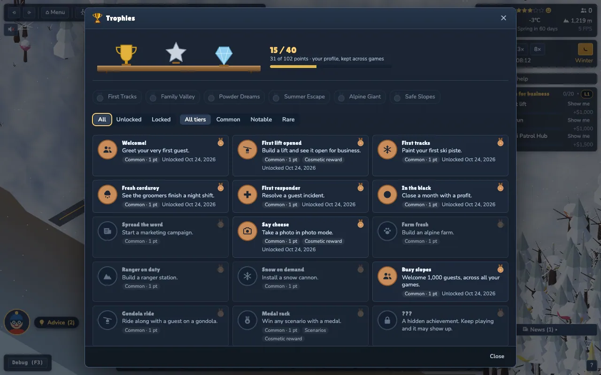
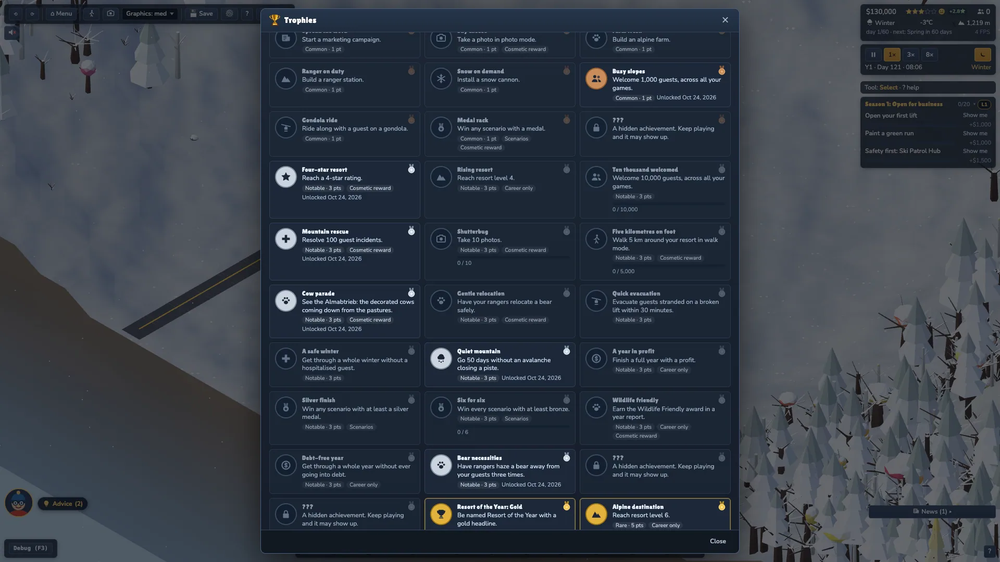
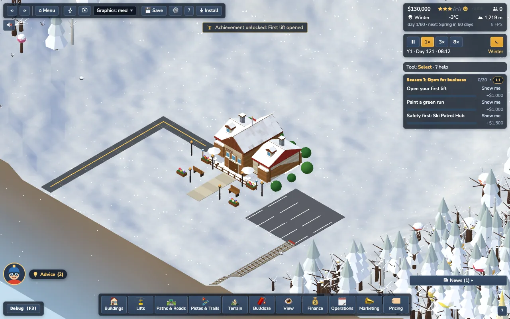
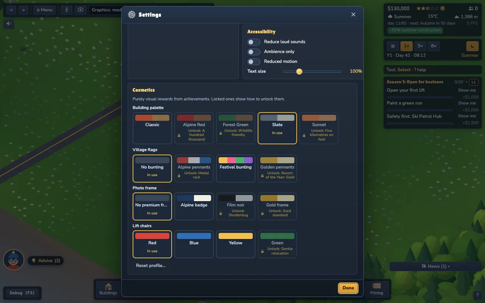
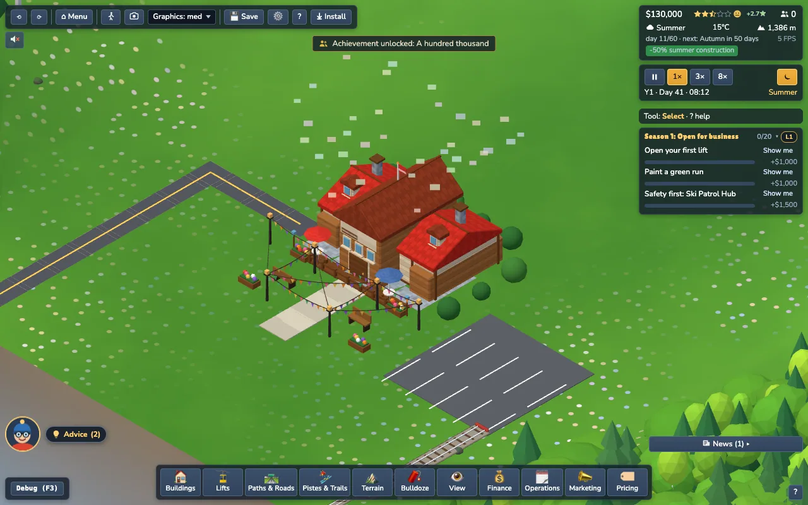

# Achievements, trophies and cosmetic rewards (M5.3, Task 16)

40 profile-wide achievements in three tiers, a trophy shelf dialog, and 13 purely visual cosmetic rewards. Everything is **local** (no import / export / sharing, D8) and **quiet** (a small toast, never a fanfare).







## Tiers and points
| Tier | Name | Points | Feel |
|---|---|---|---|
| 1 | Common | 1 | first steps, easy milestones |
| 2 | Notable | 3 | a season or a system mastered |
| 3 | Rare | 5 | hard / long-term; the **only** tier that may show confetti |

The shelf header shows `n / 40` and `points / 102`. Hidden achievements (4) read `???` until unlocked.

## Scope and sandbox
* `any`: earnable everywhere. A **sandbox** unlock is tagged `sandbox` on its record (shown as a chip on the shelf); sandbox progress still counts for the lifetime counters.
* `career`: only in Career games (resort levels, yearly reports, debt-free year...). A sandbox game, whose everything-unlocked starter resort is a gift, can never earn them.
* `scenario`: only inside scenario runs (medals).
* The starter resort of a sandbox game is built **before** the trackers are armed, so it never unlocks "first lift" or friends. Trackers are armed only after the profile has loaded (`Achievements.arm()`), and never in the title demo.

## Catalogue
| # | Id | Title | Tier | Scope | Tracker | Reward | Notes |
|---|---|---|---|---|---|---|---|
| 1 | `first-guest` | Welcome! | Common | any | event |  | Greet your very first guest. |
| 2 | `first-lift` | First lift opened | Common | any | window | `chair:blue` | Build a lift and see it open for business. |
| 3 | `first-piste` | First tracks | Common | any | event |  | Paint your first ski piste. |
| 4 | `first-groom` | Fresh corduroy | Common | any | event |  | See the groomers finish a night shift. |
| 5 | `first-rescue` | First responder | Common | any | event |  | Resolve a guest incident. |
| 6 | `black-month` | In the black | Common | any | event |  | Close a month with a profit. |
| 7 | `first-marketing` | Spread the word | Common | any | event |  | Start a marketing campaign. |
| 8 | `first-photo` | Say cheese | Common | any | render | `frame:alpine` | Take a photo in photo mode. |
| 9 | `first-farm` | Farm fresh | Common | any | event |  | Build an alpine farm. |
| 10 | `first-ranger` | Ranger on duty | Common | any | event |  | Build a ranger station. |
| 11 | `snow-cannon` | Snow on demand | Common | any | event |  | Install a snow cannon. |
| 12 | `guests-1000` | Busy slopes | Common | any | event |  | Welcome 1,000 guests, across all your games. |
| 13 | `ride-gondola` | Gondola ride | Common | any | render |  | Ride along with a guest on a gondola. |
| 14 | `first-medal` | Medal rack | Common | scenario | scenario | `flags:tricolour` | Win any scenario with a medal. |
| 15 | `boom` | Controlled release | Common | any | event |  | Trigger a controlled avalanche release before it triggers itself. (hidden) |
| 16 | `four-stars` | Four-star resort | Notable | any | event | `palette:slate` | Reach a 4-star rating. |
| 17 | `level-4` | Rising resort | Notable | career | fact |  | Reach resort level 4. |
| 18 | `guests-10000` | Ten thousand welcomed | Notable | any | event |  | Welcome 10,000 guests, across all your games. |
| 19 | `rescues-100` | Mountain rescue | Notable | any | event | `chair:yellow` | Resolve 100 guest incidents. |
| 20 | `photos-10` | Shutterbug | Notable | any | render | `frame:noir` | Take 10 photos. |
| 21 | `walk-5km` | Five kilometres on foot | Notable | any | render | `palette:sunset` | Walk 5 km around your resort in walk mode. |
| 22 | `farm-parade` | Cow parade | Notable | any | fact | `flags:festival` | See the Almabtrieb: the decorated cows coming down from the pastures. |
| 23 | `bear-relocated` | Gentle relocation | Notable | any | event | `chair:green` | Have your rangers relocate a bear safely. |
| 24 | `evac-30` | Quick evacuation | Notable | any | event |  | Evacuate guests stranded on a broken lift within 30 minutes. |
| 25 | `safe-winter` | A safe winter | Notable | any | window |  | Get through a whole winter without a hospitalised guest. |
| 26 | `quiet-mountain` | Quiet mountain | Notable | any | streak |  | Go 50 days without an avalanche closing a piste. |
| 27 | `year-profit` | A year in profit | Notable | career | report |  | Finish a full year with a profit. |
| 28 | `scenario-silver` | Silver finish | Notable | scenario | scenario |  | Win any scenario with at least a silver medal. |
| 29 | `scenarios-all` | Six for six | Notable | scenario | scenario |  | Win every scenario with at least bronze. |
| 30 | `wildlife-friendly` | Wildlife friendly | Notable | career | report | `palette:forest-green` | Earn the Wildlife Friendly award in a year report. |
| 31 | `zero-debt` | Debt-free year | Notable | career | window |  | Get through a whole year without ever going into debt. |
| 32 | `bear-necessities` | Bear necessities | Notable | any | event |  | Have rangers haze a bear away from your guests three times. (hidden) |
| 33 | `eye-of-storm` | Eye of the storm | Notable | any | window |  | Keep a lift open while a storm rages over a busy resort. (hidden) |
| 34 | `back-from-brink` | Back from the brink | Notable | any | window |  | Recover after a long stretch in debt. (hidden) |
| 35 | `roy-gold` | Resort of the Year: Gold | Rare | career | report | `flags:golden` | Be named Resort of the Year with a gold headline. |
| 36 | `level-6` | Alpine destination | Rare | career | fact |  | Reach resort level 6. |
| 37 | `all-lifts` | Every kind of lift | Rare | any | distinct |  | Build every lift type in one game. |
| 38 | `scenario-gold` | Gold standard | Rare | scenario | scenario | `frame:gold` | Win any scenario with a gold medal. |
| 39 | `scenarios-gold` | Grand slam | Rare | scenario | scenario |  | Win every scenario with a gold medal. |
| 40 | `guests-100000` | A hundred thousand | Rare | any | event | `palette:alpine-red` | Welcome 100,000 guests, across all your games. |

Cosmetic mapping is in the *Reward* column; the full list is below.

## Cosmetics
Purely visual. Defaults (Classic palette, no bunting, no premium frame, red chairs) are always owned and render **exactly** as before, so snapshots, tests and the look of a game never change unless the player chooses. Choose in **Settings > Cosmetics**; locked tiles show the lock and `Unlock: <achievement>`. Applying needs no restart:

| Kind | Options (unlocked by) | How it is applied |
|---|---|---|
| Building palette | Classic (default), Alpine Red (`guests-100000`), Forest Green (`wildlife-friendly`), Slate (`four-stars`), Sunset (`walk-5km`) | `BuildingMeshes.setPalette()` re-tints the shared roof / wood material colours in place (they multiply the vertex colours and the per-instance tint; stone and window glass are untouched) |
| Village flags | No bunting (default), Alpine pennants (`first-medal`), Festival bunting (`farm-parade`), Golden pennants (`roy-gold`) | `VillageDecor.setFlags()` strings pennants between neighbouring lamp posts (merged into the existing meshes: no new draw calls) |
| Photo frame | Plain (default), Alpine badge (`first-photo`), Film noir (`photos-10`), Gold frame (`scenario-gold`) | new `FrameId`s in `render/view/postfx.ts` (PNG export + live CSS preview); the Photo panel disables locked frames; the chosen tile is the default frame when photo mode opens |
| Lift chairs | Red (default), Blue (`first-lift`), Yellow (`rescues-100`), Green (`bear-relocated`) | `LiftView.setChairColor()` rebuilds the carrier geometries with a body colour (gondolas / cabins unchanged) |

UI accent themes were left out (optional in the brief).

## Engine (`src/sim/meta/Achievements.ts`)
* **Observer only**: subscribes to the typed bus and reads a few daily facts through `AchHost.facts()`; never writes the sim, no RNG, no wall clock except the injectable `now()` stamp. Its save module `achievementsRun` is flagged `observer` and skipped by `stateHash` (tested: identical hash with and without trackers).
* **Tracker kinds** (data in `config/achievements.ts`): `event` (counter, `where` filters, per profile or per game), `render` (page-fed counters: photos, walked metres, gondola ride-alongs; never counted headless), `fact` (daily number such as level or festivals seen), `streak` (days without an event), `window` (a span in which a violation must not happen; `retry` keeps it open), `distinct` (distinct values, e.g. lift kinds), `report` (the Resort of the Year report), `scenario` (medals in the profile).
* **Two stores**: PROFILE-wide `AchievementsProfile` (unlock records `{at, gameId?, sandbox?}`, lifetime counters, owned / selected cosmetics) persisted by the host in the `ProfileStore` (own IndexedDB `slope-profile`: deleting save slots never touches it); PER-GAME `AchRun` (window states, streak days, distinct sets, game counters) saved in the `achievementsRun` module so "a whole winter without a hospitalised guest" survives save / load.
* **Idempotent**: an id unlocks once; the first timestamp wins; the reward is added to `owned` once. Counters shared by several achievements (e.g. `rescues`, `guests`) have one rule and are incremented once per event.
* Counters are batched: the profile is written on every unlock, once per game day when counters changed, and on `pagehide`.
* Render-only counters (`note('photos')`, walk distance from the walker's speed x `TILE_METRES`, `rideGondola`) are fed by `main.ts` and only count while armed.
* Debug: `__slope.achievements.unlock('first-lift')` (forced, toasts like a real unlock), `.select(kind, id)`, `.trophies()`.

## Feedback policy
* Unlock = **one small toast** (`Achievement unlocked: <title>` + icon) through the toast limiter and the existing quiet `chimeImportant` chime (gain .35). `AchievementAnnouncer` allows at most one announcement per 10 s, queues the rest (cap 8) and holds everything while the tutorial runs (the unlock is recorded silently and announced afterwards).
* **Confetti only for tier 3**, and only if `confettiAllowed(policy, true)`: Off / reduced motion never get it.

## Trophy shelf (`st-trophies`)
Shared modal, size `lg`: decorative SVG shelf, `n / 40` + points, scenario medals row (from the profile), filters (All / Unlocked / Locked and tier), cards with icon, title, description, tier medal, unlocked date, `Career only` / `Scenarios` / `Cosmetic reward` / `Sandbox` chips and a progress bar for counters (per-game bars read 0 on the title screen). Reachable from: main menu **Trophies**, the pause menu, Settings > Gameplay > **Trophies** link, and the Cosmetics section. **Reset profile…** (Settings > Cosmetics) asks for confirmation and clears achievements, cosmetics and scenario medals; save slots are never touched.

## Profile format (`ProfileStore`, version 2)
```json
{ "v": 2, "scenarios": { "first-tracks": { "bestMedal": "silver", ... } },
  "achievements": { "v": 1,
    "unlocked": { "first-lift": { "at": 1700000000000, "gameId": "g1abc", "sandbox": true } },
    "counters": { "guests": 1240, "photos": 3, "walkM": 812, "medal:first-tracks": 2 },
    "cosmetics": { "owned": ["chair:blue"], "selected": { "chair": "chair:blue" } } } }
```
v1 profiles (only an empty placeholder) migrate to an empty achievements section. Everything is sanitised on load (bad ids / negatives / wrong shapes are dropped; unknown ids are kept for newer versions); a corrupt document falls back to an empty profile; quota errors never throw into the game.

## How to add an achievement
1. Add a row to `ACHIEVEMENTS` in `src/config/achievements.ts` (unique kebab-case id, tier, scope, icon from `ui/icons.ts`, a tracker, optional hidden / reward).
2. Use an existing tracker kind. Events must exist in `GAME_EVENT_NAMES`; a new event goes into `core/events.ts` first. If two achievements share a `counter`, they must share the same event / `where` (tested).
3. For a cosmetic reward add it to `src/config/cosmetics.ts` (one achievement per cosmetic).
4. Update the count in the tests (`40`) and the catalogue table here; run `npm test`.
