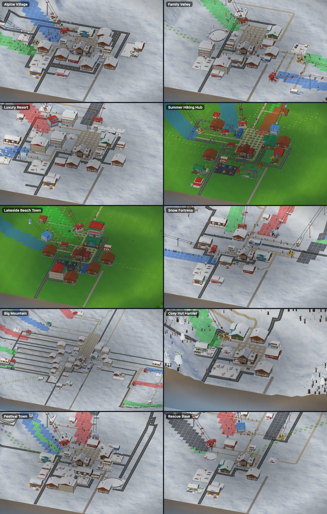

# Demo towns (archetypes)

Ten themed, seed-driven towns built through the **real** placement / lift / piste APIs (sim only, free, no fixed coordinates): `src/game/demoTowns.ts`. They feed the **title screen**, the **debug menu** (F3 > Debug tools) and `__slope.populateTown(archetype?, seed?)`.

| id | name | rec. size | season | preset | vetted seeds (size: seeds) |
|---|---|---|---|---|---|
| `alpine` | Alpine Village | 128 (64 ok) | winter | balanced | 64: [22, 39, 35, 31, 37, 14, 19, 7], 128: [25, 22, 26, 3, 33, 34, 7, 5] |
| `family` | Family Valley | 128 (64) | winter | gentle | 64: [1, 19, 22, 23, 33, 35, 39, 34], 128: [1, 3, 4, 17, 26, 28, 34, 40] |
| `luxury` | Luxury Resort | 128 | winter | gentle | 128: [22, 23, 8, 9, 5, 4, 17, 25] |
| `hiking` | Summer Hiking Hub | 128 (64) | summer | lakeland | 64: [1, 8, 17, 19, 23, 28, 33, 35], 128: [2, 6, 17, 19, 22, 25, 26, 33] |
| `lakeside` | Lakeside Beach Town | 128 | summer | lakeland | 128: [26, 33, 25, 34, 3, 5, 10, 14] |
| `fortress` | Snow Fortress | 128 (64) | winter | peaks | 64: [1, 2, 3, 6, 7, 9, 12, 15], 128: [3, 4, 5, 6, 7, 9, 10, 12] |
| `bigmountain` | Big Mountain | 256 (128 fallback) | winter | peaks | 128: [4, 6, 9, 14, 21, 24, 25, 29], 256: [1, 2, 3, 4, 5, 7, 9, 10] |
| `hamlet` | Cosy Hut Hamlet | 64 (128) | winter | forested | 64: [7, 9, 18, 22, 25, 33, 35, 37], 128: [2, 4, 10, 26, 30, 33, 36, 28] |
| `festival` | Festival Town | 128 (64) | winter | balanced | 64: [22, 39, 35, 31, 37, 16, 19, 7], 128: [25, 26, 3, 33, 34, 7, 5, 1] |
| `rescue` | Rescue Base | 128 (64) | winter | peaks | 64: [1, 6, 8, 11, 12, 19, 21, 23], 128: [4, 5, 19, 22, 24, 25, 26, 33] |

Seeds are vetted by `scripts/analysis/townSeedScan.ts` (<= 1 failure, no inactive buildings, pistes connected, niceness >= 0.5) and stored in `src/config/townSeeds.ts` (>= 6 per archetype / size, nicest first). The 256 map is only used by Big Mountain on devices reporting >= 8 GB (`navigator.deviceMemory`), else it falls back to 128.

## What each town builds

| town | characteristic mix |
|---|---|
| Alpine Village | 4-6 chalets round the lodge square, chair4d + T-bar, mountain hut, farm on a flattened pasture, rail station, terrace |
| Family Valley | ski school, kids ground, playground, 1-2 magic carpets, ice rink, mostly green pistes, chalets + apartments, terraces |
| Luxury Resort | gondola10 + bubble chair (chair6b) + chair4d, 3-4 apartments, apres bar, 2-3 heated terraces, altiport (when a flat strip exists), reds / blacks |
| Summer Hiking Hub | 3-4 hike + 3-4 MTB trails, bike lifts (chair4d / gondola6 / T-bar), adventure park, beach + boat rental on a lake, 2-3 huts, ranger, farm |
| Lakeside Beach Town | beach + boat rentals + cafes + terrace at the lake, gondola, chalets / apartments |
| Snow Fortress | 8-12 cannons + reservoir, groomer garage, 1-2 snowcat outposts, stunt park, 4 lifts and a big piste network |
| Big Mountain | funicular, cable car, gondola10, chair6b, 2x chair4d, chair4, T-bar (8 lifts / pistes), station + bus depot, 10+ chalets, 6 apartments |
| Cosy Hut Hamlet | tiny: 2-3 huts, one T-bar, 2-3 chalets, ranger station, deer |
| Festival Town | 1-2 apres bars, terraces, 2-3 cafes, 3-4 shops round the square, ice rink |
| Rescue Base | helipad, 2-3 first-aid huts, patrol hubs, ranger, reds / blacks, warning signs |

How: `buildTown(sim, id, seed)` runs `buildStarterResort` for the lift + piste skeleton (the lift site search), then every `TownItem { type, n: [min, max], at, spread, rmax }` is placed at an **anchor** derived from the terrain (`village` / `road` / `piste` / `foot` / `top` / `lake` / `hill` / `pasture`). For each item, 12 candidate sites around the anchor are scored (flat, hugging a path / road, not crowding other buildings, near the anchor) and tried best-first, then the spiral search of the starter kit, then the other anchors. Counts are drawn from a seeded `Rng` and scaled by map size (64: 0.7, 128: 1, 256: 1.6). Buildings that cannot be wired up are removed again (no inactive buildings). It never throws: `report.failures` lists what is short. `report.sites` (farm / hut / beach / station / altiport / heli / festival ...) drives the camera POIs, `report.score` is the niceness (variety 40 %, density 30 %, piste coverage 30 %).

## Title screen

* Each boot picks a random vetted `(archetype, seed, size, season)` (weighted by `titleWeight`, nicer seeds slightly favoured) and **never the previous one** (`localStorage slope.title.last`).
* Season from the archetype (Summer Hiking Hub / Lakeside start in summer and stay there; winter towns keep the winter <-> summer flip loop where `seasonLoop`; reduced motion: no flips, static village framing).
* Caption bottom-left (`Alpine Village · seed 33 — Space: next town [Shuffle]`). **Space / N / the button** store the next pick (`slope.title.next`), fade out, tear down (dispose bag) and reload: a fresh sim + renderer each time, so nothing can leak (cost: a page reload, ~2 s).
* QA / deep links: `?town=<id>&townseed=<n>&demosize=<64|128|256>` (with `?demoscene=1&nomenu=1` for the harness); the old `?demoseed=&demosize=` still work (default archetype alpine).
* Camera: extra POIs per archetype from `report.sites` (`src/render/townPois.ts`): farm, hut, beach / boat, altiport, heli, festival bar / terrace, adventure / stunt park, station, with per-archetype weights (e.g. rescue: heli x2.5, lakeside: beach x2.2).
* Guests: <= 200 (120 for the hamlet, x0.55 on 64), mix from the archetype (skiers / hikers / mixed).

## Debug menu

F3 > *Debug tools (cheats)*: **Town** select (`Random nice town` + the ten), **Seed** + dice (rolls a vetted seed for this map size), **Build town (cheats)** (two-click confirm), **Reset map (reload)** (two-click), the old *Level* select + *Populate demo resort*, and a checklist under the buttons (`Built Rescue Base (seed 42): niceness 0.91, 3 lifts ...  ✓ chalet ×3  ✗ only 0/1 altiport`). Works on any map size / seed. Console: `__slope.populateTown('luxury', 22)` / `__slope.populateTown()` (random).

## QA, images, tests

* `npm run town:shots -- [--only id,id] [--tag t] [--shots wide,close,feature,night,summer]` renders every archetype on its first vetted seed (`.weave/shots/towns-<tag>-<id>-<shot>.png`); `npm run town:sheet -- --tag t --shot close --out file.png` makes a contact sheet; `npm run analysis:towns -- [id|all] [size|all] [from] [count] [minScore]` scans seeds (`WRITE=1` rewrites `src/config/townSeeds.ts`).
* Website images: `docs/img/towns-sheet.webp` (the per-town PNGs were dropped to slim the repo; regenerate with `npm run town:shots` into `.weave/shots/`) (all ten, close shots), `docs/img/towns-sheet-night.webp`, `docs/img/towns-alpine-summer.webp`.
* Tests: `tests/game/demoTowns.test.ts` (data, 10 seeds x sizes: failure budget / validity / overlaps / niceness, determinism, characteristic content, 2.5 s build bound), `tests/game/titleTown.test.ts` (picker, capability fallback, POIs, teardown), `tests/ui-dom/{townCaption,debugTools}.test.ts`.

## Adding a town

1. Add a `TownArchetype` to `TOWNS` (and its id to `TownId`): name, tagline, size / sizes, season, terrain preset, lifts (cycled, each falls back to chair4), cannons / trails ranges, `items`.
2. `npm run analysis:towns -- <id> all 1 40 0.5` and paste >= 6 seeds into `src/config/townSeeds.ts` (or `WRITE=1 npm run analysis:towns -- all all 1 40 0.5`).
3. Add its characteristic buildings to the test table, run `npm run town:shots -- --only <id>` and LOOK at the shots.

## Known limits

* Prerequisites are real: playgrounds need a ski school, first-aid / heli pads a patrol hub (the lists add them first); the altiport needs a long flat strip and is missing on many seeds (vetted seeds have it).
* Footpaths in demo towns branch off the nearest existing path (`Networks.routeFrom`, `StarterOptions.curvedPaths`) with gentle diagonal steps, so Big Mountain no longer shows parallel "barcode" strips. Roads use the same multi-source router but stay straight (`'straight'` style); at the end of `buildTown` `pruneRoads` unbuilds road spurs / loops that serve no building (BFS tree from the road entry; Luxury seed 22's long U is a forced detour around steep tiles, not an orphan). Rendering turns plain 2-arm path / road tiles into smooth ribbons (`docs/models.md`, Rich-look pass 3). The bot / tests keep the old BFS stubs (identical economy).
* Debug builds are cheats: money is restored, but achievements can still fire (there is no cheat flag in the save meta yet).
* Decor beyond buildings (bunting / market stalls) does not exist as a mechanism: the festival feel comes from bar / terraces / cafes / shops.
