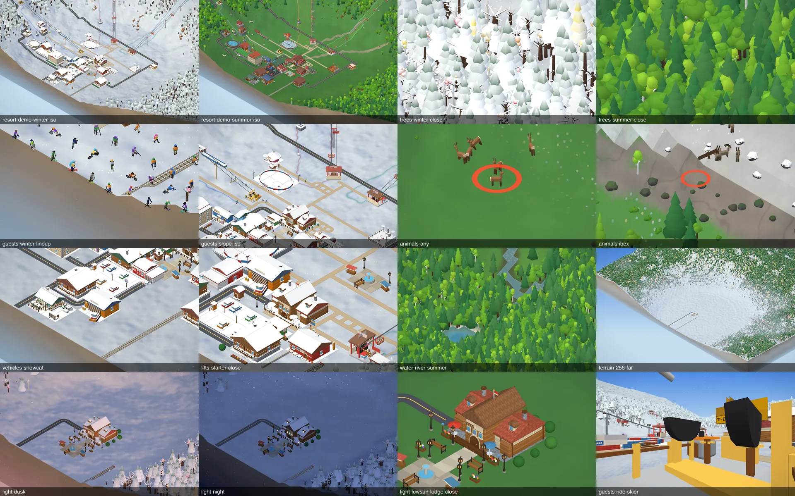
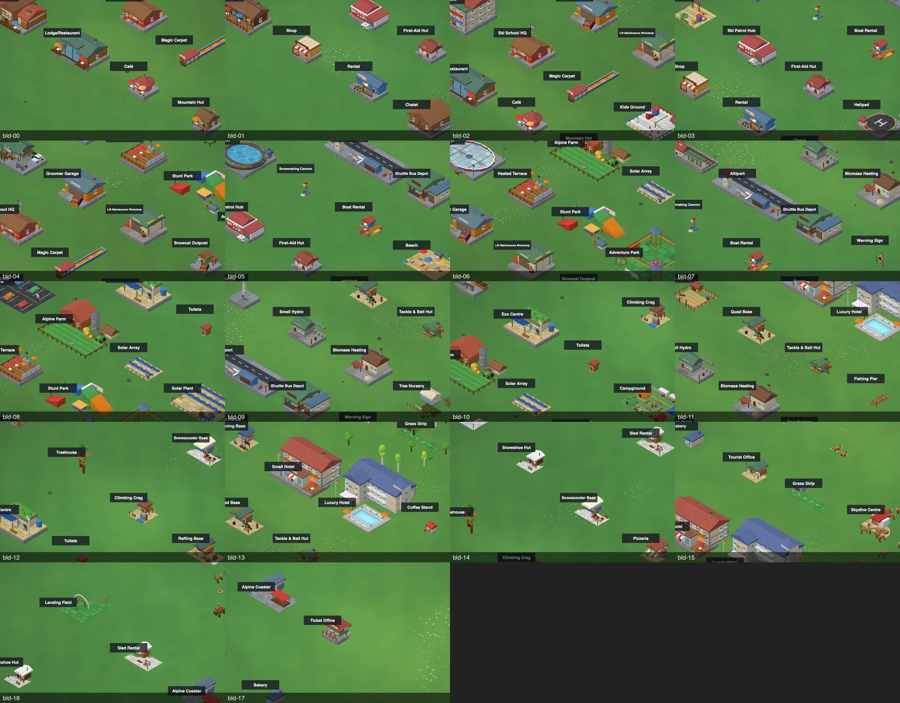

# M8 graphics audit (task 8.0, 2026-11-02)

Audit-only: **no model, shader or sim change** was made. Every number below was measured on 0.4.0 (`package.json` 0.4.0, all M7.3 / M7.4 content in) with the scripts in `scripts/shots/` (see "Reproduce"). Direction (owner, D8-1 .. D8-6): more realistic, smoother, richer but **not photoreal**; less blocky and bulky; small details on selected assets only; iso triangles **+25 % max on high, +0 % on low**, **+0 draw calls**, **+60 kB gzip JS**; real shadows on high, contact shadows everywhere; top 10-15 items + shadows.

Contact sheets for the owner (WebP, in the repo): [categories](img/graphics-audit-categories.webp), [buildings, 69 models in 18 close-ups](img/graphics-audit-buildings.webp). The full-size before shots (88 files, 1600x1000, plus 1440p and phone) are staged in `.weave/shots/m8-before-*.png` and are **not committed**.




## What I looked at, honestly

Looked at (opened and judged): 12 of the 18 building close-ups (groups 00-05, 07, 10 and 14-17; groups 06, 08, 09, 11, 12, 13 are **not inspected**), lifts gallery rows 0-1, lift stations in a real resort, a lift ride-along and a T-bar ride-along, trees / forest in winter + summer (close and mid), guest lineup (winter) + guests on a slope + ride-along, the deer herd + one ibex shot, snowcat / parking / helipad area, the real village by day (low sun), dusk, night, a river + pond, 256 far view, the buildings and lifts drawers, a 1440p winter shot and the phone shot.

Captured but **not individually inspected** (files exist): dawn, noon, terrain-winter/summer iso, 1440p summer / dusk / night, phone summer / night, summer guest lineup, animals fox / marmot / chamois / eagle / goat / sheep (cow, goat and sheep returned "no animals" in the 128 / seed 5 map: no farm built, so those three are **not audited**), vehicles-train (the station was framed but no train was in the picture, so trains / carriages / coaches / planes / helicopter are **not audited by eye**, only by triangle count), the lift rows 2.

Not auditable here: real GPU look, real fps, frame feel on motion (SwiftShader, stills only), audio, pointer-lock walk mode, high-preset shadow look (there are none yet), bloom. See "What agents cannot judge".

Harness findings that matter for later tasks:
- The model gallery (key B) places everything at one flat height, so rows 3+ sank into the terrain and the forest hid rows 6-8. `scripts/shots/m8-audit.ts` now lifts each gallery child to the local terrain height and hides trees / rocks while shooting it. Reuse it (`npm run`-less: `npx vite-node scripts/shots/m8-audit.ts <prefix> [filter...]`) for the after shots: same prefix scheme `m8-after-`.
- Ponds: `__slope.landscapeDebug.find()` returned `null` on all four seeds tried (64/61, 128/5, 128/7, 256/5), so the water shots use a river dug from the best natural spring (the same call as `scripts/summer-sanity.ts`) which also produced a small pond-like end.
- The 2560x1440 shots come out at 2560x1440 (checked); the harness image tool may downscale them in chat.

## What I saw (summary)

- **The art direction is consistent and charming**: warm log-cabin low-poly, flagstone plinths, shingle roof textures, dormers and chimneys on the lodge family, lamps / benches / fountain props, a warm-pink dusk and a believable blue night with lit windows. The weakest spots are **structural simplicity** (box + gable roofs, tube-like limbs, box animals) rather than colour or texture.
- **Blocky / bulky:** the animals (deer, ibex: rectangular torso, stick legs), the snowcat (a stack of boxes, 84 triangles), parked cars (stacked boxes, 552 triangles each with 5 identical counts), Stunt Park / Adventure Park / Playground (flat plank layouts), Sled Rental (a hull-like wedge), Boat Rental, Toilets, Snow cannon, and every near-LOD ride-along lift part (T-bar seat, chair, the plain 8-sided tower tube, helmets as black bowls).
- **Conifers** are stacked cones with a clean silhouette but no branching; **deciduous** crowns are lumpy blobs with the trunk almost always hidden in dense forest; winter conifer snow caps are good. **Trees are 59-92 % of all iso triangles** (see below), so any tree change is the budget decision of M8.
- **Water** edges are tile-aligned zigzag stairs (rivers and ponds): the clearest "hard tile edge" in the game. Summer water colour and winter ice tint are fine.
- **Map edge**: the cliff skirt on small maps is a flat brown / grey gradient slab; on 256 it reads as a clean cut block. It is on screen whenever the camera nears an edge.
- **No cast shadows anywhere** (buildings, lamps, benches, trees, guests): objects look slightly "placed on" the snow; the lodge close-up at 17:00 summer is lit but flat. This is the biggest single "realism" gap per cost, and it is already planned as 8.6.
- **Terrain surface:** snow shading (blue shade tint, drift normals) and grass are nice; the snow texture reads as large soft blotches ("clouds") at close zoom, the sparkles are fine. Roads / paths are clean.
- **Guests** read as people (jackets, helmets, skis / boards, bike wheels, backpacks) with thin tube limbs and cubic heads; fine at iso, chunky only in the near ride view.
- **Icons:** building dock thumbnails are rendered from the meshes and look good; the **Lifts drawer icons are generic** (almost the same yellow cabin for every chairlift), so mesh work does not improve them: they need their own pass (8.7).
- Real draw calls are low (see baseline): 109-190 in the iso view.

## Rubric

Scale 1-5, 5 best. **Sil** = silhouette (1 = hard boxy / bulky, 5 = smooth / slim / organic), **Det** = detail at close-up, **Mat** = material / colour richness, **Con** = consistency with the palette and other categories, **Impact** = how often seen x screen size (5 = everywhere), **Cost** = S (<= 1 day) / M (2-3 days) / L (4+ days). **Gap** = 5 - mean(Sil, Det, Mat). **Priority** = Impact x Gap / cost weight (S 1, M 2, L 3).

| # | Category / item | Sil | Det | Mat | Con | Impact | Cost | Gap | Priority | Tris now (per mesh, `m8-baseline`) |
|---|---|---|---|---|---|---|---|---|---|---|
| 1 | Snowcat (red box stack) | 2 | 2 | 3 | 3 | 3 | S | 2.7 | **8.0** | 84 |
| 2 | Animals (deer, ibex, cow, fox, marmot ...) | 2 | 2 | 3 | 3 | 3 | S | 2.7 | **8.0** | 124 (eagle) - 476 (donkey), deer 368, ibex 368 |
| 3 | Map edge / cliff skirt | 2 | 1 | 2 | 2 | 3 | S | 3.3 | **10.0** | part of terrain |
| 4 | Parked cars + road vehicles | 2.5 | 2.5 | 3 | 3 | 3 | S | 2.7 | **8.0** | 552 each; bus 1936, minibus 1264 |
| 5 | Ride-along near parts (T-bar seat, chairs, tower tube, helmets) | 1.5 | 1.5 | 3 | 2 | 2 | S | 3.3 | **6.7** | near carrier 96-1200, tower 188-788 |
| 6 | Water edges (river, pond, shore) | 1 | 2 | 3 | 3 | 3 | M | 3.0 | **4.5** | tile-aligned strips |
| 7 | Conifers (stacked cones, snow caps) | 3 | 2 | 4 | 4 | 5 | M | 2.0 | **5.0** | full 60-72 / low 14-24 |
| 8 | Deciduous / oak / birch crowns (blobs, hidden trunk) | 3 | 2 | 3 | 4 | 4 | M | 2.3 | **4.7** | full 104-140 / low 52 |
| 9 | Guests (skier, boarder, hiker, biker, kid, sledder) | 3 | 3 | 3 | 4 | 5 | M | 2.0 | **5.0** | visible 164-336 (guard 400), near ~560-690 |
| 10 | Rocks (faceted blobs, no strata) | 4 | 3 | 3 | 4 | 3 | S | 1.7 | **5.0** | 80 |
| 11 | Terrain surface (snow blotches, grass blend) | n/a | 3 | 3 | 4 | 5 | M | 2.0 | **5.0** | 15-40 k per frame |
| 12 | Low-end buildings (Stunt / Adventure Park, Playground, Sled Rental, Boat Rental, Toilets, Snow Cannon, Warning Sign, Snowscooter Base, Altiport, Launch Ramp) | 2 | 2.5 | 3.5 | 3 | 2 | M | 2.7 | **2.7** | 140-1500 |
| 13 | Main buildings (Base Lodge, Lodge, Chalet, Apartment, Hotels, Ski School, Hut, Cafe, Shop, Rental) | 3 | 4 | 4 | 4 | 5 | M | 1.7 | **4.2** | 1300-2812 |
| 14 | Lift stations + towers + chairs / cabins (iso) | 3 | 3 | 3 | 4 | 4 | M | 2.0 | **4.0** | stations 984-2660 pair, tower(3) 188-788, carrier 96-564 |
| 15 | Lighting response / **shadows** (none cast) | 2 | 2 | 3 | 3 | 5 | L | 3.0 | **5.0** | n/a (8.6) |
| 16 | Lift drawer icons (generic) | 2 | 2 | 3 | 2 | 3 | S | 3.0 | **9.0** | n/a (8.7) |
| 17 | Props: lamps, benches, fountain, fences, flower boxes | 4 | 4 | 4 | 4 | 4 | - | 1 | skip | n/a |
| 18 | Roads, paths, rails | 4 | 3 | 4 | 4 | 4 | - | 1.3 | skip | n/a |
| 19 | Lighting phases (dawn / noon / dusk / night) and atmosphere | 4 | 4 | 4 | 4 | 5 | - | 1 | skip | M7.0 |
| 20 | Dock thumbnails of buildings (rendered from meshes) | 4 | 4 | 4 | 4 | 4 | - | 1 | follows meshes | n/a |

Rows 17-20 are fine as is and only follow other work. Rows 1-16 feed the ranking.

### Per-building notes (69 models; "tris" = `buildParts` default footprint, with plinth)

Best (keep style, add a few details): Base Lodge 2336, Lodge/Restaurant, Apartment 2392, Apres-Ski Bar 2340, Small Hotel 2812, Luxury Hotel 2316, Ski School HQ, Chalet, Alpine Farm 1764, Eco Centre, Ranger Station 2128, Eco / Solar Array, Campground, Tourist Office, Bakery 220, Pizzeria. Weakest by sight: Stunt Park, Adventure Park, Playground, Kids Ground, Boat Rental, Snow Cannon (296), Warning Sign (384), Toilets (280), Sled Rental, Snowscooter Base, Landing Field, Launch Ramp (140), Coffee Stand (388), Altiport, Beach (loose coloured planks), Sled Rental (hull wedge). Not inspected (shots exist in groups 06, 08, 09, 11-13; the Treehouse, Climbing Crag and Eco Centre were seen small and look fine): Quad Base, Tackle Hut + Pier, Viewpoint, Petting Zoo, Rafting + Canyoning, Heated Terrace, Ice Rink, Train Station (seen from iso only), Reservoir, Wind Turbine, Small Hydro, Recycling, Tree Nursery, Ticket Office (seen partly hidden). Seen and judged fine to mixed: Magic Carpet, Groomer Garage, Lift Workshop, Snowcat Outpost (stacked boxes), Patrol Hub, First Aid Hut, Helipad, Shuttle Depot, Biomass Heating, Shop, Rental, Kids Ground, Climbing Crag, Treehouse.

## Ranking: weakest 10-15 items by impact per cost (+ shadows)

Ordered by Priority (Impact x Gap / cost weight). The first five are cheap wins; the next are the big-impact items. D8-6 scope: take all 14, plus shadows (item 15, 8.6).

| Rank | Item | Priority | Why (what I saw) | Proposed fix (D8-1) | Plan task |
|---|---|---|---|---|---|
| 1 | Map edge / cliff skirt | 10.0 | flat gradient slab, hard cut | strata bands + soft foot / rounded top lip in the existing skirt shader; same tris | 8.5 |
| 2 | Lift drawer icons | 9.0 | one generic cabin for every chairlift | per-family icon art (T-bar, fixed, detach, bubble, gondola, cabin, funicular) | 8.7 |
| 3 | Snowcat | 8.0 | 84-triangle box stack | rounded cab, tracks with segments, blade, light bar; <= 420 tris (1 instance layer) | 8.4 |
| 4 | Animals | 8.0 | rectangular torsos, stick legs | tapered torso, neck, head, antlers / horns, 9-segment-style legs; +25 % tris each | 8.4 |
| 5 | Cars + road vehicles | 8.0 | stacked boxes with snow caps; 5 car styles same 552 tris | lofted body (rounder profile), wheel arches, mirrors; coach / shuttle already lofted | 8.4 (vehicles) |
| 6 | Ride-along near parts | 6.7 | T-bar seat, chair, tower tube, helmets are chunky boxes close up | near-LOD only: rounded chair + restraint bar, lattice or capped tower, real helmets; iso unchanged | 8.2 (near LOD) |
| 7 | Conifers | 5.0 | stacked cones, no branches | wavy tier skirts, droop, 2-3 visible branch tiers on near LOD; full <= 80 | 8.3 |
| 8 | Guests | 5.0 | tube limbs, cube heads | rounded torso + limb tapers, jacket collars / hoods, goggles, backpack variants; visible <= 380 (guard 400) | 8.4 |
| 9 | Rocks | 5.0 | faceted but uniform, no strata | strata bands + lichen tint (vertex colour), 80 -> 100 tris | 8.3 |
| 10 | Terrain surface | 5.0 | snow reads as large soft blotches | second, finer world-space octave + corduroy on groomed pistes; shader only | 8.5 |
| 11 | Water edges | 4.5 | tile-aligned zigzag stairs | render-only shoreline smoothing of the water mesh (Chaikin of the contour, wet band); sim untouched | 8.5 |
| 12 | Deciduous / oak crowns | 4.7 | lumpy blobs, trunk hidden | 3-lobe crown with branch fork visible; full <= 145 | 8.3 |
| 13 | Main buildings | 4.2 | gable boxes, thin eaves | thicker overhangs + eave brackets, balcony railings, window shutters / mullions, signs; top ~12 only, <= 2800 -> 3300 on high | 8.2 |
| 14 | Lift stations + towers + chairs / cabins (iso) | 4.0 | boxy canopies, small carriers | rounded station roofs, bullwheel housing, tower sheave assemblies, chair seats; carriers +40 % tris | 8.2 |
| 15 | Low-end buildings | 2.7 | flat plank layouts | do the 6 worst only: Stunt Park, Adventure Park, Sled Rental, Boat Rental, Snowscooter Base, Playground | 8.2 |
| + | **Shadows / contact** | 5.0 (L) | nothing is grounded | real map on high, contact blobs on low / med | 8.6 |

Quick wins (S): ranks 1-5, rock strata, the near-LOD parts. Biggest visible change per day: trees (7, 12), guests (8), main buildings (13) and shadows. Mid-risk: water smoothing (11: must not change the sim, only the drawn mesh).

## Baseline numbers

Everything below is **SwiftShader on an Apple-silicon Mac** with desktop Chrome 156; draw calls and triangles are real, **frame ms is relative only** (software rasterizer; not the player's GPU). Scripts: `scripts/shots/m8-perf.ts`, `m8-share.ts`, `m8-baseline.ts`. Winter 11:00, demo resort + 300 skiers, camera on the lodge.

### Iso frame: draw calls and triangles (`renderer.info`, median of 9 frames)

Triangle counts at zoom 3 depend on LOD state (cross-fades and +-6 % hysteresis put a layer on the full or low mesh depending on how the camera got there): a repeat of the 128 / zoom 3 / low run gave **0.56 M** and **1.24 M**. Compare after shots on the **same camera path** and take the best-of-N; 128 / zoom 1.5 and 64 are stable.

| size | zoom | low calls | low tris | med calls | med tris | high calls | high tris |
|---|---|---|---|---|---|---|---|
| 64 | 1.5 | 152 | 0.37 M | 152 | 0.45 M | 157 | 1.20 M |
| 64 | 3 | 111 | 0.59 M | 111 | 0.80 M | 111 | 0.90 M |
| 128 | 1.5 | 165 | 0.39 M | 168 | 0.67 M | 170 | 0.74 M |
| 128 | 3 | 166 | 0.56-1.24 M | 155 | 0.71 M | 166 | 2.01 M |
| 256 | 1.5 | 190 | 0.32 M | 190 | 0.40 M | 190 | 0.43 M |
| 256 | 3 | 165 | 2.60 M | 169 | 4.06 M | 169 | 4.74 M |

Draw calls: **109-190** in iso (the ride / photo / walk numbers in `docs/perf.md` still apply: 161-182 on 128). JS update path: **0.13-0.37 ms** per frame (`renderer.onFrame`, 40-frame mean). Guests: 300-321.

### Relative frame time (SwiftShader, render + readPixels sync; 128 map, winter)

| zoom | low | med | high |
|---|---|---|---|
| 1.5 | 185 ms | 275 ms | 314 ms |
| 3 | 216 ms | 252 ms | n/a (the run ended before the row) |

The ratio low : med : high (about 1 : 1.5 : 1.7) is the only usable result. Real GPUs are far faster; the owner's F3 numbers decide.

### Where the triangles go (share of one iso frame, med, `m8-share`)

| frame | total tris / calls | trees | rocks | guests (300) | terrain | water | rest (buildings, lifts, vehicles, animals, paths, props) |
|---|---|---|---|---|---|---|---|
| 128, zoom 3 | 710 k / 157 | 418 k (59 %), 8 calls | 64 k (9 %) | 131 k (18 %), 5 calls | 15 k (2 %) | 1 k | ~82 k (12 %) |
| 128, zoom 1.5 | 669 k / 169 | 418 k (62 %) | 0 | 129 k (19 %) | 29 k (4 %) | 2 k | ~91 k (14 %) |
| 256, zoom 3 | 4.06 M / 169 | 3.76 M (92 %) | 0 | 127 k (3 %) | 42 k (1 %) | 1 k | ~130 k (3 %) |

Consequence for the +25 % cap: **trees decide it**. A +25 % tree mesh increase alone would blow the cap on 256 maps; buildings, lifts, vehicles and animals are only 3-14 % of a frame, so they can grow by 50-60 % each for +2-8 % of the frame.

### Triangles per model category (pure geometry, `m8-baseline`)

| category | n | total | mean | max (item) | min |
|---|---|---|---|---|---|
| buildings (default footprint) | 69 | 64,160 | 930 | 2,812 (Small Hotel) | 140 (Launch Ramp) |
| lift stations (bottom + top pair) | 12 | 20,188 | 1,682 | 2,660 (chair8b) | 984 (chair2) |
| lift carriers, iso / near | 12 | 3,948 / 8,860 | 329 / 738 | 564 / 1,200 | 96 |
| lift tower (3 tall) | 12 | 5,396 | 450 | 788 (cablecar) | 188 |
| trees full LOD (8 species) | 8 | 820 | 103 | 140 (oak) | 60 (pine) |
| trees low LOD | 8 | 314 | 39 | 56 (shrub) | 14 (conifer) |
| rock | 1 | 80 | 80 | 80 | 80 |
| guest gear geometry, visible per figure (8 gears) | 8 | 1,712 | 214 | 336 (bike) | 164 |
| guest near-LOD gear geometry | 8 | 4,988 | 624 | 692 | 560 |
| animals | 13 | 4,244 | 326 | 476 (donkey) | 124 (eagle) |
| vehicles (5 car styles, coach, minibus, train, plane, snowcat) | 10 | 10,000 | 1,000 | 3,388 (train) | 84 (snowcat) |

Existing guards: tree `FULL_MAX 150` / `LOW_MAX 60`, building 3000 / 9000, figure <= 400 near, train 3500 (`tests/render/*`, `docs/perf.md`).

### Flicker (`npm run flicker`, 64 / seed 61, default atmosphere, 960x600; tag `m8-before-w` / `m8-before-s`)

| scenario | sweep | osc px / frame | osc % | pops | LOD flips |
|---|---|---|---|---|---|
| 64 winter day | rotfine | 3,228.2 | **0.5604** | 0 | 0 |
| 64 winter day | rotpop | 0 | 0 | 0 | 0 |
| 64 winter day | zoomfine | 876.5 | **0.1522** | 0 | 0 |
| 64 winter day | zoompop | 0 | 0 | 0 | 2 |
| 64 winter day | jitter / sheet / still | 0 / 0 / 15.4 | 0 / 0 / 0.0027 | 0 | 0 / 1 / 0 |
| 64 summer day | rotfine | 738.9 | **0.1283** | 0 | 0 |
| 64 summer day | rotpop | 0 | 0 | 0 | 0 |
| 64 summer day | zoomfine | 255.9 | **0.0444** | 0 | 0 |
| 64 summer day | zoompop | 0 | 0 | 0 | 2 |
| 64 summer day | jitter / sheet / still | 0 / 0 / 3.0 | 0 / 0 / 0.0005 | 0 | 0 / 1 / 0 |

Noise between two identical winter runs: zoomfine 871.7 vs 876.5 (0.5 %), rotfine 3,228.8 vs 3,228.2. Treat a change below ~2 % as noise. After-runs must also be done with `--atmos off|low|high` (this baseline is the default level only; run the other two before 8.3 starts if they are wanted as extra baselines).

### Size (`npm run build && npm run size`)

| group | raw | gzip |
|---|---|---|
| app js | 2,197.4 kB | **754.2 kB** |
| three chunk | 568.4 kB | **142.5 kB** |
| css | 5.7 kB | 1.5 kB |
| icons / images | 64.4 kB | 62.7 kB |
| html / manifest / other | 106.2 kB | 91.8 kB |
| **total (excl. sw.js)** | 2,942.1 kB | **1,052.7 kB** (budget < 2,048 kB) |

D8-2: gzip JS may grow by at most **+60 kB** over (754.2 + 142.5 =) **896.7 kB** -> **<= 956.7 kB**.

### Mesh builder code locations (where the work happens)

| area | files (line counts) |
|---|---|
| building registry + PartBuilder helpers | `src/render/meshes/index.ts` (275), `common.ts` (404: `C` palette, `box`, `flagstoneFoundation`, `MIN_PART_THICKNESS`) |
| building meshes | `src/render/meshes/buildings/{services,kidsSafety,ops,outdoor,transport,mountain,farm,ranger,energy,tours,sled,climbing,visitor,waterTours}.ts`, `hotelSmall.ts`, `hotelLuxury.ts`, `campground.ts`, `pettingZoo.ts`, `viewpoint.ts`, `treehouse.ts`, `tackleHut.ts`, `fishingPier.ts`, `coffeeStand.ts`, `footbridge.ts`, `bridges.ts`, `overpass.ts`, `Paths.ts` (544) |
| lifts | `src/render/meshes/lifts/{index,stations,stationKit,Station,Tower,Chair,Gondola,Tram,Funicular,Cable,midStation,geo}.ts`; near LOD: `src/render/lod/nearLod.ts` |
| trees, rocks | `src/render/props/Trees.ts` (1171: `tier()`, `conifer / deciduous / pine / larch / birch / oak / shrub / snag`, impostor atlas), `NearTrees.ts`, `Rocks.ts`, `treeTint.ts` |
| guests | `src/render/meshes/Figures.ts` (247), `src/render/guestAppearance.ts`, `GuestRenderer.ts` |
| animals, vehicles | `src/render/meshes/Animals.ts` (238), `Snowcat.ts` (67), `VehicleModels.ts` (216: `loft`), `Vehicles.ts`, `Helicopter.ts` |
| terrain, water, lighting | `src/render/TerrainMesh.ts` (631), `TerrainGeometry.ts` (217), `Water.ts` (357), `Lighting.ts` (169), `Renderer.ts`, `atmosphere/*` |
| textures, thumbnails | `src/render/textures/*`, `src/render/thumbnails/Thumbnails.ts` (141), `src/ui/icons*` |

## Proposed per-area tasks with budgets (input to the 8.1 numbers)

All budgets are **per mesh on the high preset** unless a column says otherwise; **low = today's meshes unchanged** (improvements via vertex colour / normals / shader only, so +0 %), **med = halfway**. Frame-level: the sum must stay <= **+25 % of the iso frame on high** (measured as in "Baseline" with the same camera path), **+0 % on low**, draw calls **+0**, gzip **+60 kB**. Suggested split of the +25 % on the 128 / zoom 3 reference (710 k): trees +10 % of their 418 k (+42 k), rocks +25 % (+16 k), guests +20 % (+26 k), rest (buildings / lifts / vehicles / animals) +60 % of ~82 k (+49 k) = **+133 k = +18.7 %**, leaving ~6 % headroom for the shadow pass casters and the water mesh. On 256 maps trees are 92 %: tree growth there must come with a cell-count / LOD-distance compensation or the +25 % cap is hit by trees alone, so **the tree budget is the one to confirm with the owner**.

| plan task | scope (from the ranking) | per-mesh budget now -> high | draw calls | other limits |
|---|---|---|---|---|
| 8.2 buildings + lifts | rank 13, 14, 15, 6 | main buildings 1,300-2,812 -> <= 3,400 on the top ~12 (guard 3000 -> 3500, deliberate); low-end 6 worst: 140-1,500 -> <= 2,000; station pair 984-2,660 -> <= 3,200; carriers iso 96-564 -> <= 780, near 96-1,200 -> <= 1,600; tower(3) 188-788 -> <= 1,000 | 0 (all merged into the existing wood / stone / roof / glass materials) | footprints, picking, clearance, `bbox`, `buildingContract.test.ts` unchanged; no sub-pixel parts (`MIN_PART_THICKNESS 0.03`) |
| 8.3 trees + rocks | rank 7, 8, 9, 12 | full LOD conifer 72 -> <= 80, pine 60 -> <= 66, larch 124 -> <= 136, deciduous 132 -> <= 145, oak 140 -> <= 150 (guard `FULL_MAX 150` stays), birch 104 -> <= 114; low LOD **unchanged** (14-56, guard 60); rock 80 -> <= 100 | 0 (same 8 tree layer calls) | impostor atlas regenerated from the new recipes; `world/TreeHeights.ts` untouched; flicker LOD-pop metric <= baseline |
| 8.4 guests, animals, vehicles | rank 3, 4, 5, 8 | guest visible 164-336 -> <= 380 (guard 400; near <= 760); animals 124-476 -> +25 % each (<= 600); snowcat 84 -> <= 420; cars 552 -> <= 700, coach 1,936 -> <= 2,200, train 3,388 stays <= 3,500 | 0 (guests stay 9 calls; vehicles 2 calls each) | colour-blind palette still distinguishes types |
| 8.5 terrain, water, snow | rank 1, 10, 11 | terrain tris unchanged (15-42 k per frame); water mesh +30 % (tiny: ~1-2 k) | 0 | shader-only, world-space noise, no `gl_FragCoord`, seamless chunk borders; flicker rotfine / zoomfine <= baseline (winter 0.5604 / 0.1522, summer 0.1283 / 0.0444) |
| 8.6 shadows | rank + | shadow pass casters only on high (buildings, lift towers, trees within ~25 world units of the camera); contact blobs on all tiers = 0 extra draw calls if folded into the terrain shader | main pass +0; the **shadow pass adds draw calls and tris on high**: decide whether D8-2 "+0 draw calls" means the main pass only (recommended) | Atmosphere Off == old look, low == today at the same cost |
| 8.7 icons | rank 2 | n/a | 0 | legible at 44 px, `mobile:audit` green |

## Test guards that will need a deliberate edit (so no surprise failures)

`tests/render` (tree `FULL_MAX` 150 / `LOW_MAX` 60, building 3000 / 9000, figure <= 400 visible, vehicle / train 3500), `buildingContract.test.ts` (icon + mesh), `docs/perf.md` budgets row. Per D8-2 each raise goes in 8.1 numbers first.

## What agents cannot judge (owner, real GPU)

1. Whether smoother meshes actually read better on a real monitor at 100 % scale (all my judgement is from SwiftShader stills at 1600x1000 and 2560x1440).
2. Real fps / frame pacing on the target GPUs (the 1 : 1.5 : 1.7 low : med : high ratio is software-raster only), memory, thermal behaviour on phones.
3. Shadow quality (acne, peter-panning, shimmer under motion) and bloom: only visible live and in motion; `npm run flicker` catches shimmer but not "looks wrong".
4. How the changes feel in motion (ride-along, walk mode, photo mode): needs pointer lock / real input.
5. Taste: where "less blocky" becomes "no longer charming". The current chunky toy look is a deliberate style the owner liked; the audit scores blockiness, not charm.
6. Colour-blind palette readability of new guest clothing (needs the real setting + a human).
7. Audio, nothing to do with M8.

## Reproduce

```
# before / after shots (88 files; a new prefix every run; each shot ~15-30 s)
npx vite-node scripts/shots/m8-audit.ts m8-after bld- lift- trees- guests- animals- vehicles- lifts- resort- terrain- water- snow- light- icons- hd- phone-
npx vite-node scripts/shots/m8-montage.ts      # rebuild the two contact sheets in docs/img (edit the prefix inside for after sheets)
npx vite-node scripts/shots/m8-baseline.ts     # triangles per model category (pure geometry)
npx vite-node scripts/shots/m8-perf.ts [--quick]   # iso draw calls / triangles / relative frame ms
npx vite-node scripts/shots/m8-share.ts        # triangle share per layer
npm run flicker -- --only 64-winter-day --tag m8-after-w ; npm run flicker -- --only 64-summer-day --tag m8-after-s
npm run build && npm run size
```
Known script gaps: `m8-share.ts` has no building layer (the `buildingsView` has no `.group`, so "rest" is the remainder), `m8-perf.ts` lost its last (128 / zoom 3 / high) row in the relative-ms run, `ponds` could not be placed (`landscapeDebug.find()` null), and cow / goat / sheep shots need a built farm.
