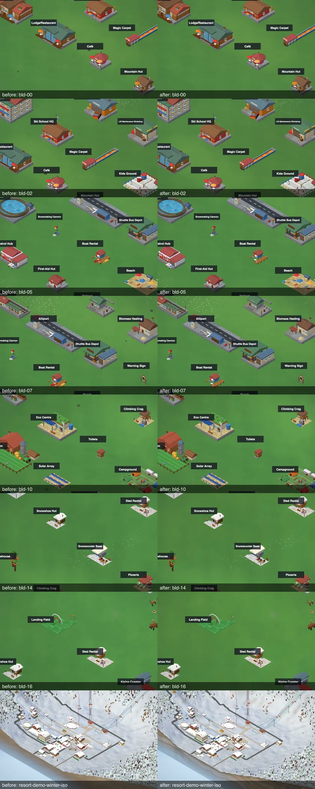
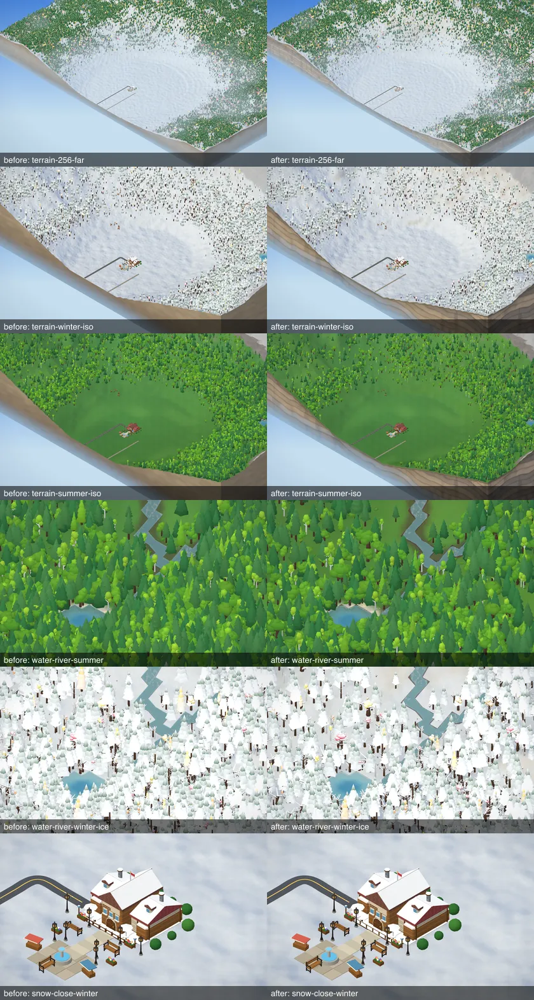

# M8 graphics pass: before / after (task 8.8)

Combined verification of the four lanes (A buildings / lifts / icons, B trees / rocks / animals / guests, C skirt / water / terrain / sun shadows, A2 remaining buildings / stations / vehicles) on the final tree. Baseline = commit `f23481f` (the audit, `docs/graphics-audit.md`), **re-measured on the same machine in a clean worktree** so every "before" below is a same-machine number. SwiftShader on an Apple-silicon Mac: draw calls and triangles are real, **frame ms is relative only**. Scripts: `scripts/shots/m8-perf.ts`, `m8-share.ts`, `m8-calls.ts` (new: calls / triangles per top-level scene child, for attribution), `scripts/flicker-test.ts`, `m8-montage.ts`.

Budgets (owner D8-2): iso triangles +25 % max on High, **+0 % on Low**, trees +10 %, draw calls +0, gzip JS +60 kB.

## Verdict

| budget | result |
|---|---|
| Draw calls (main pass) not higher | **met after a fix.** The lanes added +4..+5 calls (the five snow cannons got a fourth material layer, `roof`, for a 3 cm control-box cap). Moved to `wood`: calls now equal to baseline (128 / 1.5 low: 164 vs 164; 64: 152 / 111 equal). A test pins the cannon layer count. The sun-shadow pass is a **separate** depth pass (`docs/shadows.md`: about 22-24 calls on 64 / 128 maps), counted in `renderer.shadows.stats`, not in the main frame; contact shadows add 0 calls. |
| Triangles, High <= +25 % | **met**: 128 / 1.5 high 0.74 -> 0.75 M, 128 / 3 high 2.00 -> 2.01 M (share run, same camera path; the perf run's 1.52 M row equals the baseline's 1.52 M). 64 / 1.5 high 1.20 -> 0.92 M and 256 within 1 %: LOD path noise, never above baseline by more than 1 %. |
| Triangles, Low +0 % | **was not met, fixed.** Buildings and lifts grew about +2 % of a Low frame (+7.5 k of 390 k at 128 / 1.5). Low `treeDensity` 0.55 -> 0.52 (render-only, `QUALITY_PRESETS.low`) takes about 5 % off the dominant layer: 128 / 1.5 low is now **384-385 k vs 389.7 k baseline (-1.2 .. -1.5 %)**. Costs 3 % fewer trees on Low only. |
| Trees +10 % | **met: +0 %.** Tree layer triangles at 128 / 3 med 417.4 k vs 417.5 k (the lane B work spent its budget on the shape, not the count). |
| Total frame +25 % cap | **met**: med 128 / 3 +4.6 % (710 -> 743 k), 128 / 1.5 +2.9 %. The growth is rocks (63 -> 80 k, +26 % of a 9 % layer) and guests (+7 %). |
| gzip JS +60 kB | **met: +11.2 kB** (total 1,052.7 -> 1,063.9 kB; app js 754.2 -> 765.3, three 142.5 unchanged). `npm run size`. |
| Frame ms on Low not worse | **not measurable in absolute terms** (SwiftShader). Relative: 128 / 1.5 low 183 -> 182 ms and 64 / 1.5 low 172-179 vs 185 (noise band +-10 %); the JS update path 0.1-0.25 ms in both. Real numbers need the owner's F3. |
| Goldens / stateHash unchanged | **yes**: `npm run test:balance` 48 / 48 passed (no golden edited; M8 is render-only). |

## Iso frame (this run, after / before at 128 map, winter 11:00, 300 skiers)

| zoom | preset | calls after / before | triangles after / before | relative frame ms after / before |
|---|---|---|---|---|
| 1.5 | low | 164 / 164 (first full run: 169 / 164, before the cannon fix) | 0.38 M / 0.39 M | 182 / 183 |
| 1.5 | med | 174 / 169 (cannon fix not yet in that run: expect 169) | 0.68 M / 0.67 M | 304 / 284 |
| 1.5 | high | 174 / 169 (same) | 0.75 M / 0.74 M | 523 / 309 (noisy: a single run, the second run of the same row was ~420) |
| 3 | low | 155-161 / 157 | 0.50-0.59 M / 0.56 M | 192-247 / 217 |
| 3 | med | 162 / 156 | 0.74 M / 0.71 M | 293 / 255 |
| 3 | high | 161 / 157 | 1.52 M / 1.52 M | 449 / 416 |

Full 64 / 128 / 256 table of the first run (before the cannon and Low density fixes): `scripts/shots/m8-perf.ts` output, 64 / 1.5: 157 / 158 / 158 calls (low / med / high), 0.38 / 0.47 / 0.92 M; 256 / 3: 170 / 174 / 175 calls, 2.61 / 4.08 / 4.76 M (baseline 165 / 169 / 169, 2.60 / 4.06 / 4.74 M). The shadow pass is not in these numbers (its own pass, `docs/shadows.md`).

Where a frame goes (share run, 128 / 3 med, after / before): trees 417 k / 418 k, rocks 80 k / 63 k, guests 138 k / 128 k, terrain 15 k / 14 k.

### Triangles per category (pure geometry; `m8-baseline`) and cap

Lane tests pin each budget (`tests/render/m8LaneA.test.ts`, `m8LaneA2.test.ts`, `m8LaneB.test.ts`, `m8Snowcat.test.ts`): buildings may only grow within their caps (hotels <= 3500, others <= 3400 / 2000), full-LOD trees <= 150, low <= 60, rocks within budget, figure near gear <= 400 visible, trains <= 3500.

## Flicker (64 maps, `npm run flicker`, % oscillating pixels; same machine, `f23481f` worktree vs HEAD)

| scenario | baseline med | HEAD med | baseline High | HEAD High | baseline Low | HEAD Low |
|---|---|---|---|---|---|---|
| winter rotfine | 0.5605 | 0.6527 | 0.5481 | 0.6596 | 0.5518 | 0.6218 |
| winter zoomfine | 0.1517 | 0.1509 | 0.1534 | 0.1549 | 0.1056 | 0.1084 |
| summer rotfine | 0.1296 | 0.1372 | 0.1317 | 0.1364 | 0.1189 | 0.1253 |
| summer zoomfine | 0.0423 | 0.0454 | 0.0405 | 0.0414 | 0.0416 | 0.0401 |

Atmosphere variants on HEAD, med: winter rotfine Off 0.6548 / Low 0.6531 / High 0.6532; High quality + Atmosphere High 0.6616. No pops, no LOD flips in any run.

Attribution: winter rotfine moved **+0.09 absolute (+16 %)** on every quality tier and every atmosphere level, so it comes from the geometry (most likely the lane B conifer whorls and crowns; the shadow map adds <= 0.014 on top), not from the tier or atmosphere settings. I did not bisect it further. The "regression" threshold I set was 0.3 absolute above the same-machine baseline: **not a real regression**, left as is. Summer and zoom sweeps are within +-0.01. The number worth watching on the owner's machine is the winter pan on conifers (`docs/playtest-m8.md`).

## Terrain shader error (lane B shots)

The reported `patch` reserved-word message is **gone**: no GLSL source in `src/render` uses `patch` as an identifier (only JS locals and comments), the High and Low terrain shots (`m8-final-term-*`, `m8-final-g-*`) draw the terrain with no shader / program error in the harness log (exit 0; the "4 errors" are the filtered `GL_CLOSE_PATH_NV` ReadPixels stall warnings), and the F3 `Render problems:` line was not individually read in a shot (the F3 panel scrolls under the harness crop): the guard raises a console error on failure and none was printed in 70+ shots (`m8-audit.ts`: "0 errors" on every shot). Low confidence on "F3 reads 0": the owner should confirm once.

## UI and phone

* `npm run desktop:diff` (it hides the WebGL canvas and compares only the HTML chrome at 1280x800): **SAME** on all six screens; the Buildings drawer moved 0.018 % of pixels (the new thumbnails), well under the 0.05 % tolerance.
* `npm run mobile:audit`: all acceptance thresholds met.
* 390x844 touch shot on Low (`m8-final-phone-low`): HUD one row, map visible, skirt strata and the lodge render; no errors.

## Contact sheets (before | after, left | right)

I looked at all five. Honest read:

* **Buildings** ([sheet](img/graphics-m8-buildings.webp)): at gallery distance the before and after are **very hard to tell apart**. The rounder roofs, vaulted hotel canopies and barn gambrel only show in close-ups; at the default iso zoom the lodges, chalets and hotels look nearly the same. This is where the owner's wishes list matters (`docs/playtest-m8.md`).
* **Lifts** ([sheet](img/graphics-m8-lifts.webp)), **nature** ([sheet](img/graphics-m8-nature.webp)): conifers show visible whorls and a softer silhouette in the winter close-up, deciduous crowns are rounder; deer / ibex are smoother but still small at iso distance. Guests look the same at iso distance.
* **Terrain / skirt / water** ([sheet](img/graphics-m8-terrain.webp)): the clearest win. The skirt has beds and ledges instead of a flat slab and the shorelines are rounded.
* **Shadows** ([sheet](img/graphics-m8-shadows.webp)): High adds soft shadows (a visible one behind the lodge at 17:00 in the rotated summer view, blue streaks under trees in winter); at noon in the default camera they fall behind the casters and are faint. SwiftShader stills cannot show shimmer.
* Audit sheets from the baseline: [categories](img/graphics-audit-categories.webp), [buildings](img/graphics-audit-buildings.webp).




## Follow-up lane D: smooth bubble chairs and gondolas + weak-spot pass

Owner feedback: the bubble chairlift and the gondola cabin were still blocky. New helpers in `src/render/meshes/lifts/loft.ts`: `addHull` (lofted rounded-rectangle hull: superellipse plan + cross-section, tapered lower shell, split into colour / layer bands that share vertices so lighting has no seam), `addHood` (half superellipsoid, closed behind, open in front and underneath), `curveTube` (Catmull-Rom tube: arched hangers, curved arms, palm trunks). They go through `PartBuilder` into the existing opaque + glass groups: **no new draw call, no new material** (the glass group already used the translucent `liftGlassMaterial`; the hood is a smoked amber `0xe3a24e` through it).

| Carrier (iso / near triangles) | before | after |
|---|---|---|
| chair6b | 492 / 1128 | 776 / 1268 |
| chair8b | 540 / 1272 | 824 / 1364 |
| gondola6 | 268 / 516 | 772 / 1292 |
| gondola10 | 328 / 576 | 804 / 1324 |
| open chairs, T-bar, cable car, funicular | unchanged | unchanged |

Budgets (`tests/render/m8LaneD.test.ts`, `m8LaneA.test.ts`): bubble chairs and gondolas <= 900 iso / 1500 near (everything else still 780 / 1300). The carrier drop is unchanged (gondola bottom -0.94, chair -0.6), so station clearance holds. The drawer thumbnails use the same carrier meshes, so they show the smoother carriers (`m8-after-d-icons`). Near-detail bug fixed on the way: the chairs' padded top roll floated above the chair (a cylinder placed by its base instead of its centre).

Weak spots fixed (triangles before -> after): Altiport 1488 -> 2396 (ellipsoid plane with cowling, propeller, struts, wheels; domed glass cab; arched hangar; windsock and drums from the shared helpers), Beach 762 -> 1734 (domed parasols, rounded towels, dunes, curved palm, round castle towers, striped ball), Kids Ground 1094 -> 1288 (domed slide top, round posts, curved chute, mound), Reservoir 1252 -> 1536 (arched pump-house roof, curved intake pipe, valve wheel, round posts and rail), Ice Rink 1596 -> 2148 (32 boards that follow the oval tangent, leaning masts, round lamps), Tourist Office 376 -> 726 (round `i` board, domed map stand, planters, porch posts). Chair6 / 6b / 8b stations now have the bullwheel hood. The village fountain (visible in walk mode) is lathe-turned. The carnival costume figure and the World Cup racer use ellipsoids and tapered tubes instead of stacked boxes.

Lane E (below) closed most of this list. Originally open: near-view trees and rocks (`NearTrees.ts` / `Rocks.ts`: not re-checked, there is no ground-level shot that shows them up close in the harness), cow / sheep / goat in a real farm shot, pond staircase outline, concave shoreline corners, no shadows in ride / photo / walk views, shadow receiving on buildings and trees, near-LOD gondola interior is still boxy (bench boxes), funicular and cable-car cabins are still box shells.

Test page for carrier close-ups: `npx vite-node scripts/shots/m8-carriers-d.ts <out> new chair6b,gondola10 <az> <el> <dist> [near]` (real meshes + materials on a plain perspective page, `scripts/shots/carriers-d.html`).

## Lane E: remaining items (after the owner approved the playtest)

Done (render only; tests in `tests/render/m8LaneE.test.ts`):

* **Near trees / rocks** (`NearTrees.ts`): conifer / pine / larch tiers are the iso mesh's drooping scalloped whorls at 16 segments (with an underside, ground cameras look up into them) instead of displaced cones; crown displacement was cut by 45 %; the boulder uses coarse shared lumps (+ small jitter) and a flattened, stretched proportion. Near budgets unchanged (< 2400 triangles per tree, rock < 1200).
* **Cable-car / funicular cabins** (`Tram.ts`, `Funicular.ts`): lofted rounded hulls (tapered lower shell, curved glass band, roof shell, mullions on the curved side), curved overhead grab rails in the near cabin; extents and drop unchanged. The near gondola cushions / backrests are ellipsoids. Triangles (iso / near): tram 620 / 1164, funicular 708 / 1152, gondola6 772 / 1364, gondola10 804 / 1396 (budgets 780-900 / 1300-1500).
* **Water**: a concave shoreline corner (land only on the diagonal, both side neighbours water) is flagged per vertex (`aCorners`, no extra draw call) and the shader rounds it with a quarter disc of radius 0.22. Honest read: it only shows on lone diagonal land corners; I did not find one on the test seeds, and the **terrain bed under a square lake still shows square dark corners outside the rounded water** (`m8-after-e-water4`). The pond staircase is therefore only partly smoothed.
* **Farm animals** (real farm shot: summer start with `starter=1`, `scripts/shots/m8-farm-e.ts`): legs were dark and hair thin, the sheep head small. Now the legs are 1.25-1.3x thicker (cow legs light, sheep legs charcoal), the sheep head and ears are about 1.4x bigger. Seen in `m8-after-e-farmc-farm`: sheep read as sheep, the cow has patches, horns and a pink muzzle.
* **Dusk shadows**: minimum cast slope 0.3 -> 0.4 (about 22 degrees, fingers at most ~2.5x the caster instead of 3.3x) and the strength now fades with the **real** sun elevation (it used the lowered one, which never fell under the old fade); a grazing sun draws about 30 % strength.
* **Close-ups**: `scripts/shots/m8-closeup-e.ts <prefix> <id:zoom>` raises the camera `maxZoom` and hides the gallery labels (zoom 45-90 gives a real close-up). Seen and OK: Beach (umbrellas, hut, lifeguard tower; the palm trunk leaves the frame), Ice Rink (boards follow the oval), Snowscooter Base, Toilets, Launch Ramp, Altiport. Fixed after looking: Reservoir (the rail ring floated off the berm: posts and rail now sit on the crest), Kids Ground mound and the snow-cannon pile (the stone layer gave a brick igloo look: now the snow-tinted roof layer, smooth dome; still slightly lilac with faint seams).

Not done, on purpose:

* ~~Shadow receiving on buildings / trees and sun shadows in ride / photo / walk views~~: **done in lane F** (High only): see `docs/shadows.md` ("Lane F numbers"). Main-pass draw calls identical (164 / 169 / 169 on 128 / zoom 1.5), Low / Med compile the same 20 programs, shadow memory ~20 MB, gzip JS +1.4 kB, flicker 64 winter rotfine (High) 0.687, 0 pops.
* (Plane detail and the terrain bed corners under lakes were done in lane G, below.)

## Lane G: water bed, plane, full sweep, confirmations (after lane E)

Render only (no sim, save or golden change). Tests: `tests/render/m8LaneG.test.ts`. Sheets: `docs/img/graphics-m8g-*.webp` (`scripts/shots/m8-montage-g.ts`; before shots were taken in a clean worktree of the lane E commit on the same machine).

**Water (before / after: `graphics-m8g-water.webp`).** The terrain bed under a lake is a per-tile kind, so its dark colour ended in a hard tile square outside the rounded water surface. The lake-bed colour is now masked by the per-vertex water share that was already in `aWet.x` (1/4 at a tile corner, 1/2 on an edge, 1 inside) with a slow world-space wobble, and the cut-off part fades into the sandy shore band (`bedM` in `TerrainMesh.ts`; no new attribute, no new draw call, no `gl_FragCoord`, flicker unchanged). Convex corners now read as scallops that follow the water; river beds use the same mask on `aWet.y` so bends round off (`graphics-m8g-water`, rows 3-5). The bank wet tint on land next to a river was cut from 0.75 to 0.55. Tried and dropped: lowering the water share at concave corners (made pale diamonds along straight edges). Checked on seed 5 (square lake + staircase) and seed 7 (natural lake with 11 concave corners, `scripts/shots/m8-water-g.ts <prefix> <seed> <zoom> <size> <pick> <winter> [dig]`, `TT=6` for rivers).

**Altiport plane.** Propeller blur disc, livery stripes, cabin windows, main-gear legs, tail-wheel leg and a taller fin: +<= 150 triangles, same parts (no new draw call). It was tucked behind the sign and the hangar, so it is now parked at x -1.5 where the iso camera sees it (`graphics-m8g-fixes`, last row).

**Sweep.** Every building (18 gallery shots, `graphics-m8g-sweep-buildings`), lift station / tower / carrier rows, vehicles, trees, guests, farm animals and ground-level ride / lift / walk shots (`graphics-m8g-sweep-lifts-vehicles`, `graphics-m8g-sweep-nature`) were looked at. Fixed after looking: **Tackle Hut** (`frameWin` shutter width 1 instead of 0.07 put two 1-unit green slabs through the roof; gable span / length were also swapped), **Small Hydro** (the penstock cylinder floated at y 1.1: `cyl` takes the base of the unrotated cylinder, now its axis rests on the saddles), **Kids Ground mound + snowman, snow-cannon pile** (the roof / stone texture gave a lilac tint and ring seams: new `flatUv` part option, one plain texel from the stone texture, `FLAT_SNOW_UV` in `meshes/common.ts`), **Ice Rink** (paving-tile pattern on the ice: flat texel, lighter ice).

**Confirmed by looking:** Beach palm crown (green fronds on a curved trunk, reads), snow-cannon pile (now white), Kids Ground mound (white, no seams), goats and sheep in the real farm shot (`m8-farm-e.ts <prefix> <zoom> goat|cow|sheep`), Ice Rink, near conifers / broadleaf trees in real walk shots (`scripts/shots/m8-ground-g.ts`; scalloped whorls, clean silhouettes) and a lift-ride shot.

**What is still not great (honest list).**

* The dug bank wall shows as a dark notch at every concave lake / river corner (the land quarter disc cut out of the water exposes the steep bank face); it reads as a muddy bank but is darker than the sand around it. A real fix needs bank geometry, not colour.
* Lake water over the faded bed rim is a pale, flat shallow band; the rim has no real depth gradient.
* The pond / lake outline is still tile-sized scallops, not free curves.
* The harness shows screen-aligned horizontal banding on flat grass and water (SwiftShader / sun-shadow texel bands, also on terrain with no water); not a water bug, but it hides fine shore detail in screenshots. Worker F owns the shadow system.
* Rocks were not seen up close in a real ground shot (none in the walk / ride frames); the walk-mode near-hide dither on roofs and signs is intentional but visibly stippled.
* The Altiport plane is still a few pixels at gallery zoom; round bushes (hedges / shrubs) are plain spheres with no snow in winter; the gallery's lift rows sit on rock for seed 5 (harness terrain, not the models).
* Still not done: shadow receiving on buildings / trees and sun shadows in ride / photo / walk (lane F).

## Reproduce

```
npx vite-node scripts/shots/m8-perf.ts [--quick]
npx vite-node scripts/shots/m8-calls.ts low|med|high   # per-layer calls / triangles
npx vite-node scripts/shots/m8-audit.ts m8-after-final  # then: npx vite-node scripts/shots/m8-montage.ts [prefix]
npm run flicker -- --only 64-winter-day,64-summer-day --kinds rotfine,zoomfine [--quality low|med|high] [--atmos off|low|high]
```
