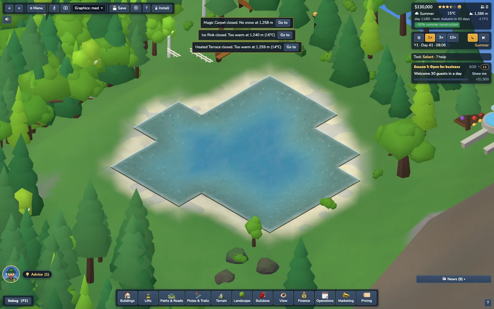
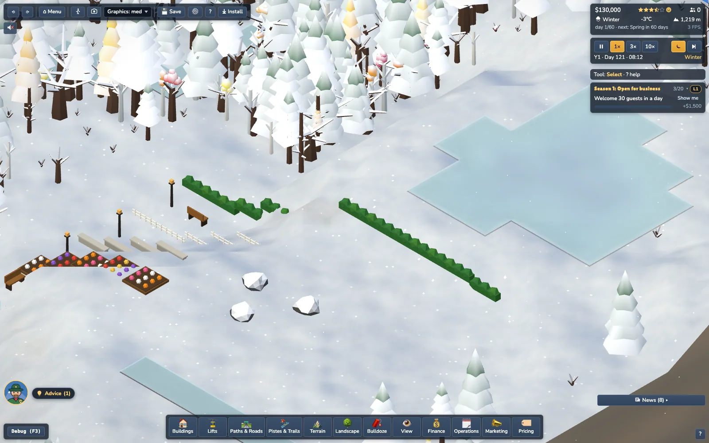

# Landscaping (Landscape drawer)

Answer to *"Should it be possible to create water, like we can plant trees? Some further landscaping would be good."*: yes. The **Landscape** drawer (dock, between Terrain and Bulldoze) has three tabs (terraforming lives only in the separate **Terrain** drawer: no duplicate tab):

| Tab | What it does | Reuses |
|---|---|---|
| **Water** | *Dig pond* (drag a rectangle 3-11 tiles, or click for the default size; `[ ]` changes it), *Fill in* (click a pond you dug) | new `LandscapeTool` |
| **Nature** | Plant / Clear trees + species, density, brush (the only place for trees: the Terrain drawer is terraform only), **Boulders** (paint) and **Remove boulders** | `PlantTool` + `LandscapeTool` |
| **Decor** | Bench, Lamp post, Flower bed, Hedge, Picket fence, Stone wall, Fountain; eraser; turn | `LandscapeTool` |

Code: `src/config/landscape.ts` (costs / limits / decor catalogue), `src/sim/landscape/Landscape.ts` (pure rules, `Landscape` state, save form), `src/build/LandscapeTool.ts` (pointer tool), `Undo.landscapeStroke` in `src/build/UndoActions.ts`, `src/render/LandscapeDecor.ts` (+ `VillageDecor.buildFrom`), `Water.setLakes` in `src/render/Water.ts`, drawer tabs in `src/ui/components/StDock.ts` (`landItems` = card data, `landControls` = side selects; the cards are the shared `buildGrid` cards of Buildings / Pistes), wiring in `src/main.ts` (`landscapeTool`, `updateLandscapeView`, `__slope.landscapeDebug` for the harness), `createSim` (`sim.landscape`, `sim.landscapeEnv()`), save module `landscape` in `src/game/saveState.ts`. Tests: `tests/sim/landscape.test.ts`, `tests/build/landscapeUndo.test.ts`, `tests/game/landscapeSave.test.ts`, `tests/render/landscapeRender.test.ts`, `tests/ui-dom/landscapeDrawer.test.ts`.

## Water

**Model.** Water is already per-tile data: `TileType.Water` + `OccFlag.Water`, drawn by the `Water` mesh as a flat quad at the lake `level` over tiles whose corners are all <= level (`buildWaterData`). A player pond is exactly a generator lake (`PondRec` = `Lake` + id): the footprint is a basin (shore vertices at `level`, deeper by up to 2 half-steps inwards), banked by two rings so every non-water neighbour has all corners >= level (`pondValid` = the generator's `lakesValid` restricted to one pond). The earthworks go through `Terraform.setCorners` (new export: same edge-delta propagation, occupancy / water / lift-clearance guards and prop clearing as the brushes), the water surface through `Water.setLakes([...natural, ...ponds])`, which main calls whenever `sim.landscape.version` moves (dig, fill, undo, redo, load).

**Sim consumers (nothing special-cased, they read the same maps).** `tileType` water => wildlife / livestock never walk in, no snow settles (`Weather`), snow cannons skip it, trees / buildings / paths / pistes / lifts / terraform are refused on and next to it, walk mode collides (water without a bridge). `buildings.lakeTiles` is recomputed (natural + ponds) on every change, so a **Beach / Boat Rental** can stand next to a pond (their `lakeEdge` rule) and `waterSource` dependencies see it. Filling a pond is refused while a beach or boat rental touches it. Sustainability: **neutral**: trees cleared for a pond are not counted as felled (`treesFelled` is restored; undo restores it too).

**Winter.** The water shader's `uFreeze` is global (temperature driven), so a pond freezes exactly like a natural lake and thaws again. There is no separate ice sim (the Ice Rink is a building with a `cold` need, unaffected). Digging or filling is allowed in every season.

**Rules (refusals name the reason, shown in the ghost tooltip and as a toast):**
* Career: unlocks at **resort level 2** (`UNLOCKS`: `landscape:pond`, `lockedReason`: *Unlocks at level 2: Local favourite*). Sandbox / tutorial / scenario gate behave like for buildings. Everything else in the drawer is always available. No goal or advisor rule mentions it (test greps).
* Footprint: ellipse inscribed in the rect with a deterministic wobble; 3-11 tiles each way, >= 8 tiles.
* Ground: nearly level: corner spread over the footprint <= 4 half-steps (20 m) and every footprint tile steeper than 1 half-step/tile refuses (*Too steep for a pond ...*). Bare rock refuses.
* Clearances (Chebyshev tiles from the footprint): other water 2, buildings 2, ski pistes 2, lift line 3, anything built (path, road, rail, trail, decor) on or next to it, map edge 4. Lift cable clearance is checked on the changed corners.
* Cost: **$70 per water tile + earthworks at the terrain price** (10 per half-step), x the construction multiplier (the -50 % summer discount applies). A 5x5 pond (~20 tiles) is about $1,500-3,000, the biggest ~ $9,000. *Fill in*: $35 per tile, no refund of the dig.
* Not available: **Stream** channels (skipped: a fall-line channel needs a routing rule that joins the existing stream network / basins and a flow field for the water shader; ponds + the existing streams cover the need for now) and removing natural lakes / streams.
* Ducks: not done (no animal species uses water yet).

## Boulders, Decor

**Boulders** are ordinary `PropKind.Rock` props (`born = -1`, they never grow), so they are saved with the props, drawn by the rock layer, avoided by walkers like natural rocks and undone with the prop chunk snapshot. Brush 1-4, $25 each (0-2 per tile, deterministic per (seed, tile, day)), removal $12 each; refused on water, slopes > 2.6 and occupied tiles. Natural boulders can be removed too.

**Decor** is one piece per tile (`Landscape.decor`, saved as `[x, y, kind, rot]`). Placing sets the new `OccFlag.Decor` bit, so every existing rule treats the tile as occupied (buildings: *Garden decor in the way*, paths / roads / lifts / piste painting refuse, terraform near it refuses, trees and boulders are not planted on it); the eraser clears it for free. Costs: bench 60, lamp 80, flower bed 40, hedge 30, fence 25, wall 45, fountain 600 (no upkeep). Oriented pieces (bench, flower bed, hedge, fence, wall) follow the **drag direction**, so one stroke along a path edges it; `R` turns them. Needs dry ground (<= 1.6 slope) without trees or rocks on the tile (*Clear the trees or rocks on this tile first*). Meshes are the village decor recipes (bench = 0.84 x 0.28 slatted park bench with backrest, armrests and iron side frames; lamp = plinth, tapered pole, glowing lantern under a cap; card icons for those two are inline SVG since no emoji fits) (`VillageDecor.emit`; flower bed gets a full-tile variant), 3 draw calls, rebuilt only when `landscape.version` changes or terraforming moves the ground. Walk mode collision uses the same `decorCircles` as the village (bench, lamp, hedge, wall, fountain are solid; flower bed and fence are walkable).

## Keys, undo, saves, determinism

* Keys while the landscape tool is active: `1`-`6` Dig pond / Fill in / Boulders / Remove boulders / Decor / Remove decor, `[ ]` size, `R` turn, `Esc` cancel. Registry context `landscape` (`ui/shortcuts.ts`, help overlay). The drawer is opened from the dock.
* **Undo / redo** (`Ctrl+Z`, same 10-step same-day stack, verb *landscaping*): every drag is ONE step (`Undo.landscapeStroke`): a `TerrainDelta` (heights + prop chunks + network signature) plus tile types, occupancy bits, snow, the Landscape lists and the tree counters. Undo refuses (with the usual message) when the ground / landscape changed since, after a day change, or when funds are short for a redo.
* **Saves**: tile types / heights / occupancy are in the existing `grid` module, boulders in `props`; the new `landscape` module (`observer: true`, so `stateHash` and every golden are unchanged; its effects on the sim are all in the hashed grid / props modules) stores the pond list (level + tiles, for the water mesh and `lakeTiles`) and decor. Old saves have none (reset => empty). No SAVE_FORMAT bump.
* **Determinism**: no wall clock, no `Math.random`; pond footprints are hashes of the rect, boulders of (seed, tile, day). Same seed + same actions => same `stateHash` (test).

## Perf

`planPond` preview on an 11x11 footprint: < 1 ms (map scan of 3,500 ponds sites takes well under a second); a 300-piece decor rebuild is one merge of ~3,000 small boxes (< 60 ms budget, measured in `tests/render/landscapeRender.test.ts` `[perf]`). Ponds add 6 vertices per tile to the existing water mesh (one draw call); decor adds 3 draw calls only when something was placed.

## Not done / follow-ups
Stream tool; ducks / fish; meadow (ground colour) patches (flower beds are the cosmetic ground decor); path edging as an automatic option; a hotkey for the drawer; decor does not follow terraforming smoothly (it is re-seated on the new ground, walls step on slopes); the pond's blocky outline follows the tile grid (like natural lakes).
