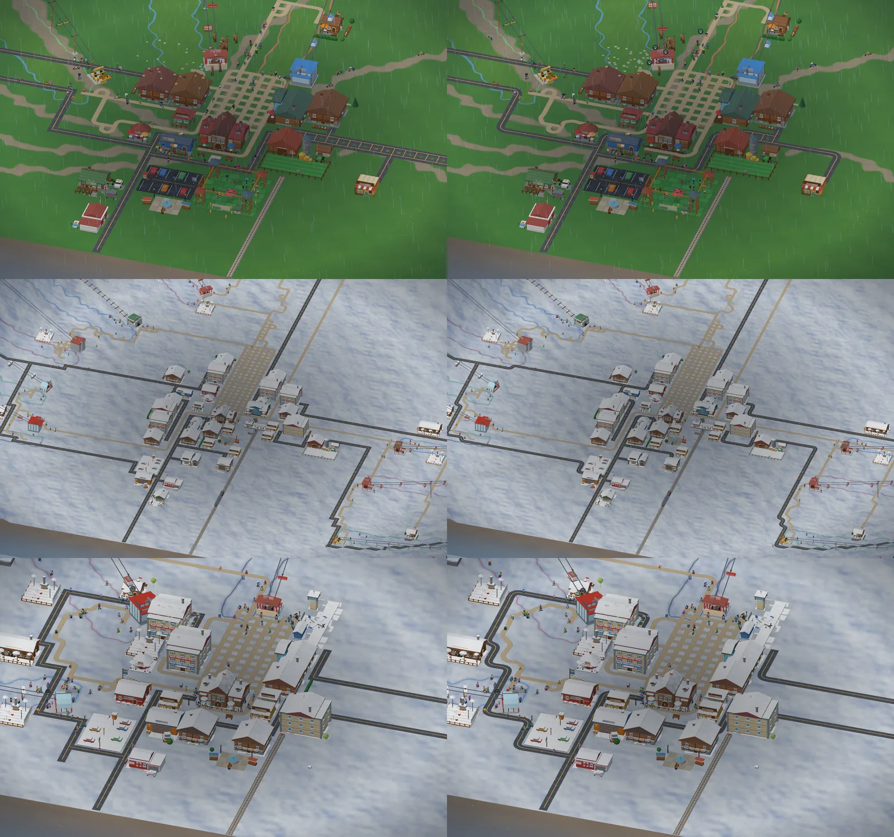
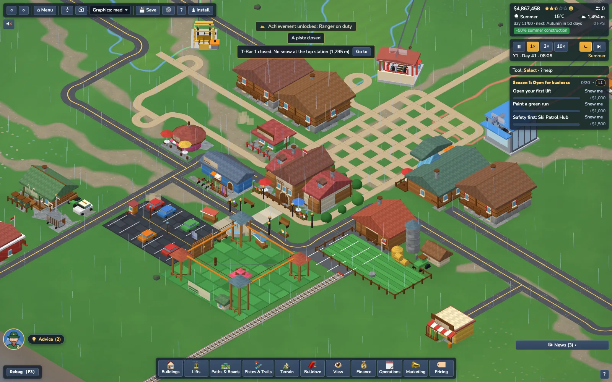
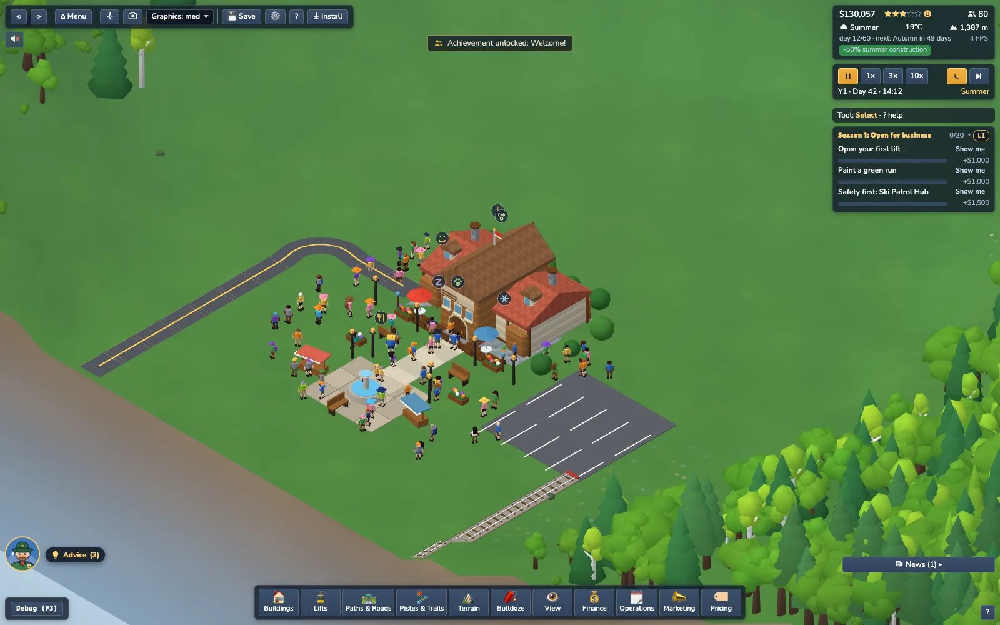

# 3D models: visual identity

All models are procedural low-poly geometry (`src/render/meshes/**`), vertex-coloured, merged into **≤ 4 meshes per building** (wood / stone / roof / sign).
Window glass uses the exact `C.glass` vertex colour: those pixels glow warm at night (`BuildingMeshes.setNight`). Roof/ground faces turn white with the snow uniform.
Each building instance gets one of 4 subtle material tints, seeded by building id (`tintVariant`).
Press **B** in the game (debug) to see every building plus all 12 lift kinds in labelled rows (bottom station, top station, tower, carrier).

Budgets (asserted in `tests/render/buildings.test.ts`, `tests/render/liftModels.test.ts`): buildings ≤ 3,000 triangles for footprints ≤ 6 tiles, ≤ 9,000 for bigger ones
(real counts: 242 – 1,920); lift stations < 3,500 (real: 352 – 1,284); everything fits its footprint + overhang tolerance and is deterministic.

## Look & construction details (world polish pass)
* `PartBuilder.box` now chamfers every solid block with min side >= 0.2 (`chamferBox`, 44 triangles, bevel <= 0.035); thin slabs/trim stay plain 12-triangle boxes.
* `gable` roofs are sheets with eave thickness (lip below the slope) and a small bevel on verge/ridge edges.
* Everything stays within the budgets in `tests/render/buildings.test.ts`; the heavy per-model items from the wish list that are NOT done yet: curved glazed station canopies, rounded cabins/chair backrests, tapered tower tubes, irregular snow slabs (snow is still the shader's white-up-faces), window recesses (panes are still proud of the wall), stone coursing with varied blocks.
* Village dressing (`src/render/VillageDecor.ts`, 3 draw calls: wood / plants+paint / emissive lamp glass): stone path from the entrance, 6 lamp posts (glow at night), 2 benches, 4 flower planters, hedge shrubs, a 2-row parking lot with painted stalls. Layout is a pure function (`layoutVillage`) that skips blocked tiles; it is rebuilt when the lodge or the building count changes.

## Lifts

Stations are written once for the bottom station and mirrored for the top. **Bottom** = boarding hall, ticket gates / turnstiles, return wheel.
**Top** = drive house with motor, exit ramp / arrival platform, drive wheel. Every station has a canvas name sign (4 faces).

| Kind | Station look (bottom / top) | Tower | Carrier (`meshInfo`) |
|---|---|---|---|
| `tbar` | Tiny open concrete pad, yellow wheel A-frame, little motor housing with slab lid (no canopy), yellow rail posts; top has an exit ramp and marker | Slim wooden pole, single small sheaves, yellow plate | Grip clamp, spring anchor + rod, yellow T-bar (2 riders) |
| `chair2` | Small wood-clad hut with brown roof, red steel wheel frame, open deck; bottom has a little red-roof shelter + bench | Tubular steel pole, dark T-arm, 2-wheel sheave trains | 2-seat red bench, footrest, safety bar, fixed grip |
| `chair4` | Concrete platform, sloped dark canopy on red posts, visible bullwheel, boarding carpet, control booth, barrier | Tubular pole, red arm, 2-wheel trains | 4-seat red bench |
| `chair4d` | As chair4 but red canopy, tyre rails along the platform, turnstile gates (detachable) | Tube + ladder, 3-wheel trains | 4-seat, grip block with wheels |
| `chair6` | Modern station: long curved steel/white tunnel canopy, red end beams, chair park rails, concourse block | Steel A-frame mast, red cap, 4-wheel trains | 6-seat open chair, detachable grip |
| `chair6b` | Same tunnel in blue glass panels + steel ribs | A-frame + white plate | 6-seat with translucent bubble hood |
| `chair8b` | Widest/taller glazed tunnel, 5 ribs, longest concourse | A-frame + white plate | 8-seat bubble |
| `gondola6` | Rectangular glazed terminal (blue accents), cabin parking rails, entrance hall + canopy / drive house with motor on the roof | Tall steel mast, big 5-wheel trains, service platform | Compact white/blue cabin, small windows (6) |
| `gondola10` | Wider, taller terminal with a second glazed storey, red accents | Heavier red-cap mast | Longer/taller red cabin, panoramic window band, door frames (10) |
| `cablecar` | Heavy stone hall with red roof, yellow lintel, tower-like head house with sheave behind; bottom: gates + boarding hall; top: counterweight pit + ramp | Very tall four-legged red/grey lattice pylon, big saddle | Big yellow cabin, door + window frames, red roof (40) |
| `funicular` | Platforms either side of the rails, green canopy, stone tunnel portal with keystone, window-facade terminal; top has drive house + ramp | Concrete trestle with diagonal bracing | Three stepped green compartments, lights, translucent windows (60) |

Carrier `meshInfo` (on `geometry.userData`): `{ family, seats, bubble, cabinSize, detachable? }`. Bubble hoods / cabin windows are a second, translucent geometry group (material slot 1).

## Buildings

| Id | Visual identity |
|---|---|
| `baseLodge` | Two-wing timber-frame hall, tall brown entrance tower, dormers, two chimneys, terrace with railing + parasol tables, flag |
| `lodge` | Wood hall with green roof, A-frame glass dining room, two terraces with parasols, log pile |
| `cafe` | Round pink drum, red cone roof with chimney cap, ring of windows, striped awning, terrace tables |
| `mountainHut` | Small timber cabin, stone chimney, terrace slab with parasol + picnic table, pennant, logs |
| `solarArray` | 3x2 gravel bed with two rows of four tilted blue panels on frames (cell lines, NOT the window-glass colour: no night glow), inverter cabinet, low fence |
| `solarPlant` | 5x4 field of 18 panels in three rows, control hut with a lit window and a SOLAR sign, transformer, fenced yard, lamp post |
| `windTurbine` | 2x2 tapered white tower (432 triangles) on a plinth, nacelle, service door; the hub + three red-tipped blades are a separate `rotor` group spun by `BuildingsView.update` (`sim.energy.rotorSpeed`) |
| `smallHydro` | Stone powerhouse with a green gable roof and framed windows, steel penstock on saddles, tailrace trough, gauge post, HYDRO sign |
| `biomassHeating` | Cream boiler house with a brown roof and a stone stack (smoke), grey wood-chip silo with a blue cone, open log store, chip heap |
| `treeNursery` | Greenhouse with glass-colour windows (warm night glow), three seedling beds with little trees, potting shed, wheelbarrow, NURSERY sign |
| `recyclingCentre` | Sorting hall with a green roof, ramp, blue / yellow / green bins, two timber compost bays, RECYCLE sign |
| `shop` | Yellow shop, red-white awning, big shop window, raised signboard, ski rack, sale barrel |
| `rental` | Blue counter hut with serving awning, ski rack + three bikes outside |
| `chalet` | Stone base, log walls, wide brown roof, balcony, shuttered windows, stacked logs, chimney |
| `apartment` | 3-storey cream block, balcony per floor in alternating colours, quoins, entrance canopy, antenna |
| `skiSchoolHQ` | Bright red hut with yellow bands, banner pole + bunting, kids' sleds, slalom cones |
| `magicCarpet` | Conveyor with chevrons, blue side walls, red ribbed glazed tunnel, drive housing |
| `kidsGround` | Fenced white play slope, slide, rope tow, cones, mini hut, snowman |
| `playground` | Swings, slide, sandpit with border, merry-go-round, seesaw, spring rider, bench |
| `patrolHub` | Red hut with white roof + red cross, ambulance garage + parked ambulance, flag, rescue sleds |
| `rangerStation` | Log lodge with green roof, antlers + RANGERS sign, paw-print post, ranger pick-up + ATV, bear-proof bins in a fenced corner, transport cage, chimney |
| `firstAid` | White hut with red crosses, red-trim door, bench, rescue sled, flag |
| `helipad` | Round pad with H, 12 glowing edge lights, windsock, ops hut, fuel drums |
| `groomerGarage` | Orange garage, blue roof, segmented roll-up door, snowcat parked outside |
| `liftWorkshop` | Cream hall, green roof, roll-up door, yellow gantry crane, cable drum, spare chairs + tower legs |
| `snowcatOutpost` | Small green shed, red fuel tank on stand, drums, parked snowcat |
| `reservoir` | Round pond in an earth embankment with stone rim, pump house, pipework, fence posts |
| `snowCannon` | Mast with red fan-gun, yellow nozzle, hose coil, snow mound |
| `shuttleDepot` | Green canopy over a yellow bus, garage with roll-up door, stop sign, bench |
| `boatRental` | Blue boathouse, jetty with piles, red/yellow boats, paddle |
| `beach` | Sand, striped parasols + towels, lifeguard tower with flag, sandcastle, beach bar |
| `iceRink` | Oval ice with striped boards, warm-up hut, three floodlight masts (glowing), benches |
| `apresBar` | Dark-timber bar under a low gable roof, 'APRÈS SKI' sign, deck terrace with parasol tables + patio heater, string lights between posts and door lanterns (glass-colour bulbs = warm night glow), skis on the wall, logs, chimney (smoke in the cold) |
| `heatedTerrace` | Timber deck, patio heaters, glass windbreak, stone stove with chimney, tables |
| `stuntPark` | Kickers, quarter pipe, funbox, rails, flags, coach hut |
| `adventurePark` | Four braced rope-course towers, bridges with net strands, net pyramid, zip line, climbing wall, ticket hut |
| `alpineFarm` | Red barn (hayloft, battens), silo, farm shop, hay bales, tractor, fenced pasture |
| `trainStation` | Hall with clock tower, platform canopy, benches, track bed + signal |
| `altiport` | Runway with edge lights + thresholds, control tower with beacon, hangar, small plane, windsock |
| `warningSign` | Red triangle with avalanche pictogram, yellow `!` plate, striped marker stakes |
| `parking` | Marked bays, centre line, varied cars, booth with barrier, lamp posts, P sign |
| `ticketOffice` | Green booth with two ticket windows, awning, turnstiles, queue barrier, price board |

## Close-up LOD (M5.2, ride-along / photo)
Near variants exist only for **perspective (ground) cameras**; iso (orthographic) always renders the base meshes, so iso screenshots are unchanged. `src/render/lod/nearLod.ts` is the one pure decision function: `nearLod(kind, distanceTiles, prev?)` returns `base` for `ortho` at every zoom; for `perspective`: `near` < 6 tiles (60 m), `mid` < 20, `far` beyond, with 0.75-tile hysteresis. Caps: `NEAR_CAPS` (40 near figures, 70 near trees / 40 near rocks per 16-tile cell). Tests: `tests/render/lod.test.ts`.

| Asset | Near variant (ground camera) |
| --- | --- |
| Figures (`buildGearGeometry(g, true)`) | nearest 40 guests only (own instance batches, same material and animation): mittens, boot soles, collar, zip, goggles + strap, helmet vent, hair volume, beanie / cap detail, pole baskets, ski bindings, snowboard bindings + high-backs, pack yoke. <= 400 triangles (base 144-316). |
| Chairs (`buildChairGeometry(.., near)`) | base + curved backrest wings, padded top roll, seat piping, side tubes, hanger collars, grip jaws + bolts + spring, safety-bar hinge arms + handle grips, footrest rubber (+~230 tris). |
| Gondola / cable car / funicular | interior floor, benches, backrests, grab pole, ceiling liner, window sills, door handles (you see them through the culled back faces when the camera is in the cabin). |
| Towers | sheave side plates, axle bolts, rope catcher, ladder rungs, base flange. |
| Cable | `buildCableNearGeometry`: round tube, 8 radial segments, lit vertex-colour material, light grey spiral stripes (twisted-strand look). Swapped per lift when the camera is < 6 tiles from the line. |
| Roofs | `uNearHide` (camera xyz + radius 3 tiles) dithers away station AND building roof fragments (the `roof` material layer) more than 0.15 above the eye inside the radius; 0 in iso. |
| Trees | Per 16-tile cell at most `treesPerCell` instances: if a cell has more, the NEAREST ones to the camera are kept (re-selected when the camera moves > 1.5 tiles), so trees right next to the camera never vanish. `NearTrees.ts`: crowns with >= 12 radial segments, position-hashed noise displacement, ridged 8-sided trunks, branch + twig bundles, root flare. Band < 8 tiles; full 8..40; low-poly 40..100; billboards beyond. |
| Rocks | detail-4 icosahedron (500 facets), two-octave displacement, flat base; moss / snow tops come from the shared shader. |
| Band cross-fade | `uLodFade = (lo, hi, w=3 tiles)`: a level draws in `[lo-w, hi+w)`; the incoming side keeps pixels with `n >= 1 - wIn`, the outgoing side `n < wOut` (interleaved-gradient dither), so the two levels are complementary and never pop. |
| Terrain | `uDetailFade` (1 in perspective, 0 in iso): tiling procedural grain (two octaves fading with `fwidth` so they never alias), normal ripple, rock crack specks and fine snow glints under ~45 m. |

Screenshots: `docs/img/lod-chair-cable.webp`, `lod-station-chair.webp`, `lod-trees-rocks.webp`, `lod-village-terrain.webp`. Not done (deferred): shader-based building detail (mortar, window recesses), village decor / animals near variants, T-bar station rescale.

Task 13: quality caps (`QUALITY_PRESETS[q].ground`: near radius, near tree / rock caps, near figures, fog range, detail texture; low switches the near LOD off and hands the standard meshes over from distance 0) - see `docs/ground-level.md`. T-bar station: not rescaled (a 1.3 x 1.7 tile footprint with 0.5-diameter wheels reads as a machine ~10x a person from the ground, like every building: the world is deliberately chibi-scaled).

## Softer look pass (less blocky, same low-poly identity)

User feedback: *"Very blocky now, which is nice, but a little better / less blocky would be appreciated."* A refinement, not a restyle: same palette, same instancing, same draw calls, rounder shapes.

| area | what changed |
|---|---|
| **Trees** (`src/render/props/Trees.ts`) | Crowns are clusters of 2-4 overlapping lumpy lobes (icosphere + per-vertex position-hashed noise, **welded vertices with smooth normals**: `Part.smooth`, `mergeParts` welds with `mergeVertices`). Conifers are **4-5 tiers** (`tier()`: 10-14 radial segments possible, per-vertex radius noise, alternate hem vertices droop and flare = scalloped skirts, smooth side normals, flat cap on the lowest tier). Trunks tapered with 6 radial segments, open-ended (hidden caps cost nothing). Snow cap threshold raised to `smoothstep(0.2, 0.64, n.y)` so tiers / lobes stay readable under snow. Meshes are shrunk (`fit()`, only if too big) to stay inside the **sim canopy table** `world/TreeHeights.ts` (lift clearance + planting are part of the deterministic sim, so the table did not move). Near (ground view) crowns use smooth normals too. |
| **Impostors** | `createImpostorAtlas` regenerated from the new recipes: 4-5 scalloped tier silhouettes (`tri()` draws shoulders + 3 hem scallops), 3-4 ellipse lobes per crown, twigs 0.065 wide. |
| **Thin parts** | `MIN_PART_THICKNESS = 0.03` (Trees.ts, ~1.2-1.8 px at the default iso zoom) and `MIN_THIN` (common.ts). Branch tips are 0.046 (4 sides, open, tapered), trunk tops >= 0.09, bunting cords 0.03 (were 0.012), lamp posts r 0.03-0.04 / 10 sides, `PartBuilder.beam` clamps to 0.03, fence rails 0.045, ski / trekking poles 0.02, chair frame tubes, gondola pole, tram rod 0.032. Guard: `tests/render/softLook.test.ts` (every tree mesh declares `userData.minThick` >= 0.03). |
| **Terrain** | Smooth/flat normal mix 0.85 -> **0.92** (8 % facet normal keeps the RCT tile structure and grid visible). Vertex smooth normals use Sobel-weighted central differences ([1 2 1] across the other axis) over the global height grid: a gentle blur and **identical along chunk borders** (no seams). |
| **Buildings** (`meshes/common.ts`) | Chamfer 0.035 -> up to 0.05 / 14 % of the smallest side; chimneys are 12-sided cylinders with a round cap (cap top still exactly `y + hgt`); doors have an **arched head** (half-round trim + door); roofs: bevel 0.018 -> 0.028 with 2 bevel segments (rounder ridge / verge edges); stone and brown roof tints a touch warmer; **soft AO gradient at the wall base** in the building shader (`vLY`, 0.8 -> 1.0 over the first 0.32 units; no extra draw call). Largest building 2026 -> 2314 tris (+14 %), average +9 %; budgets unchanged (3000 / 9000). |
| **Figures** (`meshes/Figures.ts`) | Limbs are 6-segment tapered open cylinders, torso an 8-segment ellipse, head / hair / hats are 20-triangle balls with **smooth radial normals** (round for the same cost); poles 0.02; ski tips tilted. Visible tris per guest 164-248 (was ~150-230); near variants still <= 400 (ski / bike near drop the soles, zip and goggle strap: `lite`). Vertex-shader animation tags are untouched. |
| **Vehicles / animals / lifts** | Wheels 12 sides (hubs 8), animals use soft chamfered boxes (28 % bevel), lift tower poles 10-12 sides, gondola shells + roof fairings are chamfered boxes (bbox, seat offset and clearance geometry unchanged). |
| **Lighting** (`Lighting.ts`) | Very subtle: sky hemisphere a little warmer (0.812,0.894,1.0 -> 0.84,0.9,1.0), ground bounce warmer (0.30,0.26,0.26 -> 0.32,0.27,0.25 shader / 0.416,0.353,0.4 -> 0.43,0.36,0.38), tree bases already darken (AO gradient in the prop shader). Night values untouched. |

### Budgets (before -> after)

* Tree triangles (full / low LOD): conifer 62/10 -> 72/14, deciduous 160/40 -> 132/52, pine 68/30 -> 60/24, larch 164/30 -> 124/24, birch 168/40 -> 104/52, oak 192/40 -> 140/52, shrub 140/44 -> 100/56, snag 116/44 -> 88/40 (tests: `FULL_MAX = 150`, `LOW_MAX = 60`).
* Iso frame (64 map, village, `renderer.info`): 26 calls / ~858 k tris -> 26 calls / ~676 k tris (-21 %). Ride-along frame (128, perspective): ~1.05 M -> ~1.25 M tris (low-LOD conifer / crowns + near figures), calls unchanged (159-162).
* Train body budget 3300 -> 3500 (12-sided wheels); figure budgets unchanged.

### Screenshots for the website (stable names)

`docs/img/soft-village-winter.webp` (village + arched doors, round chimneys), `soft-forest-summer.webp` (lumpy crowns, scalloped conifers), `soft-forest-winter.webp` (snowy tiers), `soft-lifts.webp` (stations + lifts), `soft-slope-guests.webp` (skiers, queue, lifts), `soft-gallery.webp` (key B), and the contact sheet `soft-before-after.webp` (left: before, right: after). Scene set + harness: `scripts/soft-shots.ts` (`npx vite-node scripts/soft-shots.ts <prefix>` writes `.weave/shots/<prefix>-*.png` + draw calls / triangles).

## Rich-look pass (calmer ground, soft pistes, village decor)

User feedback on a summer Medium resort: "messy / dull". Findings and what changed (before/after: `img/rich-before-after.webp`, left = before):

* **Pistes / trails** were per-tile decal quads (full-tile difficulty colour, opacity 0.55) = a lime/blue/red mosaic. Now a soft ground treatment in the terrain shader, **no extra draw calls**: `src/render/groundMask.ts` writes one N x N RGBA8 `DataTexture` (R ski, G MTB/hike, B ski x (difficulty+1)/4 premultiplied, A building footprints), LINEAR filtered, rewritten only when `Networks.version` / the building set changes (checked every 8 frames; no geometry rebuild). The shader samples it with a world-space noise wobble (flicker-safe, no `gl_FragCoord`): summer ski run = paler mown grass with low-contrast stripes along the fall line, winter = groomed corduroy + soft blue shoulders, MTB/hike = a ~0.5 tile gravel ribbon, difficulty = a thin coloured edge rope (min ~1.5 px wide). `tileDecal` now only draws trail bridge decks and the red outline of disconnected pistes; the 'Piste difficulty' overlay is untouched and keeps the full-tile colours. `Networks` data/API unchanged.
* **Ground**: meadow/flower texture only in broad patches (baseline 0.35 -> 0.12), flower dots 58 % -> 38 % of cells and softer, saturation boost removed, an extra 30-60 tile brightness patch term, relief light a bit lower (0.6 -> 0.5), aerial haze 10 % -> 15 % (iso), ambient a little higher / sun a little lower in `Lighting.ts` (`lighting.test.ts` min radiance still passes). Contact shading: the A channel of the ground mask darkens the terrain around building footprints (22 %, soft bilinear ring) instead of a separate decal layer.
* **Village**: `layoutVillage(lodge, env, homes)` adds a square (cobble patch + new fountain mesh, market awnings, lamps, bench; falls back to a fountain + benches on existing paths when no free tile is left) and gardens around chalets / apartments / huts (corner shrubs, one conifer / birch / apple tree, a flower bed and a picket fence on one side). Same 3 meshes (wood / plants / glass), non-blocking; fountain / tree / awning have walk-mode collision circles (`decorCircles`). Festival Town gets default bunting between the lamp posts (`VillageDecor.festival`, cosmetic flag sets still override).
* **Buildings**: roof palette softened (`roofRed/Blue/Brown/Green`, saturation <= 0.6, was up to 0.77). Cosmetic palettes multiply on top, so Alpine Red etc. still work and the default stays 'Classic'.
* **Cables / crowds**: cable strands radius 0.025 -> 0.036 (min thickness guard `CABLE_RADIUS`), colour near-black -> mid steel grey; waiting (standing) walkers get a deterministic per-guest offset (+-0.17 tile, eased in/out, render-only).

Not done (honest list): per-district roof palettes (`tintSeed` still picks one of 4 neutral tints), flower boxes / shutter variety / curved town road layouts in `demoTowns.ts`, separate instanced AO decals for trees / lift towers, hedge rows, stone walls, snowmen, guest outfit harmony by district, `Props` keeping decorative trees in yards. Tests: `tests/render/richLook.test.ts`.

## Rich-look pass 2 (districts, curved paths, decor, contact shadows)

Before / after (left = before, rows: Big Mountain, Hiking Hub, Alpine, Festival): `img/rich2-before-after.webp`; also `rich2-hiking-paths`, `rich2-bigmountain`, `rich2-festival`, `rich2-alpine`.

| # | item | what was done |
|---|---|---|
| 1 | Curved / diagonal paths | `Networks.routeFrom` (Dijkstra, multi-source from the lodge ring **and every existing path tile**, existing tiles ~free, deterministic per-tile wobble, small bonus for turning = diagonal staircases). `ensurePath` in `starterResort.ts` uses it when `StarterOptions.curvedPaths` (demo towns only; the bot / tests keep the BFS stubs). Connectivity, determinism and the vetted seeds are unchanged (`tests/game/demoTowns.test.ts` all 26 pass without re-running `analysis:towns`). |
| 2 | Per-district roof palettes | `BuildingMeshes.setDistrict(seed)` (main.ts passes the map seed): 3 hues of 6 (terracotta, slate, moss, ochre, plum, charcoal, as RGB multipliers on the roof layer) + the 4 neutral tints, picked per building id (`roofVariant`). Cosmetic palettes still multiply on top; seed 0 / gallery stay neutral. Material count: roof layer 4 -> up to 7 variants, no new draw calls in practice (one per variant, same as before for the neutral set). |
| 3 | Flower boxes + shutter variety | `frameWin` (only shuttered front windows): 70 % get a flower box (dark trough + one of 5 bloom colours, +2 boxes ~ 24 tris); shutter colour is hashed from the window position over 6 muted paints unless the caller passes one. Largest building is still < 9000 tris (`buildings.test.ts`). Blooms read as snow-capped in winter through the up-face snow shader. |
| 4 | Hedge rows / stone walls | `VillageDecor` kinds `hedge` (long bar + lumps) and `wall` (stone body + cap) next to garden plots, only where both ends are free. Decor only: non-blocking, no walk collision; reuse the plants / wood merged meshes (still 3 draw calls). |
| 5 | Contact shadows | `groundMask.ts` `treeTowerAo`: tiles with >= 2 trees (alpha 40 + 26 per tree, capped at 120) and lift towers (150, neighbours 75) are written into the ground mask A channel *below* the building level (255), `GroundMask` takes an `extra` hook whose signature (`props.chunkVersion` sum + lift count) triggers rewrites. Same terrain shader ring (22 %), zero new draw calls. |
| 6 | Cable sag | Already rendered from the sim path: `buildCableGeometry` samples `liftPath(...)` which is `buildPath(nodes, LIFT_PARAMS[kind].sag)` - the same sagged polyline that `validateLift` / `LiftClearance` check (`sagOffset`). Nothing to change, nothing added (LiftClearance / rideSeat tests untouched). |
| 7 | Vignette | `index.html` `body::after` radial gradient (transparent to 64 %, 12 % navy at the edge), z 21 (under `#ui` z 22, above the canvas), pointer-events none. Static CSS, no JS, no toggle. |
| 9 | Guest outfit harmony | `setGuestDistrict(seed)` (`guestAppearance.ts`): 5 of the 16 cloth colours per village are worn by about half of the guests that are not already in their type colour. Off (null) in tests / gallery. |
| 10 | Big Mountain barcode | Fixed by (1): new stubs merge into the existing network. Contact sheet row 1. |

Not done here (since done in pass 3: wildlife sighting emote, hedge / wall walk collision): per-district *wall* colours (only roofs). Tests: `tests/render/rich2.test.ts`, `tests/game/demoTowns.test.ts` (routeFrom).

## Rich-look pass 3 (smooth ribbons, wildlife paw, solid hedges)

Before / after (left = before; rows: Hiking Hub, Big Mountain, Luxury): `img/rich3-before-after.webp`; close path shot `rich3-paths-close.webp`, the paw `rich3-emote-paw.webp`.

| item | what was done |
|---|---|
| Smooth paths / roads | Curved footpaths still read as tile staircases because every 2-arm tile was a quarter arc / straight: a diagonal run is a chain of alternating 90-degree arcs. `Paths.ts` now draws a plain 2-arm tile (straight or corner) as a **Hermite curve** from edge midpoint to edge midpoint (8 samples, explicit per-point tangents, `TileLine.tans`). The tangent at an edge shared by two plain 2-arm tiles of the same kind is the Catmull-Rom direction (next centre - previous centre, `networkEdgeTan`): both tiles compute the same vector, so end points, direction and width (the strip offsets +-half width along the shared tangent) match exactly - no seams, no gaps, no overlap, still draped with `surfaceHeightAt`, same single net mesh / material (draw calls unchanged). Junctions (T / cross), dead ends, bridge tiles (flat deck) and the map edge keep axis tangents, so they join like before. The grid, `Networks` and every gameplay API are untouched (render only). Roads use the same ribbon for 2-arm corners (they were square rect elbows before) with the tangent lean blended to `ROAD_SMOOTH` 0.3 (half width 0.36 folds its inner edge on a tight bend at 0.5: a 300-chain random walk shows min centre-line radius 0.395 > 0.36 and no flipped triangle at 0.3, 0.334 and 292 flipped at 0.5). Straight axis road tiles stay rects. Rail, stairs / tunnels (not part of this mesh) are unaffected. Flicker: geometry only, no new shader / noise. |
| Luxury seed 22 'spur' | Not a dead end: the altiport's road column is cut off from the village by two unbuildable steep tiles, so the router legitimately goes round (east, down, back west = the U). `pruneRoads` (end of `buildTown`) still removes real orphans: only BFS-tree paths from the road entry to road tiles that touch a building are kept; spurs, orphan loops left by rejected candidate sites are unbuilt (reverts itself if any building would lose road service). Luxury 22 lost 2 tiles; `scripts/analysis/roadSpurs.ts` (env TOWN / SEED / SIZE / DUMP) lists dead ends and prints the map. |
| Wildlife emote | New glyph `wildlife` (paw: pad + four toes, green) in the emote atlas (now 4 x 2 cells, 7 used). `WildlifeSight` (render-only hash grid) tells when a guest is within 7 tiles of an awake bear or 3.5 tiles of a deer (a closer deer would already flee). Rules stay restrained: edge-triggered (first sighting), lowest priority (after happy), counts towards the per-guest daily limit (1 subtle / 2 lively), only on screen and in iso view, a 35 % dice roll per first sighting and a **global cooldown of 160 ticks** between two paws (`wildlifeAllowed`), shares the cluster / cap logic and Off / reduced-motion handling. Wired in `main.ts` (`wildSightFor`, rebuilt once per tick from `fauna.animals` + `safety.wildlife.animals`). Sim untouched (stateHash test with emotes on / off still passes). |
| Hedge / wall collision | `decorCircles` turns every `hedge` (r 0.13) and `wall` (r 0.11) into a row of overlapping circles along its bar, so walk mode cannot cross them (the wall is 0.19 high > the 0.17 step-up). Placement: `layoutVillage` now requires **every** sample along the row (0.4 tile steps, full length) to be free, so a hedge / wall never lies across a footpath or road tile and cannot block walk / start pathing (guests and ride pathing are sim-side and never see decor). |

Tests: `tests/render/rich3.test.ts` (tangent symmetry + shared end points, turning reduction, axis tangents at junctions / bridges / edges, no flipped triangles, wildlife pick / gate / sight / Emotes integration, hedge / wall barrier + walker stop, hedge rows avoid blocked tiles, pruneRoads), `paths.test.ts` (isolated corner), `demoTowns.test.ts` (27 pass with the prune).

Still meh: the village square is still a lattice of cobbles / path tiles; road elbows next to junctions are only mildly smoothed (wide ribbons); the paw is not paired with a sound or a news line; paws are not verified with a real bear in view (unit tests + forced glyph shot).
