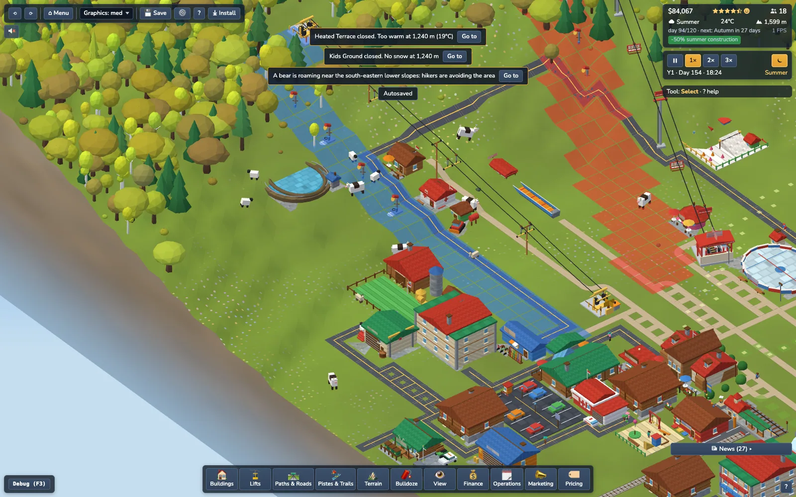
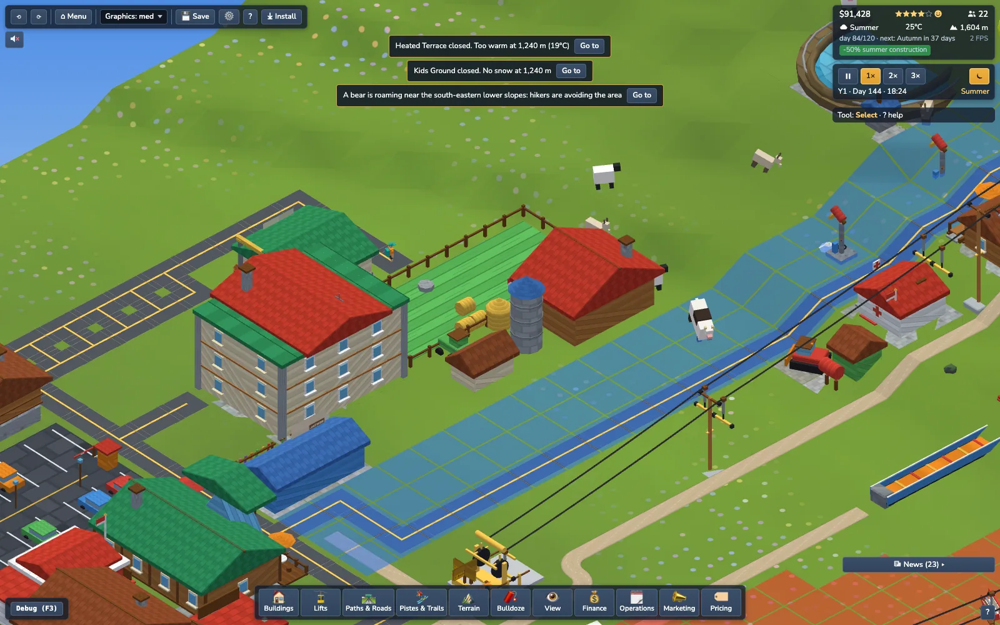
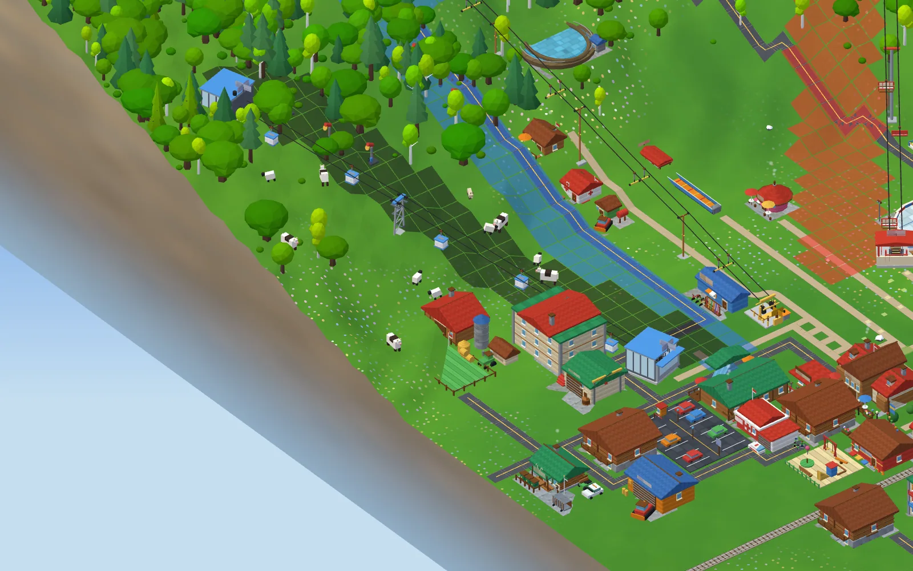
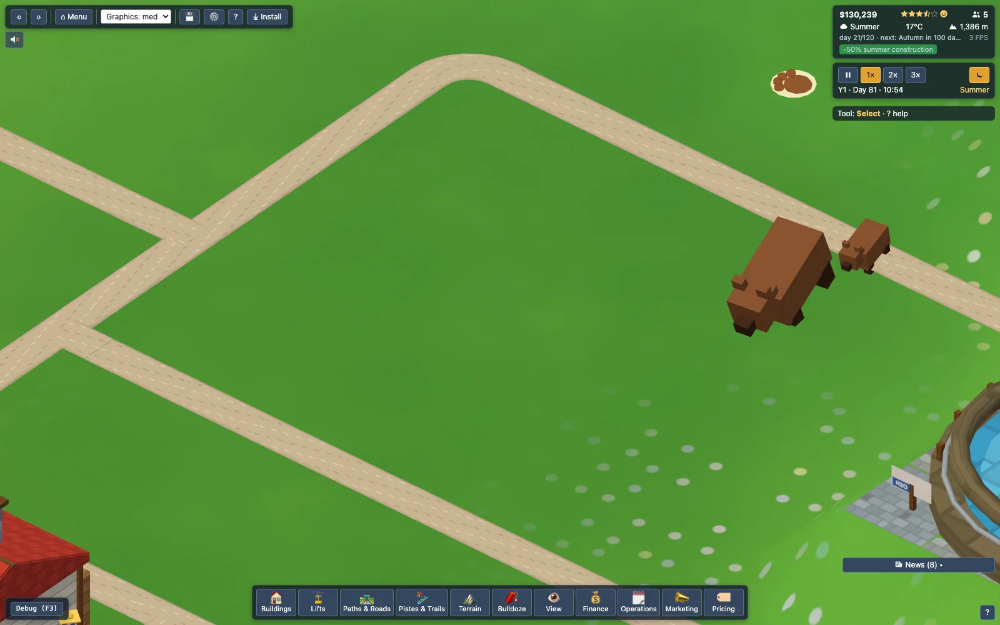
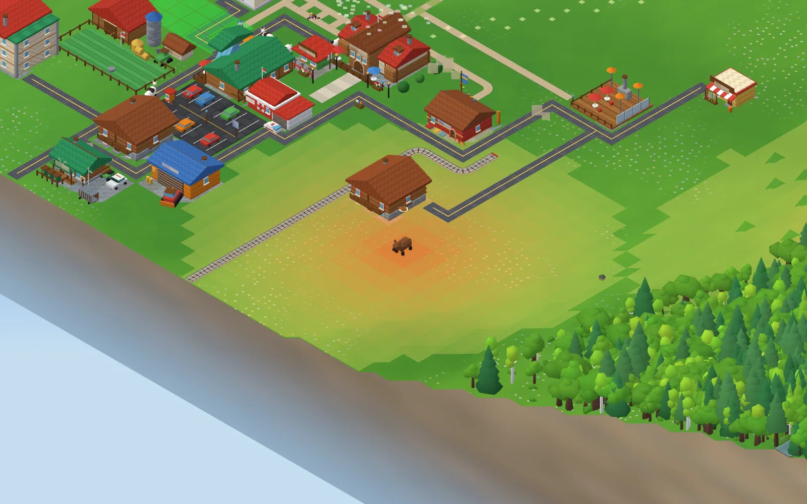
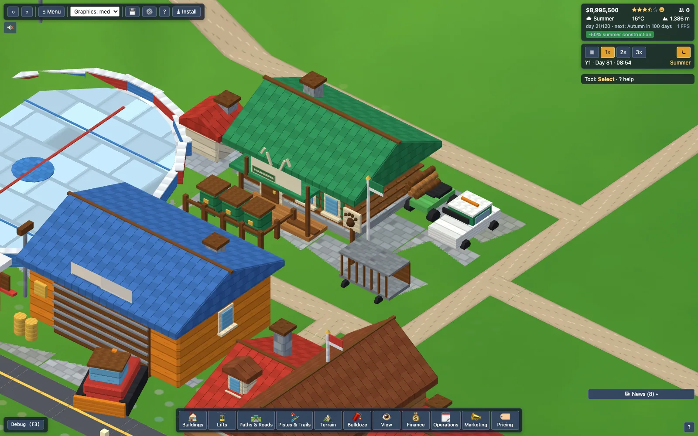

# Nature

Code: `src/sim/nature/{Fauna,Livestock,Planting,Nature}.ts`, render `src/render/{NatureView,Smoke}.ts`, meshes `src/render/meshes/Animals.ts`, tool `src/build/PlantTool.ts`. Everything is deterministic (seeded) and time-sliced; `createSim` ticks `nature` after the registry.

## Species
| Species | Habitat (alt frac / slope / forest) | Herd | Seasonal behaviour | Flee (tiles) |
|---|---|---|---|---|
| Deer | 0.04–0.55 / ≤1.6 / forest edge+ | 4–12 w/ leader | descends (alt ≤0.28) as snow > 0.3 deep; wolves hunt/scatter herds in winter | 9 |
| Ibex | 0.5–1 / steep ≥1 / little forest, rock bonus | 3–7 | winter band 0.4–0.8 | 14 |
| Chamois | 0.38–0.9 / ≥0.7 | 3–6 | winter band 0.3–0.7 | 12 |
| Marmot | 0.4–0.85 meadow / ≤1.2 | 3–6 | out 07–19h, hibernates (hidden) in winter | 6 |
| Fox | 0.05–0.55 forest edge | 1–2 | out 16–09h | 10 |
| Eagle | cliffs >0.5 | flock 2–4 | circles a shared, slowly drifting anchor (flock); out 08–18h | – |
| Cow / Sheep / Goat | farm pasture | 6 / 5 / 3 per farm | see below | – |

Bears/wolves live in `ops/Wildlife.ts` (see *Bears & wildlife management* below; hare/birds: not implemented). Counts scale with map area (herds per 128² map), capped 120/240/440 wild + livestock 14/40/100 (64/128/256).

## Motion (why animals used to look frozen, and the fix)
Causes found: fauna was stepped every 4th tick at 0.04-0.07 tiles/tick, leaders only re-targeted on arrival (so herds stood still for long stretches) and followers froze inside a 0.35 tile deadband; herds spawned uniformly, mostly inside forest where trees hide them (a 64 map had one deer herd).
Now: `Critter.mode` (graze / walk / rest / run) + `timer`. Leaders walk to a habitat-scored target, then graze 4-14 s (head-down pose, nodding) or rest (look up; marmots stand upright), then move on. Followers keep a personal offset to the leader, graze when near, and trot (up to 2.4x) when left behind, so herds stay cohesive (test: deer never > 14 tiles from their leader). Guests within the flee radius set mode `run` (2.2x speed, faster gait). Eagles are flocks of 2-4 circling one drifting anchor. Sim step every 2nd tick, speeds x1.5; herd counts scale with area^0.75 (min 2 herds per walking species), spawn points are biased towards the map middle and open meadow (`centreDist + 0.08*forest`).
Render (`NatureView`): frame-rate independent ease of position + shortest-arc heading (`easeToward`/`easeAngle`, exported + tested), on-screen speed drives the walk bob/pitch/roll amount, per-mode poses, per-species scale (1.35-1.6x so they read at default zoom). Not done: leg-swing animation (legs are merged static geometry), flee from vehicles (only guests are threats).

## Livestock (Alpine Farm)
Winter: barn (hidden). Early spring: paddock (r 4). Late spring: climb to snow-free meadows (r 12/18/24), one news line "The cows are heading up…" per year. Summer: graze, preferring higher tiles. Early autumn: Almabtrieb – descend; once 60 % are home one festival per year (news + happiness bonus nearby). Then paddock, barn. Farm shop = summer family attraction (`needs: snowFree`); active farms add +4 % (max 10 %) restaurant income outside winter.

**Where is the farm / cattle? (user report, fixed).** Livestock exists only when an Alpine Farm is built (Buildings, Recreation, $7,000; the Buildings card now says what it does) and now also in the demo resort (`buildDemoResort` medium + large: placed last, flattened, connected by path or, failing that, road), the 'Populate demo resort' debug action and New Game's pre-built resort when the start season is not winter. A one-shot hint 'Summer is here: an Alpine Farm ... ' (`summer.farm`, only without a farm, respects the Hints setting) and the tutorial's summer lesson point at it. The title-screen camera director has a `farm` point of interest (the herd centroid; null while the herd is in the barn).
Defects found and fixed with the harness (64 / 128 maps): (1) a farm placed before its path / road was connected never got animals, and animals appeared only on the *next* building event (herds now exist for every built farm); (2) herds spawned at the building centre / below the map edge for farms next to the edge and then never moved; (3) an unreachable pasture target was kept forever (cows stood at the barn door all summer): walk timer (700 ticks) + graze pauses, sidestep around buildings/water; (4) pistes and hiking trails were treated as solid so small maps had almost no pasture (only roads, rail, footpaths and buildings block now); (5) in winter cows never walked into the barn (the barn centre is a building tile): they go to the door and hide (or hide after 500 ticks if boxed in); (6) a date jump (`sim.jumpToDay`) left the herd where it was and waited for the 40-tick wake-up: a jump of more than 3 days now settles every herd into the new phase at once (barn / paddock / pasture); (7) pasture choice favours higher and forest-free tiles (trees hid cows), livestock render scale 1.35 -> 1.6 (cow) / 1.5 (sheep, goat).
Farm shop (summer family attraction, `needs snowFree`) served ~100 guests in 6 summer days in the demo; restaurants earn the +4 % farm bonus outside winter (tests: `tests/sim/nature/livestockFarm.test.ts`).

## Scenery & viewing
Guests within 5 tiles of a visible animal get a tiny happiness bump (per-guest cooldown, no news). `nature.scenery()` (50 % tree share, 30 % wildlife, 20 % livestock) feeds `RatingInput.scenery` (up to +2 rating points).

## Tree planting
Terrain drawer → Plant / Clear. Groups: conifer, deciduous, birch grove, shrubs. Brush 1–5, density 0.1–1. $12/tree ($4 shrubs, ×construction multiplier), clearing $6/tree, +$5 timber per mature tree. Rejected: map edge, water/ice, rock, slope > 2.2, any occupied tile (building, lift, path, road, rail, piste/trail layers), above tree line (0.88), spacing < 0.42 tiles, > 4 per tile. Saplings grow: 25 % → 60 % (30 days) → 100 % (120 days) via `PropStore.born`/`growthFactor`; chunks refresh every 5 days. Mature forest lowers avalanche release gain by up to 60 % (`forestProtection`). Keys: 1 plant, 2 clear, G species, `[ ]` brush.

## Smoke & night
Chimney offsets live in the catalog (`chimney`) for baseLodge, lodge, café, mountainHut, chalet, apartment, heatedTerrace, alpineFarm, rangerStation. Smoke when < 8 °C (full at −2 °C); chalets by overnight occupancy, restaurants at lunch/dinner; ≤16 emitters, LOD by zoom, offscreen not spawned, 1 draw call. Window glass (vertex colour) glows warm via `BuildingMeshes.setNight`.

## Perf
Sim: ~0.01 ms/tick average on 128 (test log), max ~0.3 ms. Render budget unmeasured (no WebGL here).

## Bears & wildlife management (Task: bears roam, scare guests, Ranger Station)
Code: `src/sim/ops/Wildlife.ts` (all sim), `src/render/IncidentView.ts` + `meshes/Animals.ts` (bear/cub/ranger ATV/paw marker), `meshes/buildings/ranger.ts`, Coverage kind `wildlife`, overlay mode `threat`, news in `ui/newsFormat.ts`.

**Roaming.** Every bear has a den (spread out, in remote forest) and a home range (`terr` = 15 tiles, wolves 24). Cycle: *rest* (14-44 ticks) -> *wander* to a random free tile inside the range (0.1 tiles/tick, slightly biased to remote tiles) -> *forage* (head down, 8-22 ticks) or rest. Stalking prey / fleeing are faster (0.3). Bears may walk anywhere >= 2 tiles from a building/path in forest (so the range can touch trails and huts); the render eases positions, turns by shortest arc, bobs while walking and lowers the head to forage. About a third of the bears are mothers with a cub (render only). A floating paw marker above awake bears is the 'bear sighted' icon (visible above the tree canopy). Counts (limited by remote forest, 1 bear per 90 remote tiles): 1-3 / 2-4 / 4-8 bears on 64 / 128 / 256 maps (+1/2/4 wolves). **Seasons:** hibernation in winter (teleport to den, hidden, no threat), 70 % active in spring, full in summer; **autumn hunger**: range x1.6 and the next wander target is the candidate closest to buildings/paths (more encounters) unless bear-proof bins cover the bear.

**Threat field** (`wildlife.threat`, 0..255 per tile, recomputed every tick: ~0.02 ms on 256 maps with 8 bears): a disc around the bear's CURRENT position, radius 10 + 8 x activity tiles (rest 11, wandering 15, hungry autumn 18; x0.4 while hazed), linear falloff, plus a weak persistent territory footprint (30 % peak, fades to 15 % at the range edge; halved inside ranger coverage). View it with overlay *Wildlife threat* (View drawer / key O); *Ranger coverage* shows the station radius.

**What guests do.**
1. *Avoidance* (revenue): `Decider.avoidTile` = threat x (0.55 + 0.45 x scare level) (x0.35 inside a staffed ranger station's radius). Hike/MTB tile scores lose 1.1 x avoidance, hikers/bikers sample two trail ends and take the safer one, attractions/huts lose 0.8 x avoidance at their centre. Trail use falls, so passes, rentals and hut meals are lost.
2. *Scare* (every 3 ticks per bear): guests (walking/idle, not riding/queueing/inside) within 65 % of the field radius (6.5-11.7 tiles) get happiness -0.12, a 'Saw a bear!' thought (guest inspector), their activity is aborted (they re-decide and steer away) and 12 % of unhappy ones leave. 60-tick cooldown per guest.
3. *Reputation*: each scared guest adds 1 to a decaying counter (x0.85/day); `scareLevel = 1 - exp(-recent/12)`. It lowers arrivals (x(1 - 0.2 x level)) and the Safety rating component (up to -30 points, hint 'Wildlife is scaring guests: build a Ranger Station').
4. *Attacks* stay rare: Warning Signs x0.4 and patrol coverage x0.5 attack chance (signs do NOT stop scares), rangers x0.78 (`attackCut`).

**Events / news (low volume).** `wildlife:scare` {animal,id,x,y,tile,guests,areaName}: at most one per bear per 1200 ticks (5 days) ('A bear is roaming near Upper Meadow Trail: hikers are avoiding the area'; important tier when >= 4 guests were scared, otherwise an info-tier digest count). `wildlife:hazed` {..., station}: trivial (digest counter only). `wildlife:relocated` {x,y,toX,toY,station,cost}: important. `incident:wildlife` is unchanged.

**Ranger Station** (Safety & Ops, $9,000, upkeep $25/day, 4x3, road or path access, <= 2 slope with auto-flatten, no pistes, no prerequisite - better inside Ski Patrol coverage but independent; coverage radius 35):

* *Deterrence*: inside its radius the bear's field radius x(1 - 0.6 x 0.45) and the scare radius x0.55; guests caught between the two radii count as **prevented scares**. A station with 0 rangers only gives 18 % deterrence.
* *Response*: when a bear has guests/paths in its conflict range, a free ranger (staff 0-4, default 2, +/- in the inspector; extra rangers cost $30/day) drives an ATV (2.5 tiles/tick) to it. **Hazing** ($40, `wildlife:hazed`): the bear bolts to the remotest tile within 10-20 tiles and its den creeps 40 % that way (territories drift away from trails); no stalking for 40 ticks. After 3 hazings (log decays every 2 days) the next response is **tranquilise + relocate** ($600, 8 ticks, bear hidden): new den at the best of 14 random remote tiles by distance + remoteness, then a 1200-tick (5 day) relocation cooldown (hazing only meanwhile).
* *Bear-proof bins* ($1,500 one-off, inspector button): autumn hunger no longer pulls bears towards civilisation inside the station radius.
* *Inspector*: rangers ready, bears in range, hazed/relocated, 'Prevented scares this month: N - est. revenue saved $X' ($35 per prevented scare, $70 per haze, $210 per relocation).
* Debug switches on `Wildlife`: `enabled` (no animals), `rangersEnabled` (ignore stations); `__slope.debugPlace(type,x,y)` places a building from the visual-QA harness.

### Balance numbers (`tests/game/wildlifeRevenue.test.ts`)
Summer starter resort (64 map, seeds 1-4, 20 days each) with a hiking + MTB trail and one bear whose den is ~4 tiles from the trail middle (worst case). The Ranger Station exists in every arm, only its effect is switched.

| arm | hiking + MTB uses | total income |
|---|---|---|
| no bears | 497 | $52,696 |
| bear, no rangers | 401 (-19 %) | $49,676 (-6 %) |
| bear + rangers | 474 (-5 %) | $49,155 (-7 %) * |

\* Income differs by +-10 % per seed from chaotic guest-flow changes alone (a bear changes which guests walk where), so only the usage numbers and the 4-seed income sum are asserted (bear < baseline, > 75 %); usage is the clean measure: -19 % without, -5 % with rangers (57 scares prevented, 2 suffered vs 7). Arrivals are unaffected in these runs (scare level stays < 0.05); a bear that keeps scaring crowds (>= 30 scares in a week) costs up to 20 % of arrivals and 30 rating points of Safety.
Perf: wildlife step incl. field + scares 0.02 ms/tick (256 map, 8 bears + 4 wolves, 3,000 guests; `[perf]` test < 0.3 ms).
Not done: a dedicated 'running away' guest pose (scared guests abort their activity and re-path; figures keep the normal gait); footprints.

## Hiking interplay

Excursionists respect the bear threat field: a guest whose current route tile has `avoidance > 0.35` turns back along the same route (or ends in place on the return leg), and `scare` turns an excursion back instead of aborting it. Trekkers sleeping in a Mountain Hut are indoors (not rendered, not scareable). See `docs/hiking.md`.
