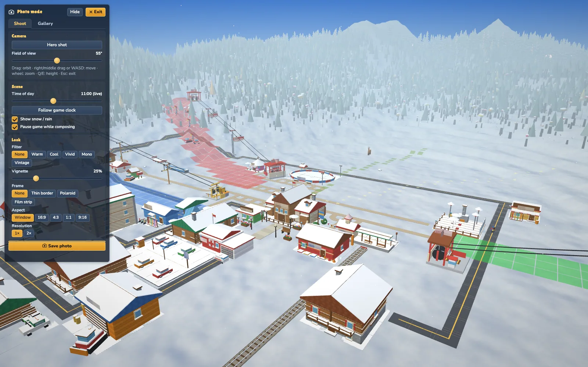
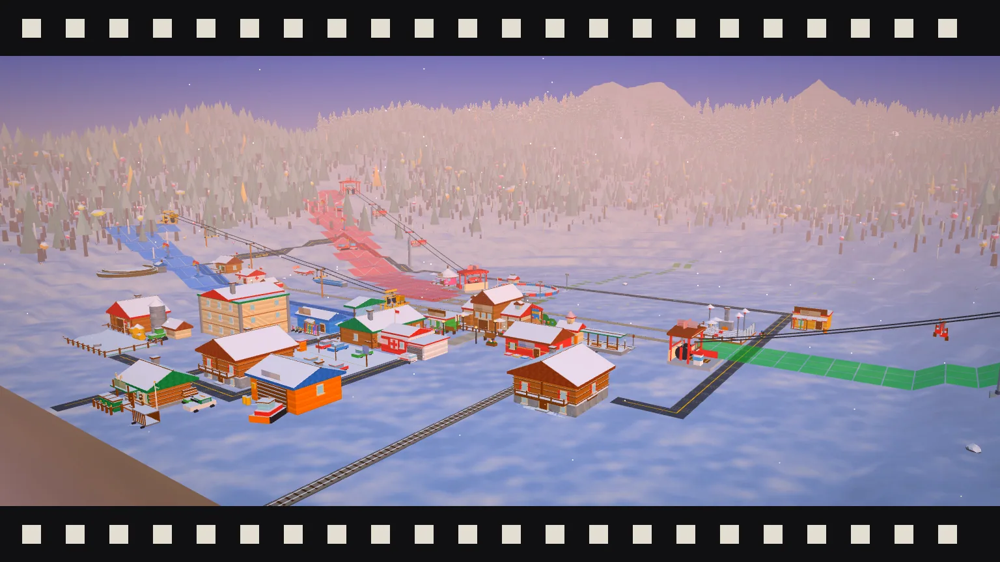

# Photo mode (M5.2)

Enter with **P**, the camera button in the top bar, or *Photo mode (P)* in the View drawer (from the iso view or from a ride-along). **Esc / P / Exit** returns to the exact previous view (iso pose bit-for-bit; a ride-along resumes, or ends with a note if the guest left meanwhile).

Everything is **render only**: `stateHash` is identical with photo mode on (tests/render/photoMode.test.ts runs 2 sim days). Photos are **local**: a PNG download plus a device-only gallery. There is no sharing of any kind (plan D8): no Web Share API, no links, no codes (`tests/repo/noSharing.test.ts`).

## Code
* `src/render/view/PhotoMode.ts`: settings + `sanitizeSettings`, orbit maths (`orbitPose`, `orbitFromPose`, `panFocus`, `heroState`, pure), input handling (capture-phase window listeners, only active in photo mode), `capture()` and `downloadBlob()`, `HourOverride`.
* `src/render/view/postfx.ts`: pure pixel routines: colour filters (the CSS `filter()` matrices), vignette, frames, aspect/size clamp, sky paint, `compositeExport`, file name.
* `src/ui/components/StPhoto.ts`: the panel + live preview layer (aspect mask, vignette, frame). `src/persist/PhotoStore.ts`: gallery. `Sfx 'shutter'`.
* main.ts: `enterPhoto / exitPhoto / savePhoto`, `body.view-photo` CSS (hides every `#ui` child except `st-photo` and the toasts), key handler (capture phase, before the ride handler and the pause-menu handler).

## Controls
Drag = orbit (yaw / pitch), right / middle drag or Shift+drag or W A S D / arrows = move the focus (Shift = 3x), wheel = dolly, Q / E = lower / raise the focus (0..60 above the surface), Enter = save, Space + - . , still control time. The camera never goes below the surface (+0.6 clearance; the pitch is raised) and never leaves the map by more than 25 %. No smoothing or animation at all, so reduced motion is respected by construction.
Start pose: from iso, a perspective view of the same spot (focus = iso target, yaw = iso yaw, pitch -0.62, distance from the ortho view height); from a ride, exactly the ride camera (focus 12 units ahead). **Hero shot** = 3/4 view of the lodge (yaw 0.62, pitch -0.3, lift 2.5, distance `clamp(map * 0.2, 16, 40)`). **Follow guest** (only when entered from a ride) keeps the guest as the focus (distance 7, pitch -0.22).

## Panel
* Camera: Hero shot, Follow guest, FOV 20..90 (default 55; from a ride the ride FOV).
* Scene (all render-only): time of day (0..24 h, 15 min steps, "Follow game clock" returns to live; overrides the same lock as the debug panel's time slider and is restored on exit), Show snow / rain (hides the particle layer only, not the weather), **Pause game while composing** (default on: pauses with speed 0 and restores the previous speed on exit, unless you un-paused yourself).
* Look: filters None / Warm / Cool / Vivid / Mono / Vintage, vignette 0..100 %, frames None / Thin border / Polaroid / Film strip, aspect Window / 16:9 / 4:3 / 1:1 / 9:16 (a dim mask shows the framed area), resolution 1x / 2x.
* Gallery tab: thumbnails, click = larger view with **Save again** and **Delete**, **Delete all** (asks twice). Collapsible (Hide / Show) so the whole frame is visible. Under 700 px wide it becomes a bottom sheet.

## Export (how the PNG is made)
1. The framed rect (`aspectRect`) defines the output: 1x = the on-screen pixels of that rect (css px x device pixel ratio), 2x = double, clamped by `clampExportSize` to the GPU max texture / renderbuffer size and **16 megapixels** (aspect preserved; the status line says when it was limited).
2. The WebGL canvas is resized to that size for ONE synchronous render with the vertical FOV cropped (`cropFov`) so the PNG shows exactly the framed rect, copied with `drawImage` right after rendering (no `preserveDrawingBuffer`), then everything is restored.
3. The renderer's canvas is transparent (the sky is a CSS gradient behind it), so `paintSkyBehind` composites the same gradient (`skyGradient` of the current lighting, horizon stop at `horizonFraction(pitch, fov)`) UNDER the pixels. The fog colour is that horizon colour, so the distance melts into the paper sky as on screen.
4. Colour filter (matrix applied to sRGB bytes, same maths as the CSS functions used for the live preview), vignette, frame. Every pixel is opaque afterwards.
5. `toBlob('image/png')` -> object URL -> `<a download="slope-tycoon-<resort>-<yyyy-mm-dd>.png">`. Browsers without `download` support (old Safari) open the blob in a new tab instead. A 256 px JPEG thumbnail goes to the gallery with the PNG.
6. Quiet double-click `shutter` sound (not "loud": unaffected by reduce-loud), toast "Photo saved".

## Gallery (`PhotoStore`)
IndexedDB database **`slope-photos`** (separate from the save database `slopetycoon`, whose schema is untouched), stores `meta` (listing + thumbnail bytes) and `full` (PNG bytes). Cap **30**, oldest evicted (inside the same transaction as the add). A quota error evicts the oldest photo and retries up to 3 times, then the add fails with `StorageError('quota')`: the download already happened, the status line says the gallery could not store it. Without IndexedDB the tab explains it and downloads still work.

## Not included
* **Depth of field / tilt-shift**: skipped (needs a second pass or a blurred duplicate: costly and not worth it on the targeted GPUs).
* Roll, hide-guests toggle: not implemented. Smoke is hidden (its point size assumes the ortho camera); floating text, emotes and overlays are hidden like in ride mode.
* The live CSS filter is applied to the canvas container (sky included), the vignette / frame preview are CSS approximations of the export maths.

## Harness
`npm run shot -- --size 128 --seed 61 --start winter --hour 11 --pre "__slope.populateDemo('medium'); __slope.spawnGuests(200,'skiers')" --ticks 600 --view photo --photo-hero 1 --freeze 1 --out photo-x`
Options: `--photo-filter warm|cool|vivid|mono|vintage`, `--photo-frame thin|polaroid|film`, `--photo-aspect 16:9|4:3|1:1|9:16`, `--photo-hour 17.4`, `--photo-vignette 40`, `--photo-fov 40`, `--photo-scale 2`, `--photo-orbit "yaw,pitch,dist"` (after the hero preset), `--photo-from ride` (enter from a ride-along), `--photo-save 1` (headless export to `.weave/shots/photo-export-<out>.png`; logs `[photo-export] WxH rawTransparentPx(before sky)=N transparentPx=0 skyTransparentPx=0` and records an error if any pixel is transparent). Page API: `__slope.view.photo.{enter, exit, set, hero, capture, settings, orbit}`.
