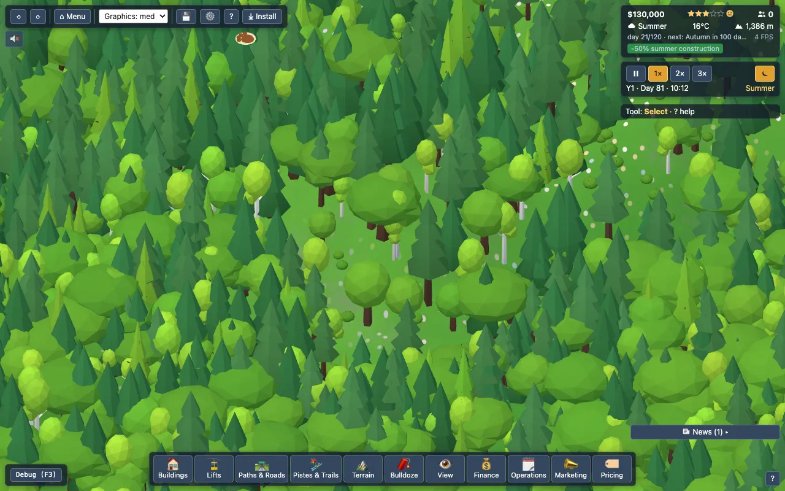
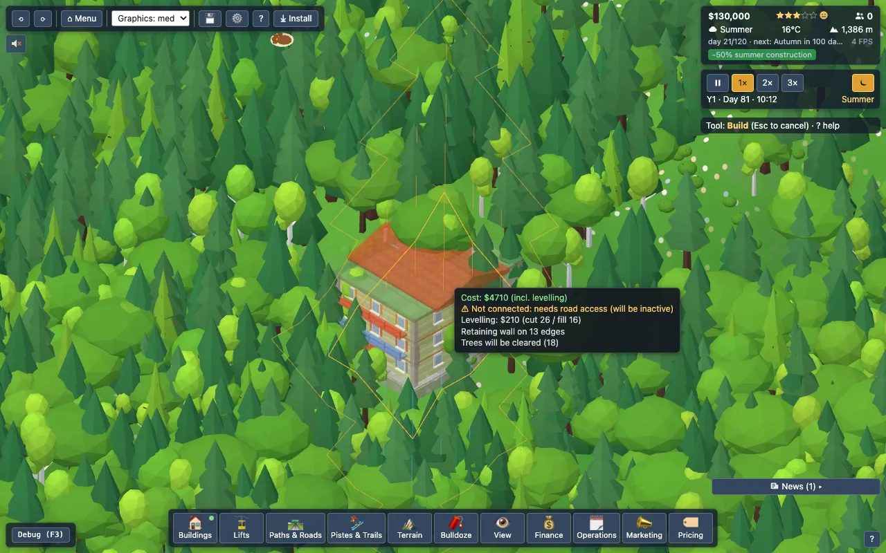
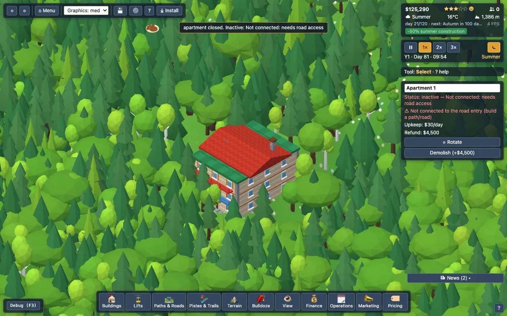
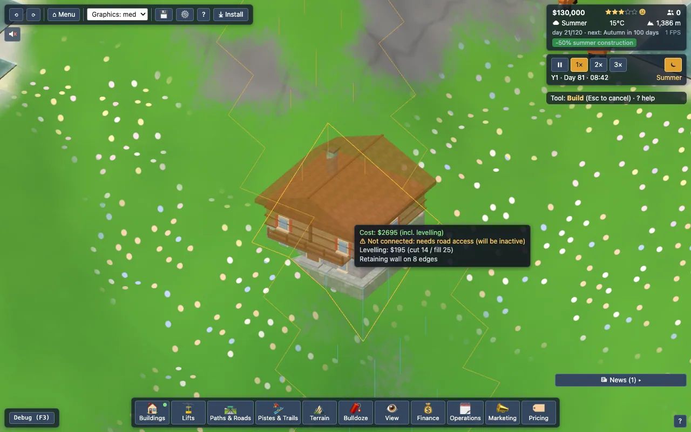
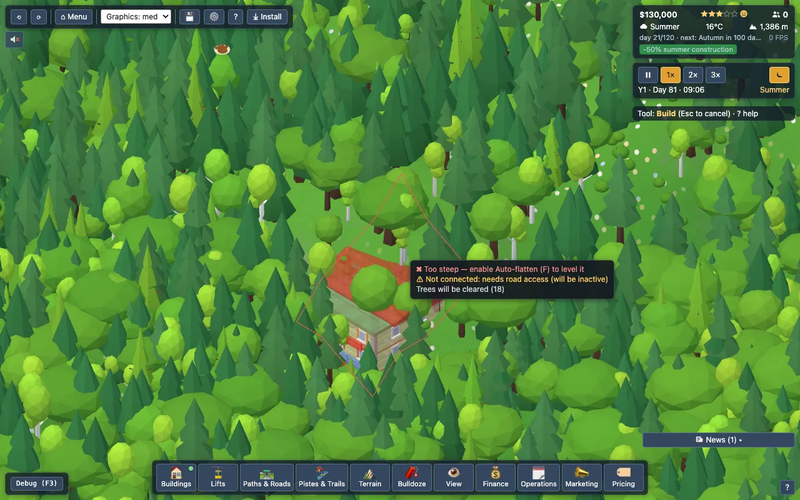

# Placement rules

All rules are data in `src/config/buildings.ts` (`access`, `altAccess`, `pisteRule`, `site`, `maxCount`) and `src/config/lifts.ts`; `validatePlacement` has no per-id logic. Query them with `describeRules(id)` / `placementHints(id)` (`src/sim/PlacementRules.ts`).

## Rule semantics

- **access** (`road` | `path` | `rail+path` | `pisteEdge` | `trail` | `none`, plus optional `altAccess`): *never blocks placement*. Without it the building is inactive with reason `Not connected: needs …` (placement preview shows it as a warning). `path` = footprint touches a footpath/road connected to the road entry; `road` = touches a road connected to the entry; `rail+path` = both; `pisteEdge` = footprint on/next to any piste layer; `trail` = footprint on/next to a Hike / MTB trail tile of an *attached* trail (see [trails-access.md](trails-access.md)).
- **overRail** (Train Station only): the footprint may overlap rail tiles (footpaths/roads still refuse it). The platform sits ON the end of the line: the rail tiles stay in `Networks` (kept, counted as connected, drawn under the model's own track bed), nothing is deleted or refunded, so place/undo/bulldoze/save/load need no special handling; the rail Bulldoze refuses tiles under a building. Without access the ghost tip reads *Place the station on the end of a rail line, with a footpath next to it* (`BuildingDef.placeTip`).
- **pisteRule**: `forbid` – no footprint tile may carry a piste/trail layer (also: a piste cannot be painted over such a building); `allow` – may stand on a piste (and pistes may be painted over it); `edge` – not on a piste tile, intended beside one.
- **site.maxSlope / slopeKind**: corner spread across the footprint in half-steps tolerated without flattening ("flat" = ≤1). `any` = no limit (cannon, sign). `gentleSlope` (Magic Carpet) = monotone uniform gradient along the long axis, rise 2–6 half-steps, cross-slope ≤1, **not flat**.
- **site.autoFlatten**: `default` on by default (toggle with F), `optional` off by default, `never` never touches terrain. Flatten cost is shown in the preview and the placement is refused if unaffordable. Levelling is planned by `src/world/FlattenPlanner.ts` (cut & fill pad + apron / retaining wall, see "Auto-flatten: cut & fill" below). It never touches water/streams, buildings or lifts (or pistes, outside the pad); footpaths/roads/rail under the blend are tolerated (they re-drape, dirty chunks refresh the network meshes) provided road/rail keep their max slope; lift cable clearance is checked via `Buildings.liftClearance`; trees on the footprint are cleared (apron trees stay and re-seat on the new ground).
- **def.streamAdjacent** (Small Hydro): the footprint ring (1 tile) must touch a stream tile; reason `Must be next to a stream`; dependency-checked like the lake rule, so a hydro whose stream is later changed becomes inactive. The stream itself is never built on. Green buildings (Solar Array / Plant, Wind Turbine with `minAltitude` 20, Small Hydro, Biomass Heating, Tree Nursery, Recycling Centre): category `energy`, docs/energy.md.
- **site.onWater**: `never` (all but lake types), `lakeEdge` (Boat Rental, Beach: dry footprint touching a lake), `shallow` (supported, unused). Streams are never buildable (bridges are for paths/roads only).
- **site.forest** (`{ minTrees, radius, keepTrees }`, treehouse): needs `minTrees` real trees within `radius` tiles or the placement is refused with `Needs forest around it`; trees are not felled (see [viewpoints.md](viewpoints.md)).
- **site.allowRock**: footprint may sit on Rock tiles (huts, cannon, sign only).
- **min/maxAltitude**: supported (mean footprint corner height) but no catalog entry sets one yet.
- **maxCount**: Base Lodge, Train Station, Altiport = 1.
- Always: footprint ≥1 tile from the map edge; no overlap with buildings, roads, paths, rail, lift corridors/stations/towers; trees are auto-cleared; all failing reasons are listed, not just the first.
- Snowmaking Cannon / lake users: water source = a Reservoir **within pipe range (24 tiles)** or a lake within 12 tiles.

## Lifts: what is under the cable
Lift validation also checks trees / shrubs (mature canopy), building roofs and other lifts' towers / stations under the line (carrier bottom + 0.3 margin): see [lifts-clearance.md](lifts-clearance.md). Trees the cable cannot clear can be cut as a lane (default on, "Clear forest lane (L)", the preview says how many and what it costs); buildings taller than 2.0 are never overflown (`Cable would hit <Building>`); the Plant tool refuses trees that would grow into an existing cable.

## Buildings × rules

| Building | access | pisteRule | slope | autoFlatten | water | rock ok | max | Season |
|---|---|---|---|---|---|---|---|---|
| Base Lodge | road | forbid | flat | default | never | no | 1 | all |
| Lodge/Restaurant | road | forbid | flat | default | never | no | – | all |
| Café | path / pisteEdge | forbid | flat | default | never | no | – | all |
| Mountain Hut (12 trekker beds) | pisteEdge / path / trail | edge | ≤2 | optional | never | yes | – | all |
| Shop | path (road counts) | forbid | flat | default | never | no | – | all |
| Rental | road | forbid | flat | default | never | no | – | all |
| Chalet | path (road counts) | forbid | flat | default | never | no | – | all |
| Apartment | path (road counts) | forbid | flat | default | never | no | – | all |
| Ski School HQ | path | forbid | flat | default | never | no | – | winter |
| Magic Carpet | path / pisteEdge | allow | gentle slope | never | never | no | – | winter |
| Kids Ground | path | forbid | ≤2 | optional | never | no | – | winter |
| Playground | path | forbid | flat | default | never | no | – | shoulder |
| Ski Patrol Hub | road | forbid | flat | default | never | no | – | all |
| Ranger Station | road / path / trail | forbid | ≤2 | default | never | no | – | all |
| Toilets | path / trail / pisteEdge | edge | ≤2 | optional | never | yes | – | all |
| First-Aid Hut | none | edge | ≤2 | optional | never | yes | – | all |
| Helipad | none | forbid | flat | default | never | no | – | all |
| Groomer Garage | road | forbid | flat | default | never | no | – | winter |
| Snowcat Outpost | none | forbid | ≤2 | optional | never | yes | – | winter |
| Reservoir | none | forbid | flat | default | never | no | – | all |
| Snowmaking Cannon | none | allow | any | never | never | yes | – | winter |
| Boat Rental | path | forbid | ≤2 | optional | lake shore | no | – | summer |
| Beach | path | forbid | flat | default | lake shore | no | – | summer |
| Ice Rink | path | forbid | flat | default | never | no | – | winter |
| Heated Terrace | path | forbid | flat | default | never | no | – | winter |
| Après-Ski Bar | road or path | forbid | flat | default | never | no | – | winter |
| Stunt Park | path / pisteEdge | allow | flat | default | never | no | – | winter |
| Adventure Park | path / trail | forbid | flat | default | never | no | – | summer |
| Train Station | rail+path (may stand on the end of the rail) | forbid | flat | default | never | no | 1 | all |
| Altiport | road | forbid | flat | default | never | no | 1 | all |
| Shuttle Bus Depot | road | forbid | flat | default | never | no | – | all |
| Warning Sign | none | allow | any | never | never | yes | – | all |
| Parking | road | forbid | flat | default | never | no | – | all |
| Alpine Farm | path / road / trail | forbid | ≤2 | optional | never | no | – | summer |
| Ticket Office | path | forbid | flat | default | never | no | – | all |

## Lifts

**Season column** (`BuildingDef.season`, derived from `needs` + a few overrides): `all` = useful all year; `winter` = ski season (needs snow/cold, ski operations); `summer` = summer attractions (warm / snow-free); `shoulder` = snow-free ground (spring to autumn). It never blocks placement: it only orders the Buildings drawer (see *Drawer ordering by season* below).

| Lift | bottom station | top station | on piste | towers | flatten |
|---|---|---|---|---|---|
| T-Bar, Chairlift, Gondola, Cable Car, Funicular | access `path` (inactive/“Not connected” warning otherwise) | `none` | stations: allowed | allowed on piste tiles (as in real life), never on buildings/roads/paths/water | station footprints flat, auto-flatten default on; towers never flatten |

`liftAccess()` / `liftConnection()` in `src/sim/Lift.ts` return the missing-access reasons; `validateLift` puts them in `LiftCheck.warnings` (needs `LiftEnv.access`). Stations are also kept 1 tile from the map edge.

## Terraform on occupied tiles

Manual terraform (raise/lower/flatten/smooth) is still blocked when any changed corner touches *any* occupied tile (building, lift, path, road, rail) or water. Only building/lift **auto-flatten** tolerates paths/roads/rail (see above).

## Terrain slopes (generation targets)

Terrain is shaped (`shapeTerrain` in `src/world/TerrainGen.ts`, constants in `config/balance.ts`: `TERRAIN_RELIEF_128`, `TERRAIN_RELIEF_EXP`, `TERRAIN_TALUS`, `TERRAIN_TALUS_CLIFF`, `TERRAIN_TERRACE`, `TERRAIN_FREQ_SCALE`): soft terraces, thermal erosion (talus 0.55 half-steps/tile, 2 on cliff bands/summit cone) and guaranteed flat benches (2/3/5 on 64/128/256, kept dry of lakes) for stations and buildings. Relief is ~30/52/90 half-steps on 64/128/256. Asserted in `tests/world/Slopes.test.ts`: median steepness ≤0.75, ≤20% of tiles ≥1.5, ≤8% =2, ≥55% beginner+intermediate (≤1), ≥2 benches (5×5 tiles ≤0.5 at mid altitude). Summit plateaus (flat, >95% relief) are no longer rock.

## Auto-flatten: cut & fill (FlattenPlanner)

### Why a forested hillside near a road was red (root cause)

Reported: Chalet, Auto-flatten ON, forested slope near a road, ghost red, no visible reason. Three separate causes:

1. **The old ripple could not terminate.** `flattenRect` set the pad to its mean height and BFS-propagated with an adjacent-vertex limit of **1 half-step**. A natural slope of `g >= 1` half-step/tile is never "absorbed" by a 1-step apron: if the pad is cut `d` below the hillside the uphill ground must come down by `d` **everywhere uphill** (and fill `d` everywhere downhill), so the ripple ran across the map until it hit water (`Cannot flatten next to water`), a building/road whose slope limit broke (`Cannot flatten next to other buildings`), or a lift. Candidates that did pass moved thousands of half-steps (mean levelling cost **$4,400-5,000** for a $2,500-9,000 building).
2. **Nothing displayed the tooltip.** `PlacementTool` wrote `Overlays.setTooltip(...)` but no consumer was ever attached to `Overlays.onTooltip`, so *no reason text was ever on screen*. New: `src/ui/GhostTip.ts` (plain DOM, pointer-events none) wired in `main.ts`.
3. The reason texts did not say what to do ("Too steep", "Cannot flatten next to other buildings" for a road-slope veto).

### Failure histogram before the change (`scripts/placement-survey.ts --legacy 1`)

Samples every 2nd position (both rotations) of the 20 flat-needing building types on seeds 61/7/23 (64) and 5 (128), counting only candidates **without hard blockers** (footprint on water/building/road/lift/rock, or a footprint corner touching water/building/lift): 175-196k candidates per run.

| Reason (old auto-flatten) | empty map | starter resort (roads, paths, lifts, pistes) |
|---|---|---|
| `Cannot flatten next to water` (ripple reached a lake/stream) | 10,536 | 10,495 |
| `Cannot flatten next to other buildings` (ripple hit a building, or a road/path/rail exceeded its slope limit) | 9 | 7,754 |
| `Too steep` (flatten reported `nochange`/lift clearance) | 0 | 518 |
| `Cannot build on a piste` (not a flatten problem) | 0 | 560 |
| **placeable** | 94.6% | 89.3% |
| of candidates that needed levelling (footprint spread > 1) | 91.5% | **83.5%** |
| steepness 1-1.5 | 92.8% | 85.3% |
| steepness 1.5-2 | 89.8% | 83.6% |
| mean cost of the successful levellings | $4,359 | $4,982 |

Not causes: trees (always auto-cleared), protected zones (none exist), a "too steep" cut-off, `maxEdgeDelta`'s diagonal rule, funds (a separate reason). The 1-half-step apron limit (cause 1) is the real one.

### The planner

`planFlatten(grid, rect, opts)` (pure; reads the grid, mutates nothing) evaluates candidate plans and returns the cheapest valid one:

* **Pad height H**: around the mean (±3), the median (±1), min and max of the footprint corners. **Tilt**: 0 (a true plane) or the site's slope tolerance (1 half-step: corners are clamped into `[H, H+1]`, half the earthwork).
* **Apron**: step **1** (gentle) or **2** (steep apron = the retaining wall: the largest step the terrain invariant allows, corner spread <= `MAX_TILE_DELTA` = 2, i.e. a one-step cliff edge around the pad). A wall is chosen only when it saves real earthwork (`WALL_PENALTY` = 14 half-steps) or is the only way out. `wallEdges` counts pad-boundary edges with a step of 2.
* The apron is propagated outward from the pad inside a margin window (10 vertices). A candidate **fails** when the apron would move a *frozen* vertex (any adjacent tile with water/stream, building, lift; or - outside the pad - a piste tile), leave the window, change one vertex by > 14 half-steps, or when the caller's `validate` hook vetoes it: road/path/rail slope limits (`networkSpreadViolations`) and lift cable clearance. Roads/paths/rail are *not* frozen: they re-drape, as long as they keep their limit.
* Score = moved half-steps (+4 for a tilted pad, +14 for a wall); candidates are tried in ascending pad cost, so the search stops early. Deterministic.
* Result: `changes` (corner from/to), `cut`/`fill` (half-steps), `cost` = `halfSteps x TERRAFORM_COST_PER_HALF_STEP x constructionMultiplier` (scales with moved volume), `wallEdges`, `area`, `failKinds` histogram, and the most telling `fail` (`water|building|lift|piste|network|clearance|earthwork|range|invalid`).
* Integration: `validatePlacement` builds the frozen/validate hooks (`planPad`) and returns `flattenPlan` (cut/fill/height/base/wall edges/changes), `info` (`Levelling: $X (cut a / fill b)`, `Retaining wall on N edges`, `Trees will be cleared (N)`), `hints`/`hintFor` and `warnings`; `placeBuilding` re-plans (identical, pure) and commits; touched chunks include every chunk around a changed corner so props, roads and path meshes refresh. Terraform.ts / manual terraform / lifts are unchanged (lift stations still use `flattenRect`).
* Hard physical limit (documented, tested): a uniform natural slope of `g >= 2` half-steps/tile (the invariant's maximum) cannot be levelled at all, and slopes between 1.5 and 2 only with a long apron; these are reported as `Cannot flatten here ... too steep to level, even with a retaining wall`.

### Before / after (same candidates, auto-flatten ON)

| | before | after |
|---|---|---|
| placeable, empty map (196k candidates) | 94.6% | **99.6%** |
| placeable, starter resort (175k) | 89.3% | **99.1%** |
| needed levelling, starter resort (steepness <= 1.5) | 83.9% | **99.4%** |
| steepness 1-1.5, starter resort | 85.3% | **99.4%** |
| steepness 1.5-2 / >= 2, empty map | 89.8% / 87.3% | **95.7% / 98.6%** |
| mean levelling cost | $4,359-4,982 | **$222-229** |
| candidates that use a retaining wall | n/a | 46% |

Remaining failures (starter resort, 1,150 of 175k): `Cannot flatten here` 625 (too steep to level), water 297, piste 114, buildings 84, lift 36. `tests/world/FlattenPlanner.test.ts` asserts >= 90% on seeds 61/7 (64) and 5 (128), determinism, invariants after 12 committed placements per map, cost > 0, and that no plan ever changes a corner next to an occupied/water tile; `tests/build/placementFlatten.test.ts` covers the chalet-on-a-forested-slope case, hints, warnings, roads in the apron, policy fields and rotation.

Rotation is untouched: `validateRotation` validates the rotated footprint with auto-flatten **off** (rotating never reshapes terrain). Auto-flatten policy fields are unchanged (`default` on for the flat-needing types incl. Chalet, `optional` huts etc., `never` for Cannon, Sign, Magic Carpet).

### Ghost feedback

* **Tooltip** (`src/ui/GhostTip.ts`, fed by `Overlays.onTooltip` with structured `lines`): every blocking reason in red (`x`) with its hint on the same line (`Too steep - enable Auto-flatten (F) to level it`, `Cannot flatten next to water - the levelled slope would run into water at 8,14: move away from the lake/stream`, `Cannot flatten: road would get too steep`, `Tile occupied - pick a free spot` ...), then **warnings in amber** (`Not connected: needs road access (will be inactive)`: placement stays allowed), then neutral notes (`Levelling: $195 (cut 14 / fill 25)`, `Retaining wall on 8 edges`, `Trees will be cleared (18)`).
* **Colours**: red = blocked, amber = allowed with a warning, green = fine, for the outline *and* the ghost's glow. The outline is always the real footprint rectangle. The levelled area is a separate faint overlay (`Overlays.setTerraformPreview`): an outline of the changed tiles plus a tick per changed corner (orange = cut, blue = fill). The ghost sits on the levelled pad height.
* Debug hooks for the harness: `__slope.startPlacement(type)`, `__slope.refreshProps(chunks)`.

Not done: a dedicated retaining-wall *mesh* (the one-step edge renders as the terrain's steep face above the existing building foundation flagstones; a stone wall mesh along `wallEdges` is a possible follow-up), pistes are only protected outside the pad (a footprint on a piste is already refused by `pisteRule`).

## One source of truth for 'Not connected'

`PlacementRules.accessProblem(type, net, rect)` (also `Networks.accessProblem(buildingId)`) is the only access verdict: it is `null` for remote types (`access: 'none'`) and otherwise `accessReason(def)`, generated from the rule and used verbatim as the inspector status: `Needs a road next to it` (road), `Needs a footpath or road next to it` (path; road counts), `Needs a footpath, road or piste next to it` (Mountain Hut, Magic Carpet; piste always last), `Needs a rail line and a footpath next to it`. `isAccessReason()` recognises them. The inspector shows ONE line (`Status: inactive — needs a footpath, road or piste next to it`); attraction open state is re-derived live (`AttractionSystem.refreshOpen`) so it can never show a cached, contradicting reason. The inspector warning, building status/reason, `Buildings.evaluateStatus`, attraction `Inactive: ...` news, the connectivity overlay, the 'lost its connection' toast and the advisor all use it. `Networks.isConnected` (raw walk network from the road entry) is NOT an access verdict.

## Drawer ordering by season
Buildings, Lifts and Pistes & Trails drawers sort their cards by relevance to the **current season** (`src/ui/seasonOrder.ts`, pure, stable): in-season items first, off-season items sorted last with a small season badge (a hint only: never dimmed or disabled) (sun / snowflake SVG + 'Summer' / 'Winter') and sorted last. Winter: `winter`+`all` now, `summer`+`shoulder` off. Summer: `summer`+`shoulder`+`all` now, `winter` off. Spring/autumn: nothing dimmed; the upcoming season's items (autumn: winter, spring: summer) and shoulder items come first, the rest follows. Off-season items stay placeable (hover card: 'Mostly used from summer on; you can build it any time'). **Construction has no season rule at all**: every building, lift, path, road, piste, trail and landscape item validates identically in every season (`tests/build/seasonFree.test.ts`); pistes can be painted on bare summer ground and only open for skiers once there is snow..
- Header chip **Season: Now / All**: `Now` (default) = relevance order; `All` = original catalog order (dimming/badges stay). Tabs (Services, Ski School & Kids, Safety & Ops, Recreation, Transport Hubs, Utilities) are kept; the order applies inside each tab.
- Keys 1-9 follow the visible order (number badges are rewritten on reorder). Tutorial targets use `data-id` / `data-tab`, so they are order independent.
- Reordering is keyed (existing card nodes are moved, never re-created; images/scroll survive); it only happens on a season change (`dock.seasonChanged()`) or chip toggle.
- Lifts: bike-capable lifts (chairs, gondolas, cable car: `LiftDef.carriesBikes`; not T-bar / funicular) are tagged `all` and carry a bike badge; the rest are `winter` (dimmed and last in summer). Pistes: Ski piste `winter`; MTB / Hiking `summer`: summer shows MTB, Hiking, then Ski; winter Ski first.

## 0.2.2 access changes
* **Shops, chalets and apartments** accept `path` as well as `road` (`access: 'road', altAccess: ['path']`); **cafe** and **stunt park** also accept `pisteEdge`.
* **Train Station**: `rail+path`, may stand on the END of a rail line (`overRail`); ghost tip "Place the station on the end of a rail line, with a footpath next to it".
* New **energy** category: Solar Array / Plant (slope <= 2, optional flatten), Wind Turbine (exposed ground only: mean corner height >= 20), Small Hydro (`streamAdjacent`), Biomass (road), Tree Nursery, Recycling Centre. Details in docs/energy.md.

## Phase 6: trail access
## Phase 6: rail level crossings
The "no path / road on rail" rule is lifted for valid crossings only: a straight rail tile crossed at a right angle (stroke tile on both sides), no station, no bridge, at least 3 tiles from another crossing. Reasons and costs, the closing logic and the safety argument are in [crossings.md](crossings.md). A building never stands on a crossing (`Cannot build on a level crossing`).
`trail` access kind, approved rows (Mountain Hut, Ranger Station, Adventure Park, Alpine Farm + trail; Café and Stunt Park already accepted `pisteEdge`) and the +25% remote-supply upkeep: see [trails-access.md](trails-access.md). Reason text order: footpath, road, hiking trail, piste (`Needs a footpath, road, hiking trail or piste next to it`).

## Access adjacency, exactly (ghost = placed verdict)

- A network tile serves a footprint only if it shares an **edge** with it (the 4-neighbour ring, `Networks.ring`): corner / diagonal contact never counts, a 1-tile gap never counts. Footprint is the rotated `footprintOf(type, rot)` rect in both the ghost and the placed building; model terraces / decks stay inside it.
- The touching `path` / `road` / `rail` tile must also be in the component **linked to the road / rail entry** (`Networks.comps`). A painted but unlinked footpath does not serve.
- The ghost (`validatePlacement`) and the placed building (`evaluateStatus`) use the same `accessSatisfied`; both read `Networks.version`-cached components, so they cannot disagree (property test `tests/build/placementPreviewAgrees.test.ts`: random placements, preview warning == `active`/`reason` after placement; same result at HEAD).
- When access is missing the ghost adds one precise line from `accessHint` (`Networks.diagnose`): *Needs a connected footpath: the one next to it isn't linked to the road entrance* (edge touches an unlinked network), *The footpath touches only the corner: move it one tile (it must share a side)*, *The footpath is one tile away: ...*; otherwise the building's `placeTip` / plain text.

**Free starter toilet** (Phase 6 Task 7): `buildStarterResort` (the pre-built resort of the sandbox, the demo towns and the balance bot) places ONE Toilets block by the village footpath at no charge (it runs through `withBypass`, the whole chain is a gift) whenever the comfort need is on (`createSim` default; `StarterOptions.toilet: false` skips it). A career game still starts with just the Base Lodge. See [comfort.md](comfort.md).
