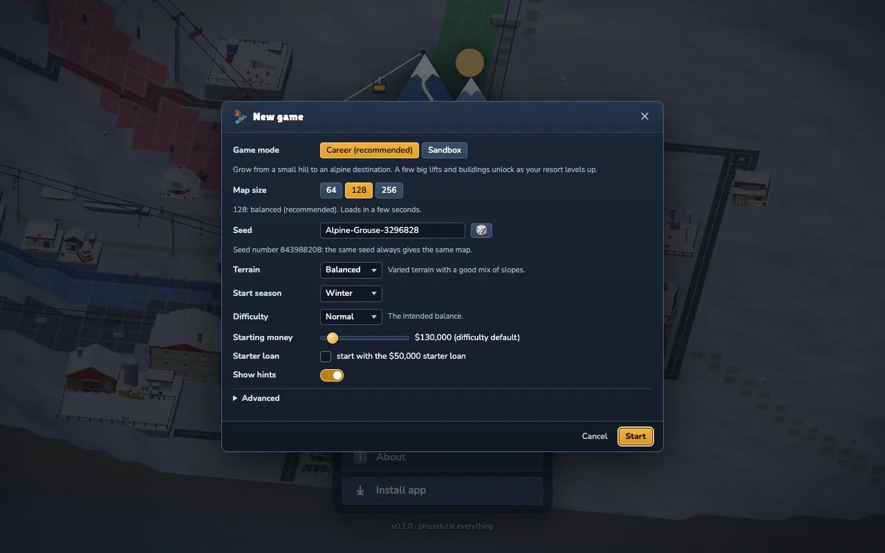
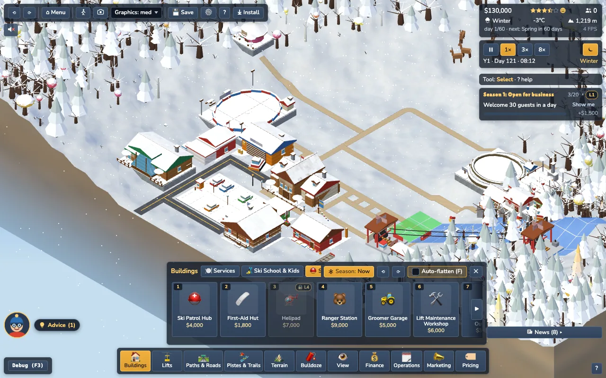
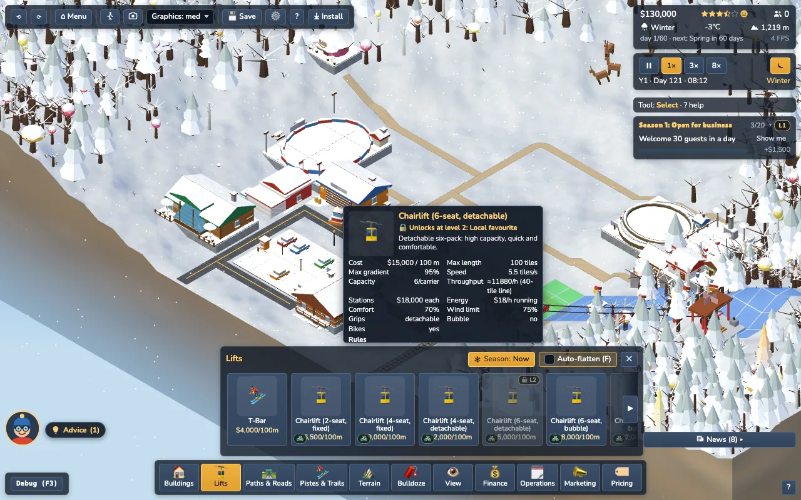
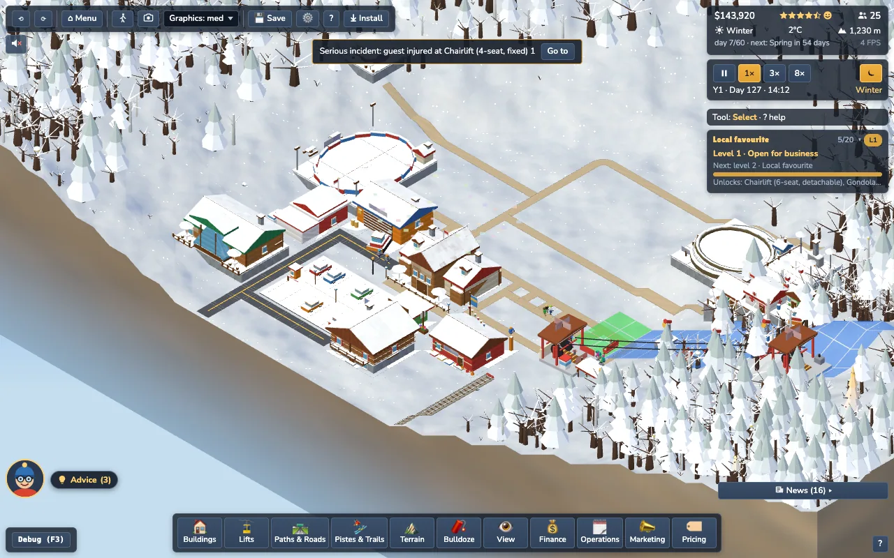
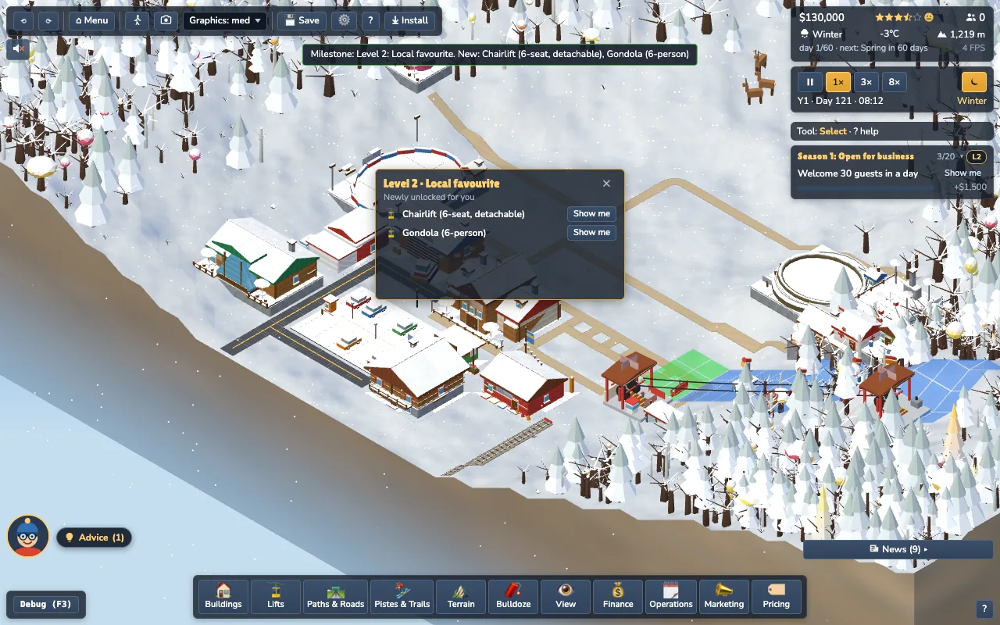

# Game modes, resort levels and selective unlocks (M5.3, Task 14)

Decisions: **D1** Career is the default for new games; **D2** only SOME items are gated; the tutorial must always work; **D8** nothing to share.

## Modes

| mode | for | gating | level |
|---|---|---|---|
| **Career** (default for new games) | growing a small hill into an alpine destination | the short list in `src/config/unlocks.ts` unlocks with the resort level | L1..L6, latched |
| **Sandbox** | free building; **every old save** | nothing is gated | not tracked |

* New Game dialog: a "Game mode" radio group, Career preselected (marked "recommended"), one line of blurb, tooltips (`MODE_INFO` in `src/config/progression.ts`).
* URL: `?mode=career|sandbox` (anything else = Career). `configQuery` writes `mode=sandbox` back; Career is the default and is omitted.
* Stored in the save twice: `config.mode` and the new `progression` module (mode, latched level, unlocked-item snapshot, level-up history). A save with **no** `progression` module and no `config.mode` loads as **Sandbox** (`createSim` + `SaveModule.reset`). See `docs/saves.md`.
* Shown in the HUD card tooltip ("Career · Level 3 · Regional name"), in the Goals card header (level chip) and in the level panel.
* Headless tests / tools that want everything use `createSim({ mode: 'sandbox' })`; the balance bot builds through the gate (`Bot` option `respectUnlocks`).

## Levels (src/config/progression.ts)

A level is reached when **all** of its criteria hold. The level is a pure function of sim state, evaluated once per game day (`day:changed`) and **latched**: it never decreases (a bad winter or a dropped rating cannot re-lock a built gondola). Several levels gained at once give ONE level-up.

| level | name | stars | guests (lifetime) | best day | profit months | goal chapters | profit, last 12 months |
|---|---|---|---|---|---|---|---|
| 1 | Open for business | | | | | | |
| 2 | Local favourite | 2 | 150 | 15 | | | |
| 3 | Regional name | 3 | 1,500 | 30 | 2 | 1 | |
| 4 | Alpine destination | 3.5 | 3,500 | 40 | 6 | 1 | |
| 5 | International resort | 4 | 8,000 | 70 | 14 | 2 | $60,000 |
| 6 | World-class destination | 4.5 | 20,000 | 120 | 30 | 4 | $150,000 |

Inputs: `rating.stars`; `goals.facts.lifetime` (arrivals), `.bestDay`, `.profitMonths` (months closed with a positive net); chapters from the Goals engine (`goals.chapterDone`); net of the last 12 closed monthly reports.

### Calibration (balance bot, Normal, `respectUnlocks`, `scripts/analysis/progressionCalibrate.ts`)

The bot plays the starter chain and a steady expansion list but only completes goal chapter 1, so L4 must not need chapter 2 (L4 needs 1). Measured level-up days (game year / day of year; the game starts on year 1, day 120):

| map | L2 | L3 | L4 |
|---|---|---|---|
| 64 (seed 61) | y1 / d126 | y1 / d151 | **y2 / d32** |
| 128 (seed 61) | y1 / d125 | y1 / d151 | **y2 / d1** |
| 256 (seed 61) | y1 / d124 | y1 / d151 | **y2 / d1** |

(Before the pacing pass: L3 y1 d166-175, L4 y2 d91-155; i.e. play day ~46-55 and ~150-215. Now play day ~30 and ~60-95. Seeds 61 and 62 agree within 5 days.)

i.e. L2 in the first week, L3 ~30 days in (mid first winter), **L4 at the end of year 1 / early year 2** on every map size; L5 and L6 need the human goal chapters (the bot never gets there). Profit by year 2 and year 3 holds with the gate on (`npm run test:balance`, "[balance] Career with respectUnlocks"): the gated items are not in the bot's wish list, so the economy is unchanged.

**How to tune**: edit `LEVELS` (and nothing else), run `SIZE=128 SEED=7 npx vite-node scripts/analysis/progressionCalibrate.ts` (prints stars / lifetime / best day / profit months / net12 per month and the level-up days) and `npm run test:balance`. If the bot stops reaching L4 in year 2, lower `guests` / `profitMonths` of L4; never change the economy for this.

### Final numbers (M5.3 readiness, Task 18) and real time

Career bot sweep (`npx vite-node scripts/analysis/m53Report.ts`, Normal, `respectUnlocks`, starter loan on 256). The game starts on year 1 / day 120, so "y1" is the first 60 days. Level days are game year / day of year; "play day" = days since the start:

| map / seed | L2 | L3 | L4 | y1 / y2 / y3 net | final |
|---|---|---|---|---|---|
| 64 / 61 | y1 d126 (day 6) | y1 d175 (day 55) | y2 d155 (day 215) | -3k / +84k / +68k | L4, 4.5 stars |
| 64 / 7 | y1 d126 | y1 d179 | y2 d151 | -3k / +114k / +74k | L4, 4.5 |
| 128 / 61 | y1 d125 | y1 d167 | y2 d135 | +14k / +104k / +117k | L4, 4.5 |
| 128 / 7 | y1 d126 | y1 d169 | y2 d133 | +2k / +114k / +87k | L4, 4.5 |
| 256 / 61 | y1 d124 | y1 d166 | y2 d91 | -73k / +109k / +93k | L4, 4.0 |
| 256 / 7 | y1 d124 | y1 d166 | y2 d136 | -86k / +83k / +7k | L4, 3.5 |

Nothing was re-tuned: L2 in the first week, L3 at the end of the first winter (the first winter is days 120-180), L4 in year 2 on every map. The bot never reaches L5 / L6 (they need goal chapters 2 and 4).

Wall-clock at the three speeds (150 s per day at 1x, 50 s at 3x, 15 s at 10x; with fast nights ~25 % less):

| | 1x | 3x | 10x |
|---|---|---|---|
| L2 (play day ~5) | 12 min | 4 min | 1.5 min |
| L3 (play day ~30) | 75 min | 25 min | 7.5 min |
| L4 (play day ~60-95) | 2.5-4 h | 50-80 min | 15-24 min |
| a year (180 days) | 7.5 h | 2.5 h | 45 min (33 with fast nights) |

Open question for the playtest: is that pacing right? (`docs/playtest-m53.md`.) If L4 feels too far away, lower `guests` / `profitMonths` of L4 in `LEVELS` only.

### Cost of the new observers (256 map, 3,000 guests; `tests/perf/m53Observers.test.ts`)

`StatsHistory.captureDay` 0.08 ms per game day, `Progression.evaluate` 0.002 ms per day, `ScenarioRunner.evaluate` 0.002 ms per day, all `day:changed` listeners together 0.5 ms per day, the achievements listener on `guest:arrived` 2.2 us per event (about 6.7 ms spread over a 150 s day at 3,000 arrivals; one `facts()` read per event). Nothing per frame. Save impact: see `docs/saves.md`.

## Unlock list (src/config/unlocks.ts)

Only 9 items are gated. **Everything not listed is always available**: roads, footpaths, pistes, basic terraforming and tree planting, T-bar, chair2 / chair4 / chair4d, Base Lodge, Lodge, Café, Mountain Hut, Ski School, Ticket Office, Parking, **Ski Patrol Hub, First-Aid Hut, Ranger Station**, grooming, snowmaking, rental, shop, lodging, summer attractions, and the Families / Budget / Summer / Brand campaigns.

| level | item | why there |
|---|---|---|
| 2 | Chairlift (6-seat, detachable) | the first upgrade over the free 4-seat lifts; cheap enough for a small resort |
| 2 | Gondola (6-person) | the "I made it" lift; $25k stations |
| 3 | Funicular | heavy transport ($50k stations, short, steep limits): not needed before the resort is regional |
| 4 | Helipad | rescue by air (needs a Ski Patrol Hub); $7k + $30/day, only worth it for a big resort |
| 4 | Gondola (10-person) | $40k stations |
| 4 | Chairlift (8-seat, bubble) | $30k stations |
| 5 | Cable Car | $60k stations, 200-tile reach |
| 5 | Altiport | $15k + $40/day; the VIP access |
| 5 | VIP High-Rollers campaign | $12k; needs an altiport or luxury lodging and 3 stars anyway |

Deliberately **not** gated: the Ranger Station (a goal in the last chapter and an Advisor rule need it long before level 3), anything a goal asks for, terraform / plant tools (basics), anything the tutorial uses. A test (`tests/sim/progression.test.ts`) fails if a goal, an Advisor `build(...)` rule or the tutorial's default lift list references a gated id.

## How the gate works

* One interface, `UnlockGate.locked(kind, id) => string | null` (`config/unlocks.ts`), implemented by `Progression`. `createSim` exposes it as `sim.gate`; `PlacementEnv.gate`, `LiftEnv.gate` and `Marketing` deps take it (all optional: tests and Sandbox pass nothing).
* **Sim-side**: `validatePlacement` / `validateLift` put `Unlocks at level N: Name` FIRST in `reasons` and in `locked`; `placeBuilding` / `placeLift` fail on any reason, so a locked item can never be built (UI, undo, debug, bot); `Marketing.blocker/start` return the reason. Rotating an already-built (bypass-built) item ignores the gate.
* `Progression.unlockAll` (set by the TutorialEngine from `start()` until the lessons finish / `exit()` / `stop()`), and `withBypass(fn)` (`buildStarterResort`, `buildDemoResort`, the "Populate demo resort" debug, the bot when `respectUnlocks` is off) open the gate without touching the level.
* The snapshot saved with the level (`unlocked: ['lift:gondola6', ...]`) means moving an item to a higher level in a later version never re-locks it in an existing save.
* Advisor: sites that fail validation are dropped, and none of its rules names a gated building. Tutorial suggestions use `sim.gate` and only default to free kinds. `validKinds` (LiftAssist) skips locked kinds. Goals never ask for a gated item.

## UI

* **Drawers**: a level-locked card is dimmed less than a prerequisite lock and carries a gold **🔒 L4** badge; the tooltip and the popover show "Unlocks at level 4: Alpine destination" (at the top of the popover, so it never scrolls out). Clicking a locked card shows the popover instead of starting the tool. A prerequisite lock keeps the plain 🔒 ("Needs Ski Patrol Hub").
* **Ghost tip / toasts**: the lock reason is the first reason.
* **Marketing**: a locked campaign card is dashed + 🔒, its button is disabled and says the reason.
* **Goals card** (zone `right-goals`, footprint unchanged): a level chip (`L3`, or `Sandbox`) in the header swaps the body between the goals and the **level panel**: name, progress bar, the (up to) 3 missing criteria with have / need, and what the next level unlocks. The choice is remembered (`slopetycoon.goalsView`).
* **Level-up**: ONE confetti burst (`milestone{major:true}`: also a quiet chime and an important news row "Milestone: Level 4: Alpine destination. New: ...") plus a small **"Level 4 · Alpine destination"** card in the recap zone (`top-card`, 320x168, 14 s, one at a time via a `ToastLimiter`, replaces a month card, yields to the welcome-back recap, hidden during the tutorial): up to 4 newly unlocked items, each with **Show me** (opens the right drawer + tab and the item popover).

## Debug

`__slope.progression.setLevel(n)` (raises the level as if earned: confetti, news, card), `.view()`, `.mode()`, `.unlockAll(bool)`. Screenshots: `--eval "setTimeout(()=>window.__slope.progression.setLevel(4),400)" --steps "wait:1200" --out prog-levelup`.

## Tests

`tests/sim/progression.test.ts` (thresholds, monotone + latched, one level-up per jump, gate table vs catalogues, basics never gated, no goal / advisor / tutorial dependence, validators + sim-side refusal for buildings / lifts / marketing, Sandbox / unlockAll / bypass, mode URL param, save round-trip, snapshot, old save = Sandbox, determinism, bot with `respectUnlocks`), `tests/tutorial/tutorialUnlocks.test.ts` (every tutorial step in Career), `tests/ui-dom/progression.test.ts` (lock badges, popover, level-up card, goals level panel, New Game radio, marketing lock, HUD tooltip, layout), `tests/game/balance.test.ts` (`BALANCE=1`).

### Pacing pass (user feedback "level pacing maybe a little sooner")

`LEVELS` thresholds (stars / chapters / best-day unchanged except where noted): L3 guests 1,500 -> **750**, profit months 2 -> **1**; L4 guests 3,500 -> **1,900**, profit months 6 -> **3**; L5 guests 8,000 -> 5,500, best day 70 -> 60, profit months 14 -> 10, 12-month profit 60k -> 45k; L6 guests 20,000 -> 14,000, best day 120 -> 100, profit months 30 -> 22, 12-month profit 150k -> 110k. The unlock list is unchanged. The achievement `level-4` now also shows in the bot-year snapshot (tests/sim/achievements). Sweep: 64 / 128 / 256 x seeds 61, 62 (`progressionCalibrate.ts`). A "mid-year check-in" card at day 90 was NOT added (the award hints need the year-report award engine; not simple), the month card already covers progress.
