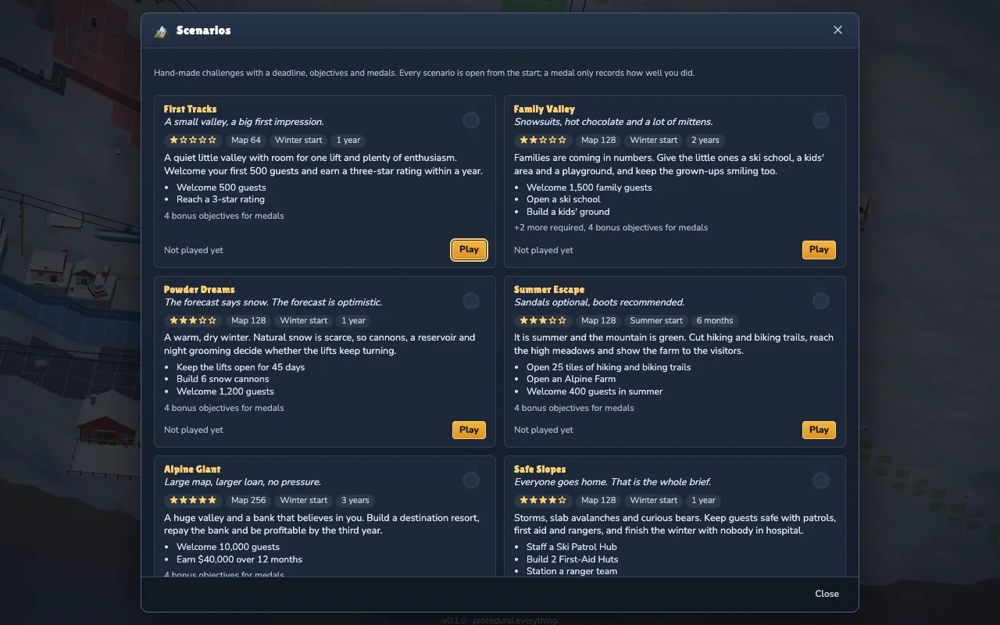
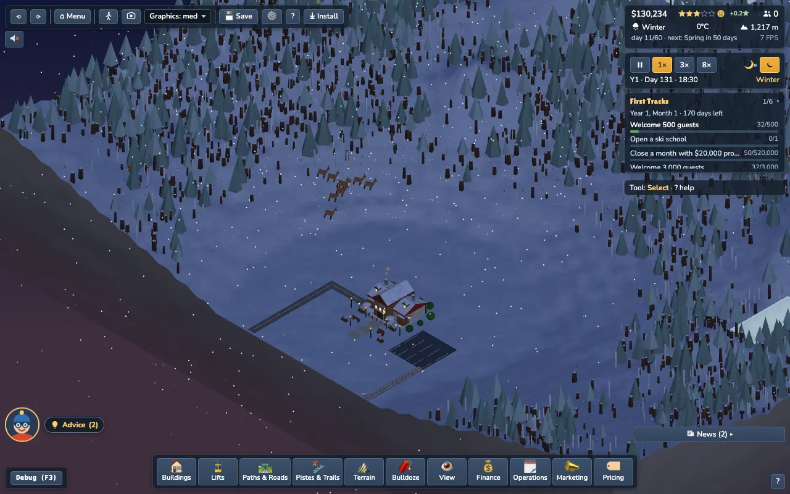
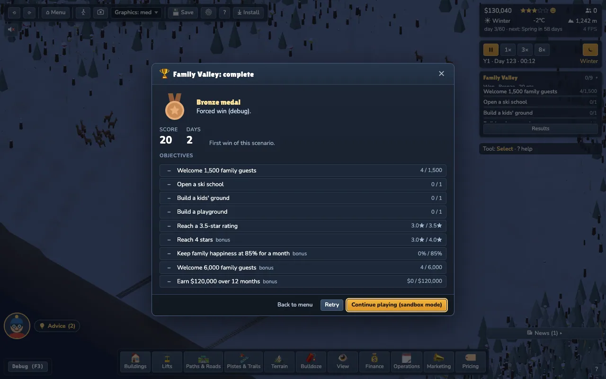
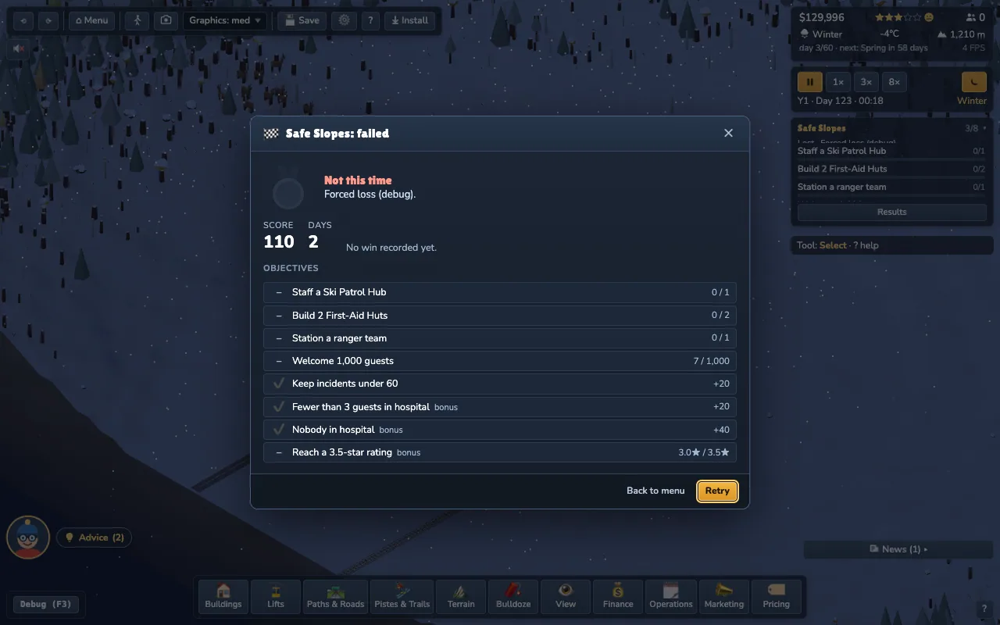

# Scenarios (M5.3, Task 15)

Six hand-made challenges with a deadline, objectives, medals and a score. Pick one from the main menu (**Scenarios**) or the **Scenarios** tab of the New Game dialog; it starts through the normal reload path `?scenario=<id>` (size, seed, terrain preset, start season, money, unlock mode and the rules all come from the definition). Every scenario is open from the start (no medal gating). The tutorial is a different thing: it stays the fixed 64 map (seed 61) and is untouched.

**No import, export or sharing of scenario files (D8).** Scenarios are bundled JSON in `src/config/scenarios/`; the only way in is the index there (`tests/repo/noSharing.test.ts` greps for it).

## How a scenario plays

* **Deadline** in game days since the start (`{days}`, `{months}` = 15 days, `{years}` = 180 days; see `docs/time-flow.md`). The HUD card shows it in the game calendar: *Year 2, Month 3 · 41 days left*.
* **Objectives**: `fact op target`, a weight (score points), `mandatory`, optional `hold` (must stay met for N days) and `by` (must be met by then). `>=` / `>` objectives **latch** when met. `<=` / `<` objectives are *caps*: met while the value is within the cap; a cap on a monotonic fact (incidents, guests ...) that is exceeded is **failed for good**.
* **Ready**: when every mandatory objective is met the card offers **Finish now (Silver)**. The scenario also ends by itself when *every* objective is met (win) or at the deadline: a win if ready, otherwise a loss ("Time is up"). Finishing early keeps the speed bonus.
* **Lost** when: the resort goes bankrupt (`failure.bankrupt`), a mandatory objective is failed, the rating stays below X stars for N months (`failure.ratingBelow`), or the deadline passes while not ready.
* **Score** = weights of the met objectives + `speedBonus` x (time left / deadline) + `marginBonus` x clamp(margin fact / par). **Medals**: bronze = every mandatory objective met; silver / gold additionally need their listed objectives and `minScore`.
* **After a win**: the result dialog (auto-pause) offers *Continue playing (sandbox mode)* (objectives off, everything unlocked, the goal card is back), *Retry* and *Back to menu*; Esc dismisses it (the HUD card keeps a *Results* button). The dialog shows the medal, reason, score, days, the objective breakdown and the previous best.
* The **scenario card** (`st-scenario-card`) replaces the goal-chain card in the same right-column zone (`right-goals`); the objective list scrolls inside its 260 x 140 footprint (unmet required objectives first). Scenario games pause the goal chain (no grants) and keep the Level system off, unless `unlocks: 'career'` (then the chain runs hidden because levels need its chapters).
* Results go to the local **profile** (`src/persist/ProfileStore.ts`): best medal, best score, fewest days, attempts and wins per scenario, in its own IndexedDB database `slope-profile` (LocalStorage fallback), never touched by save slots.

## Schema (`src/sim/scenario/ScenarioDef.ts`)

| field | meaning |
|---|---|
| `id`, `name`, `blurb`, `tagline` | slug (also the file name), picker texts (tagline: plain, a light joke now and then, D4) |
| `stars` | difficulty 1..5 |
| `mapSize`, `seed`, `preset`, `startSeason`, `difficulty?` | fixed map and start |
| `startMoney` (or `null` = difficulty default), `startLoan` | money (before the optional Starter loan) |
| `unlocks` | `'all'` (everything, no levels) / `'career'` (levels + unlocks) / list of gated items (`'lift:funicular'`; the rest of the gated items are locked) |
| `starter` | `'empty'` (lodge only) / `'prebuilt'` (the sandbox starter resort) / `{buildings:[...]}` (custom list placed through the placement API, free of charge) |
| `modifiers` | see below |
| `objectives[]`, `deadline`, `medals`, `failure`, `score` | see above |

**Modifiers** (all optional, hooks installed in `createSim`): `snowMultiplier` (0.2..3, daily snowfall depth: `SnowCover.snowfallMult`), `weatherHarsh` (0..2: more wet days and heavy ones, `Weather.harsh`, same RNG draws), `guestMix` (per guest type arrival weight: `Spawner.mixBias`), `costMultipliers {construction, upkeep, wages}`, `disabledBuildings` (locked with "Not available in this scenario" in the dock, the placement validator and the bot), `noLoans` (`Loans.disabled`), `startingDebt {amount, ratePct, termMonths}` (a loan that exists from day one; its cash is added to the start money), `bearsMax` (fixed bear count), `eventBias {incidents, avalanche}` (injury risk, slab loading `Avalanche.gainMult`).

**Fact catalogue** (objective `fact`; `arg` in brackets): `lifetimeGuests`, `bestDayGuests`, `familyGuests`, `summerGuests`, `stars`, `happiness` / `familyHappiness` (percent, sampled at noon), `money`, `debt`, `monthlyProfit`, `annualProfit` (12 months), `profitMonths`, `buildings` (building id, active ones), `liftsOpen` (lift kind, optional), `liftKinds`, `pisteTiles` (difficulty 1-4, optional), `trailTiles`, `hikeTiles`, `mtbTiles`, `highTrailTiles` (top third of the mountain), `openDays` (days with an open lift and piste at noon), `groomedNights`, `rescues`, `incidents` (`created` / `hospitalised` / `severe` / `wildlife`), `level` (needs `unlocks: 'career'`).

**Strict validator** (`validateScenario`, run on import of every shipped file and in the unit tests): unknown keys rejected (with the path), ranges, building ids / lift kinds / gated items / facts / arguments resolved, deadline > 0 (7 days .. 10 years), objective deadlines and holds inside the scenario, unique ids, at least one mandatory *goal* (a scenario with only a cap would be won on day one), medal references resolvable, `bronze` empty, `minScore` ordered and below the best possible score, starter buildings not disabled.

## Save

Module `scenario` v1 (after `progression`): definition id + version + objective states + counters + start day + result + sandbox flag. A save without it (old saves) or with another id loads as a normal game / restarts the clock; the rules are re-applied from `config.scenario`, which the `config` module stores. The runner is deterministic (no RNG, evaluated on `day:changed`; counters on `guest:arrived` and the noon hour): two runs hash identically (`tests/sim/scenario.test.ts`). Events: `scenario:objective`, `scenario:finished {result, medal, score, reason}`. Debug: `__slope.scenario.forceResult('won' | 'lost')`, `.view()`.

## The six scenarios

| # | id | map | seed | preset | start | deadline | stars | rules | required objectives | bonus (medals) |
|---|---|---|---|---|---|---|---|---|---|---|
| 1 | `first-tracks` | 64 | 54 | gentle | winter | 1 year | 1 | none | 500 guests, 3 stars | ski school, month with $20k profit, 3,000 guests, month with $30k profit |
| 2 | `family-valley` | 128 | 90 | gentle | winter | 2 years | 2 | guest mix: family x2.5, solo / adventure x0.6 | 1,500 family guests, ski school, kids' ground, playground, 3.5 stars | 4 stars, family happiness 85% for a month, 6,000 family guests, $120k profit over 12 months |
| 3 | `powder-dreams` | 128 | 153 | peaks | winter | 1 year | 3 | snowfall x0.3 | lifts open 45 days, 6 snow cannons, 1,200 guests | groom 15 nights, 3.5 stars, lifts open 100 days, 4,000 guests |
| 4 | `summer-escape` | 128 | 80 | lakeland | summer | 6 months | 3 | none | 25 trail tiles, Alpine Farm, 400 summer guests | 20 MTB tiles, 4 stars, 20 trail tiles in the top third, 800 summer guests |
| 5 | `alpine-giant` | 256 | 46 | balanced | winter | 3 years | 5 | $250k cash + $400k starting debt (6.5 %, 10 years) | 10,000 guests, $40k profit over 12 months | repay the bank, 4 stars, 18,000 guests, $100k profit over 12 months |
| 6 | `safe-slopes` | 128 | 97 | peaks | winter | 1 year | 4 | harsh weather x1.5, incidents x2.5, avalanche loading x3, 4 bears | patrol hub, 2 first-aid huts, ranger station, 1,000 guests, under 60 incidents | fewer than 3 in hospital, nobody in hospital, 3.5 stars |

Deviation from the brief: *Alpine Giant* has no "reach level N" objective. Levels need goal chapters, and scenario games pause the goal chain (its grants would distort the calibration), so the level is not reachable there; the schema supports `level` for `unlocks: 'career'` scenarios.

Medal thresholds (`minScore` for silver / gold; gold also needs its listed objectives): first-tracks 140 / 150 + both clever objectives (3,000 guests, $30k month); family-valley 140 / 180 (+ 6,000 families, $120k); powder-dreams 150 / 190 (+ 100 open days, 4,000 guests); summer-escape 125 / 160 (+ top-third trails, 800 summer guests); alpine-giant 150 / 200 (+ 18,000 guests, $100k); safe-slopes 120 / 150 (+ nobody in hospital, 3.5 stars; silver needs "fewer than 3 in hospital").

## Seed selection

`scripts/analysis/scenarioSeedScan.ts` (the same idea as the tutorial scan, `src/tutorial/scenario.ts`): for a size and preset it generates the terrain of seeds 1..200, scores it by concept and then builds the starter chain on the best candidates, rejecting any seed with a placement failure.

```
SCAN_SIZE=128 SCAN_PRESET=peaks SCAN_FOCUS=snow npx vite-node scripts/analysis/scenarioSeedScan.ts
```

`SCAN_FOCUS`: `easy` (skiable flank + drop + lakes, the tutorial score), `family` (skiable-heavy, gentle), `snow` (largest vertical drop + relief), `summer` (lakes + forest + skiable), `giant` (skiable + drop + lakes), `safe` (drop + forest). Chosen: first-tracks 54 (64 gentle: skiable 0.69, 3 lakes, not the tutorial seed 61), family-valley 90 (128 gentle: skiable 0.72, 120 piste tiles), powder-dreams 153 (128 peaks: drop 1.00, relief 54), summer-escape 80 (128 lakeland: 6 lakes, forest 0.53), alpine-giant 46 (256: of the top candidates 173 / 77 / 179 / 67 the bot only did well on 46: the others had 7-15 hospitalisations), safe-slopes 97 (128 peaks: forest 0.43, 3 lakes). All candidates build the full chain without a failure.

## Calibration with the bot

`src/game/bot.ts` takes a **policy** per scenario (`src/game/botPolicies.ts`, chosen from `sim.config.scenario`): family-valley builds playgrounds, kids' grounds and apartments first and runs the families campaign; powder-dreams builds 10 cannons in the opening plus reservoirs; summer-escape paints hiking and biking trails along every lift line and builds the Alpine Farm and Adventure Park first; safe-slopes builds the Ranger Station and more first-aid huts first; alpine-giant has a bigger wish list; first-tracks is the default bot. Calibration: `npx vite-node scripts/analysis/scenarioCalibrate.ts [id] [--probe] [--days=N] [SEED=n]` prints the objective values every 15 days (`--probe` adds a never-met objective so the numbers keep updating after the scenario ended).

The bot is a *floor* (docs/balance.md). Thresholds are set so the bot reaches **bronze** and never silver / gold except where noted (silver / gold need clever play: more lifts, pricing, marketing, safety management):

| scenario | bot result (Normal, policy) | what the bot reached |
|---|---|---|
| first-tracks | **won, bronze**, score 130, day 180 (deadline) | 2,683 guests, 4.5 stars, ski school, best month about $23k; misses 3,000 guests (silver needs 140 points) |
| family-valley | **won, bronze**, score 120, day 360 | 4,350 family guests, 4 stars, family happiness 84 %; misses 6,000 families and $120k profit |
| powder-dreams | **won, bronze**, score 130, day 180 | lifts open 76 days (10 cannons), 3,064 guests, groomed 76 nights; misses 100 open days and 4,000 guests |
| summer-escape | **won, bronze**, score 105, day 90 | 29 trail tiles, farm, 487 summer guests, 4.5 stars; no trail in the top third, misses 800 summer guests |
| alpine-giant | **won, bronze**, score 100, day 540 | 11.3k guests, $46k profit over 12 months, bank repaid by month 14, 4 stars; misses 18,000 guests and $100k |
| safe-slopes | **won, bronze**, score 100, day 180 | 3 first-aid huts + patrol + rangers, 27 incidents (cap 60), 4 hospitalised (the bonus needs fewer than 3) |

Human-hard: the *top third* trails (summer-escape) and *nobody in hospital* (safe-slopes) need deliberate play; the gold of every scenario needs two of its bonus objectives.

`tests/game/scenarioBots.test.ts`: 30-day smoke for all six (every run), the bot reaches at least bronze and not gold on First Tracks and Family Valley (every run, ~10 s), the full sweep under `BALANCE=1`.

## How to add a scenario (developer workflow)

1. Pick a concept, then scan seeds: `SCAN_SIZE=... SCAN_PRESET=... SCAN_FOCUS=... npx vite-node scripts/analysis/scenarioSeedScan.ts`; choose a seed whose chain has no failures.
2. Copy a JSON file in `src/config/scenarios/`, set `id` (= the file name), seed, objectives, deadline, medals; add it to `src/config/scenarios/index.ts` (list, in picker order).
3. `npm test -- tests/sim/scenario.test.ts`: the validator names every problem with its path.
4. Calibrate: `npx vite-node scripts/analysis/scenarioCalibrate.ts <id> --probe` and set the thresholds; add a policy in `botPolicies.ts` if the concept needs one.
5. Update the table above and `tests/sim/scenario.test.ts` (the list of ids).

## Screenshots






`.weave/shots/`: `scen-menu-1280` (main menu with the Scenarios button), `scen-picker`, `scen-picker-1000`, `scen-card` (in-game card), `scen-card-1000`, `scen-card-1920`, `scen-win`, `scen-lose`. The win / lose shots use the debug hook `__slope.scenario.forceResult('won' | 'lost')`.
