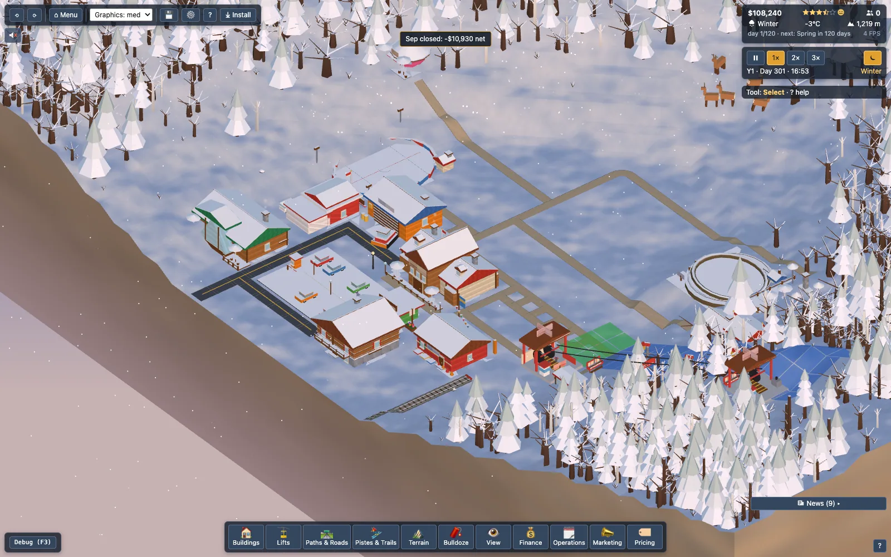
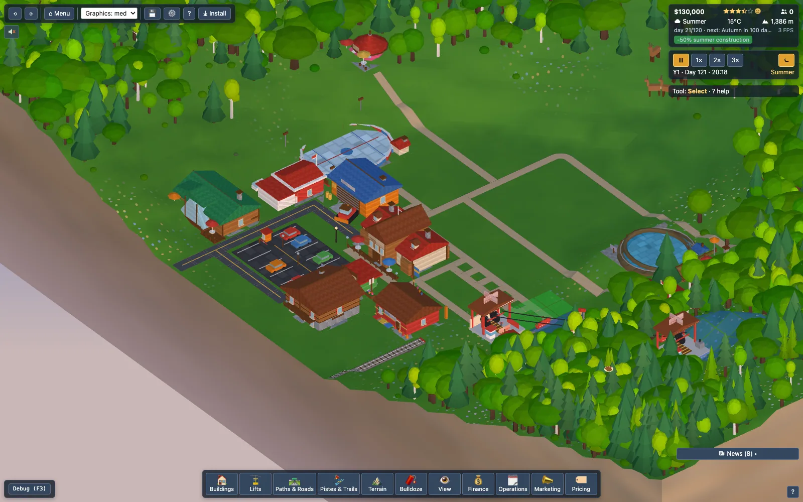
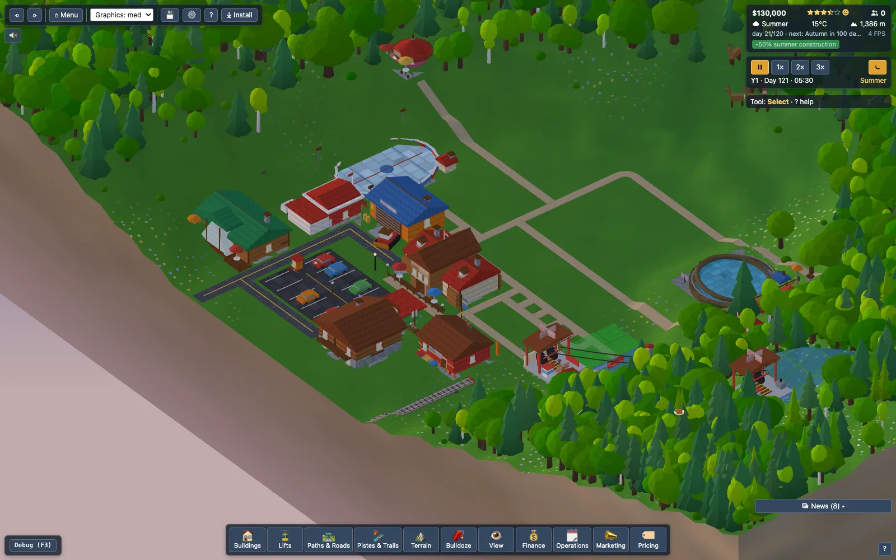

# Seasonal daylight & skier exploration

Two linked changes: the day follows the season (sun, guests, lifts, grooming, audio) and skiers use more of the mountain.
Run the measurements yourself: `npm run analysis:ski` (env `SKI_SIZES`, `SKI_SEEDS`, `SKI_LIFTS=0,5`, `SKI_DAYS`, `SKI_BASELINE=1` = legacy behaviour); library `scripts/analysis/skiLib.ts`, results in `scripts/analysis/out/ski-b{0,1}.json`.

## 1. Seasonal daylight (`src/sim/Daylight.ts`, constants `DAYLIGHT` in `config/balance.ts`)

Sinusoid by day of year (360-day year, 120/60/120/60 seasons): shortest day at mid-winter (day 300), longest at mid-summer (day 120).

| | sunrise | sunset | daylight |
|---|---|---|---|
| winter solstice | 07:45 | 16:45 | 9.0 h |
| equinox (spring day 30 / autumn day 210) | 06:30 | 18:45 | 12.25 h |
| summer solstice | 05:15 | 20:45 | 15.5 h |

Civil twilight margin 45 min (`dawnStart`, `duskEnd`, `nightWindow`). Pure helpers: `sunrise/sunset(day)`, `daylightHours`, `isDaylight`, `isNightHour`, `arrivalWindow`, `dayGuestLeaveHour`, `autoLiftHours`.

* **Lighting** (`lightingAt(hour, sun?)`): the sun/moon ride a true arc between today's sunrise and sunset (long summer days, long winter nights); the glow / day factor are computed from *hours from the horizon* so the dusk/dawn transition lasts the same wall-clock time all year. The summer sun climbs higher than the winter sun. Omitting `sun` gives the legacy 6:00/18:00 day (old tests). `main.ts` passes `sunTimes(game.date.day)`; the debug time-of-day slider is unchanged.
* **Fast nights** (`nightWarp(hour, sun?)`): full x3 from sunset + 45 min to sunrise - 45 min, 1 h easing: in after the window start, out ending exactly at sunrise - 45 min. Summer nights are short (about 7 h at 21:30-04:30), winter nights long (17:30-07:00); both warped. Same pure/deterministic structure as before (`createSim` evaluates it per tick).
* **Guests** (`Spawner`, `GuestSim`): arrivals in [sunrise + 1 h, sunset - 2.5 h] clamped to 08:00-16:30 (winter) / 07:30-18:00 (summer) => winter 08:45-14:15, summer 07:30-18:00. Day guests head home at sunset - 30 min (winter) .. sunset - 1 h (summer). Overnight guests unchanged. The spawn rate is multiplied by `8 h / window` (0.75..1.6) so guests per *day* stay about what the balance sweep was tuned for (a 5.5 h winter window is not a 31 % revenue cut).
* **Lifts**: new schedule mode **Auto (daylight)** = [sunrise + 45 min, sunset - 15 min] (winter 08:30-16:30, summer 06:00-20:30), the default for new lifts (`LiftOpsData.daylight`; absent on old saves = manual hours, which stay available: setting hours switches daylight off). `from/to` are rewritten every tick so the schedule table, energy projection and inspector show the real hours; the Operations panel summary shows today's daylight window, the lift inspector has an Auto (daylight) checkbox.
* **Grooming**: the nightly window is the dark window (sunset + 45 min .. sunrise - 45 min) instead of 22:00-06:00 (`nightWindow(day)` passed to `Grooming.update`).
* **Audio**: `AmbienceState` / `MusicInput` take optional `sunrise/sunset` (defaults = the old equinox hours): day/dawn/dusk/night windows, birds at dawn and the church bell hours (`churchStrikes(hour, sunrise, sunset)`) follow the sun; music day-parts shift with them.
* **HUD**: the season tooltip adds "Sunrise 07:45 · sunset 16:45 (9.0 h of daylight)".
* Tests: `tests/sim/Daylight.test.ts` (design numbers, monotonic between solstices, symmetry, year-wrap continuity, ranges, windows), `tests/core/pacing.test.ts` (warp aligned to the real night), `tests/render/lighting.test.ts` (continuity incl. sunrise/sunset boundaries for winter/summer/equinox), `tests/game/daylightSchedules.test.ts` (spawn window, leave time, auto lift hours, determinism).

## 2. Why skiers only ever rode one line (measured, then fixed)

Before: a run is "lift -> cheapest path back to the *same lift's bottom*" (`Decider.pickSkiLift` chooses the lift only; `NavGraph.step` costs are deterministic and the path cache is keyed by (mode, from, to)), so **every skier of a skill followed one single-tile line per lift**; the lift score had no memory (noise 0.3, distance 0.004/tile, queue 0.02/tick). Timing was not the problem *of exploration* but of the day budget:

* `NAV_SPEED`: walk 3 tiles/tick, skiBase 2.2, skiFlat 0.5 with 1 tick = 6 game minutes => a 60 m-drop run took **~30 ticks (3 game hours)**, walking 30 tiles 10 ticks; after a run guests idled `rng.int(2, 8)` ticks, after a building `rng.int(10, 40)` ticks (1-4 h). A skier completed **1.5 runs** a day.
* (Lifts are NOT slow: `LIFT_SECONDS_PER_TICK = 6` with 40 m/s lifts gives 2-tick rides; queues are one tick.)

### What changed

* `sim/guests/Exploration.ts` (+ `GuestStore.recA/B/C/via`, saved with the guests, in the state hash): each guest remembers the last 3 lifts (`EXPLORE.noveltyWeight` 0.45 x 1.5/1/0.5 by recency x skill boost 0.6/1.3/1.6/1.6, so experts and intermediates explore most). `Decider.pickSkiLift` subtracts `novelty(slot, liftId)` (the only Decision.ts edit besides the hook: one field + one term).
* **Via line**: at the top of a lift the skier picks a *via* tile from the pool of piste tiles in a corridor around the lift line that are skiable straight down from the top and straight on to the bottom (a pure flood fill per lift & difficulty on `NavGraph.step`, cached per nav epoch: identical after a save/load), scored by -crowd (log of today's passes per tile = queue/crowd avoidance + unridden lines first), distance from the previous via, difficulty fit by skill (experts like harder lines) and noise; the run is top -> via -> bottom (two cached paths; if the line is not skiable *right now* the guest drops the via and takes the plain route).
* Speeds (`NAV_SPEED`, legacy in `NAV_SPEED_LEGACY`): walk 3 -> 9, skiBase 2.2 -> 13.2, skiFlat 0.5 -> 3. Pauses (`EXPLORE`): after a run 0-2 ticks, after a building 4-14 ticks. Because guests now decide ~2.5x as often and `rng.chance(visits*0.04 + runs*0.004)` ends the visit, that chance is multiplied by `EXPLORE.leaveScale` (0.12) (otherwise they left ~6x sooner and `tests/perf/navTick` lost 15 % of its guests).
* Per-tile "runs today" counters (display only, reset daily) feed the **piste inspector** ("busiest tile N passes today · runs today: M"). **View -> Piste traffic** overlay (key `O` cycles it): heatmap of today's passes per piste tile (slate = unridden, blue -> yellow -> red, log scale).

### Numbers (winter, 4 days, seeds 1 and 7, mean; "5L" = bot-expanded resort with 5 lifts / 4-5 pistes; before -> after)

| map | runs / skier-day | distinct pistes / skier-day | skiers on one piste only | Gini per-piste skiers | Gini per-tile traffic | pistes ridden by >=10 % of skiers | piste tiles ridden by anyone / day | min per run | min per 100 m drop | arrival -> first lift |
|---|---|---|---|---|---|---|---|---|---|---|
| 64 starter (1 lift) | 2.3 -> 4.6 | 1 -> 1 | 100 % | - | 0.89 -> 0.74 | 100 % | 13 -> 32 % | 34 -> 9 | 46 -> 12 | 97 -> 59 min |
| 64, 5L | 1.7 -> 3.6 | 1.4 -> 2.8 | 60 -> 8 % | 0.27 -> 0.12 | 0.90 -> 0.75 | 88 -> 100 % | 11 -> 14 % | 40 -> 12 | 64 -> 20 | 81 -> 49 |
| 128 starter | 1.5 -> 3.0 | 1 -> 1 | 100 % | - | 0.80 -> 0.76 | 100 % | 27 -> 40 % | 177 -> 34 | 302 -> 59 | 106 -> 86 |
| 128, 5L | 1.5 -> 2.8 | 1.3 -> 2.3 | 74 -> 20 % | 0.54 -> 0.28 | 0.91 -> 0.83 | 65 -> 100 % | 11 -> 17 % | 155 -> 28 | 235 -> 43 | 94 -> 62 |
| 256 starter (2 lifts) | 1.2 -> 1.8 | 1.1 -> 1.5 | 94 -> 50 % | 0.36 -> 0.07 | 0.85 -> 0.77 | 75 -> 100 % | 14 -> 21 % | 185 -> 49 | 114 -> 31 | 249 -> 114 |
| 256, 5L | 1.4 -> 1.7 | 1.1 -> 1.5 | 88 -> 54 % | 0.76 -> 0.56 | 0.95 -> 0.91 | 30 -> 50 % | 4 -> 7 % | 173 -> 47 | 101 -> 28 | 197 -> 134 |

(Run time is a guest's `SkiDown` span, including the occasional leg over another lift when the bot's piste does not reach its own bottom; ticks are 6 game minutes.)

### What was NOT reached (and why)

* **3-8 game minutes per 100 m of drop and 8-20 runs/day.** The starter pistes are tiny (60-170 m of drop, 130-600 m long) and a tick is 6 minutes: a realistic run is *less than one tick*, i.e. a skier would cross the whole piste in 0.1 s at 1x (24 s/day) and be invisible. Measured result: 9-12 min/100 m on 64, 28-59 on 128/256 (the long maps mostly lose time in A* detours and the 20-60 tile walk to the lift), 3-5 runs per skier-day on 64 and 2-3 on 128 (guests are present ~4 h: arrival window to sunset - 30 min, they eat/shop/rest too). Going further means rescaling walking (the 256 road/lodge walk) and guest dwell time, which moves the whole economy; `NAV_SPEED` and `EXPLORE` are the knobs.
* 256 maps: only ~7-30 skiers per measured resort after 4 days (arrivals are slow on the big map) and the bot's 5 lifts there are 20-40 tiles apart, so per-tile coverage stays low.

Tests (`tests/sim/guests/Exploration.test.ts`, fixed seeds, margins below the measured values): memory/novelty by recency & skill, saved columns, slot reuse, via line used, distinct pistes/skier > 2.3 (64) / > 1.8 (128), one-piste share < 35 %, gini per-piste < 0.5, >= 75 % of pistes ridden by >= 10 % of skiers, runs/skier-day > 3 / > 2.3, single-lift coverage +15 % and tile Gini down vs exploration off, A/B vs legacy speeds (runs x1.5, run time /2), determinism.

## Update: speeds after the time-flow change (150 s day)

`NAV_SPEED` is now walk 3.4 (x `walkSizeScale`: 2.5 / 3.4 / 5.0 per map size), hike 1.9, bike 3.1, skiBase 6.25, skiFlat 1.4 tiles/tick (on screen at 1x: walk 4 / 5.5 / 8, blue runs 8-9 tiles/s; see `docs/time-flow.md` section 8). Measured with these speeds (bot resort 5 lifts, 4 winter days): 64 seed 1: 2.55 runs / guest-day, 2.45 pistes, 20 % one-piste; 64 seed 7: 1.97 / 2.2 / 31 %; 128 seed 1: 1.8 / 1.9 / 50 % (walking-bound). Runs per day fall ~15-40 % against the 24 s-day speeds (that is the price of watchable walking); `tests/sim/guests/Exploration.test.ts` thresholds follow these numbers. `NAV_SPEED_LEGACY` still holds the pre-exploration speeds for the A/B.

## 0.2.2: run-aware routing
Pistes are now **runs** (docs/runs.md). At a lift top `Exploration.pickVia` scores each candidate through `runChoice(tile, skill)`: difficulty fit uses the run's own difficulty, plus whole-run crowding (log of mean passes on the centre line, cached per sim hour), surface preference and mood (unhappy guests lean to the easier run). Closed runs (`RunSettings.closed`) are skipped; if all are closed `pickVia` returns 0 and the cheapest path is used, so nobody gets stuck. Knobs: `EXPLORE.runCrowdWeight / runQualityWeight / moodEase`.
