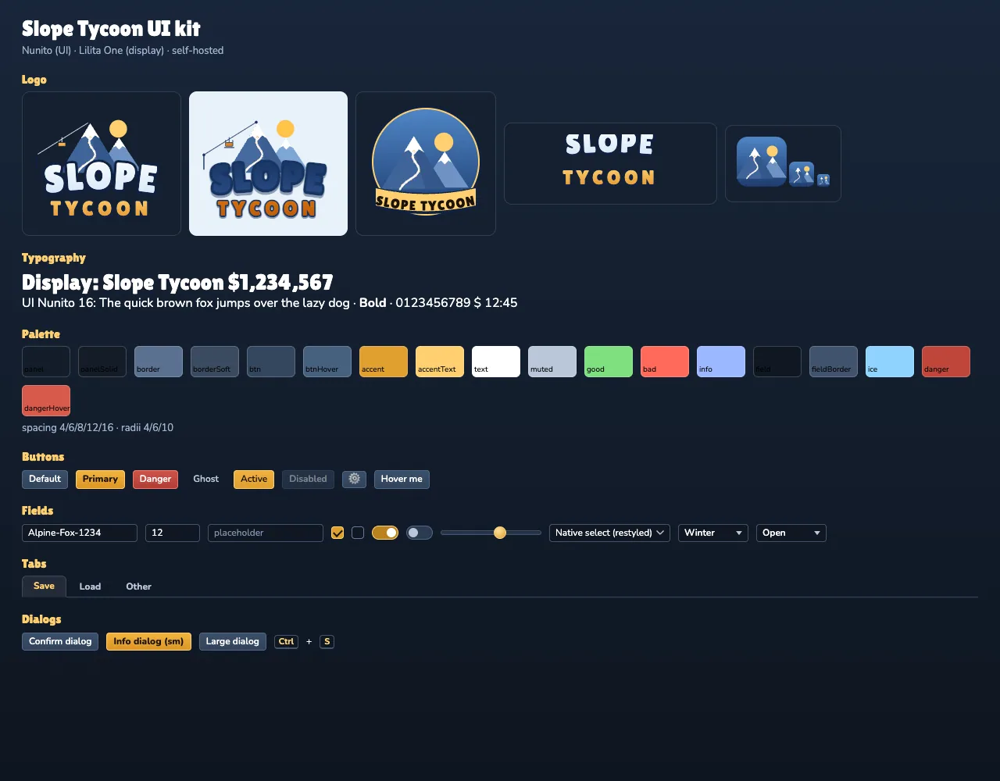

# UI kit

Everything below is shared by every `st-*` component through `BASE_CSS` (`src/ui/components/StElement.ts`: `KIT_CSS` + tokens), so a new component inherits the look for free. **Dev page: `/?uikit=1`** renders every control, the palette, typography and all logo variants (`?uikit=logo-full|logo-badge|logo-wordmark|logo-mark|logo-light` shows a single large logo).

## Tokens (`src/ui/tokens.ts`)

* spacing `--sp-1..5` = 4 / 6 / 8 / 12 / 16 px, radii `--r-sm/md/lg` = 4 / 6 / 10 px, font sizes `--fs-sm 11`, `--fs-md 12`, `--fs-lg 13`, `--fs-xl 16`, `--fs-title 20` (never below 11 px).
* fonts `--font-ui` (Nunito) and `--font-display` (Lilita One), see `docs/fonts.md`.
* colours `--c-panel`, `--c-border`, `--c-btn`, `--c-accent` (amber #e0a030), `--c-accent-text`, `--c-text`, `--c-muted`, `--c-good`, `--c-bad`, `--c-info`, `--c-field`, `--c-field-border`, `--c-ice`, `--c-danger`.
* dialog widths `--modal-sm` 420, `--modal-md` 640, `--modal-lg` 920.

## Controls

| Control | How | Notes |
|---|---|---|
| Buttons | `<button>` default (secondary), `.primary`, `.danger`, `.ghost`, `.active`, `.icon` | hover / active / `:disabled` / `:focus-visible` (amber 2 px ring) |
| **Dropdown** | `<st-select>` / `makeSelect(options, value, ariaLabel, onChange)` | button + themed listbox popup. API like a `<select>`: `value`, `options` / `setOptions(opts, value?)`, `disabled`, `selectedIndex`, `change` + `input` events (bubble, composed). Keyboard: Enter / Space / ↓ open, ↑↓ Home End move (disabled options skipped), Enter / Space pick, **Esc closes only the popup**, Tab closes, typeahead. ARIA: `button[aria-haspopup=listbox][aria-expanded]`, `ul[role=listbox]` > `li[role=option][aria-selected]`. Closes on outside click. The popup lives in the component's own shadow root with `position:fixed` from the trigger's rect (flips above when there is no room, self-corrects if an ancestor re-bases `fixed`), so it never gets clipped by a scrolling dialog or drawer. **No native `<select>` is used anywhere** (tests enforce it) |
| Text / number inputs | `<input type=text|number>` | dark field, tabular numerals for numbers |
| Checkbox / toggle | `<input type=checkbox>` / `class="toggle"` | custom box + check; toggle = switch |
| Slider | `<input type=range>` | track + round amber thumb (WebKit + Firefox) |
| Tabs | `.tabs` > `button.tab[.active]` | used by Save / Load |
| Tooltip | `data-tip="text"` on any element | styled tooltip (`title` keeps the native one for long text) |
| Keys | `<kbd>` | |
| Sections | `.section > h3`, `.field > label` | used by Settings / New game |
| Scrollbars | styled thin scrollbars everywhere | |

## Dialogs (`src/ui/modal.ts`, `StModal.ts`)

One frame for every dialog: header (icon, title in the display font, ✕), scrolling body, footer actions. Widths **sm 420 / md 640 / lg 920**, centred with flex (no transforms, so fixed popups inside work), dimmed backdrop.

* `Modal` (class): build it inside any component's shadow root (`new Modal(this.root, {title, icon, size, backdropClose, closable, beforeClose, onOpen, onClose})`, then fill `.body` / `.footer`; `open() / close() / toggle()`).
* `st-modal` + `showModal(parent, {...})` / `confirmDialog(parent, {...}): Promise<boolean>` for one-off dialogs (About-style info, confirms, bankrupt).
* `modalStack` (single global stack): z-order (each opened dialog gets a higher z-index, starting at 100), **Esc closes only the top entry** (dropdown popups are entries too), **Tab is trapped** in the top dialog, **focus returns** to the opener on close, backdrop click closes (disable with `backdropClose:false`).
* The main menu is a *screen*, not a dialog: it is z-index 30 and stays underneath (dimmed) while New game / Load / Settings / Help / About stack above it; closing returns to the menu. The pause menu is a dialog: Save / Load / Settings / Help open above it and Esc steps back to it.
* Closed dialogs render nothing (the `.layer` is `display:none`), so no full-screen element ever keeps pointer events (`tests/ui-dom/modal.test.ts`, `mainmenu.test.ts`).

| Dialog | Component | Opened from |
|---|---|---|
| New game | `st-new-game` (md) | menu → New game (always a fresh random seed) |
| Save / Load | `st-save-load` (lg, tabs Save · Load) | top bar **Save** (Ctrl+S), pause → Save game / Load game, menu → Save game / Load game |
| Settings | `st-settings` (md; Audio, Graphics, Gameplay, Accessibility) | menu, top bar ⚙, pause menu |
| Help & keys | `st-help` (lg) | menu, `?`, `H`, top bar, pause menu |
| About | in `st-main-menu` (sm) | menu → About |
| Pause | `st-pause-menu` (sm) | Esc |
| Confirm / bankrupt | `st-modal` | delete / overwrite / load confirms, bankruptcy |

## Logo (`src/ui/logo.ts`)

`logoSvg({variant: 'full'|'mark'|'badge'|'wordmark', theme: 'dark'|'light', height?})`: procedural inline SVG (peaks, sun, piste, lift cable + chair, outlined / shadowed wordmark in Lilita One). The compact **mark** has no text (safe for favicon / PWA icons) and shares `markGeometry` with `scripts/gen-icons.ts`. Used: full logo in the main menu, mark in About / boot splash (`index.html`) / favicon / PWA icons. Candidate sketches: `img/logo-*.png`.
