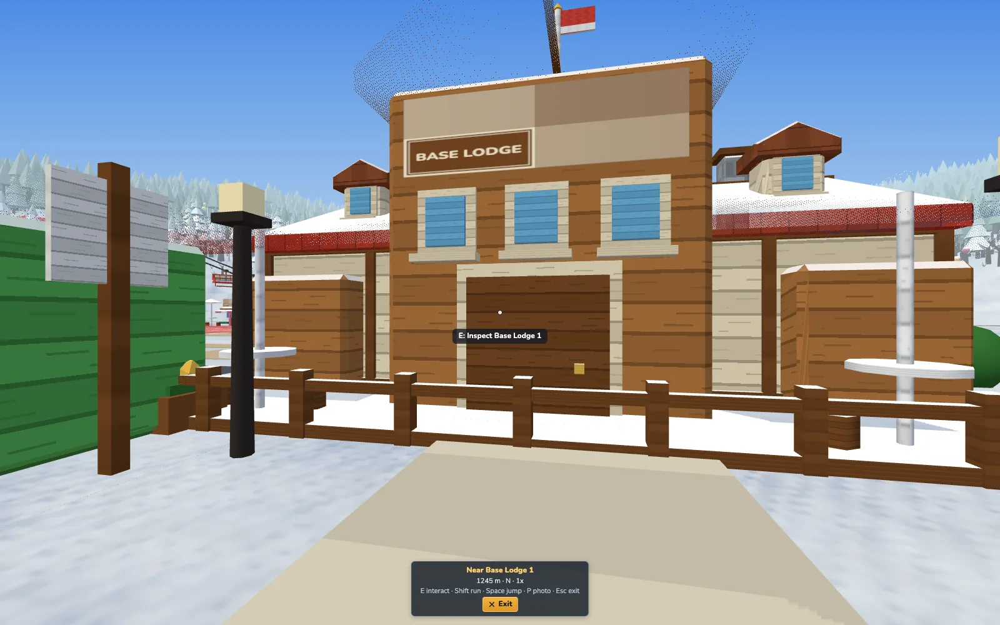
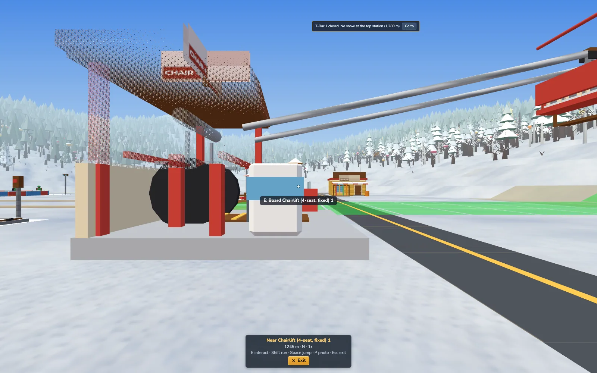
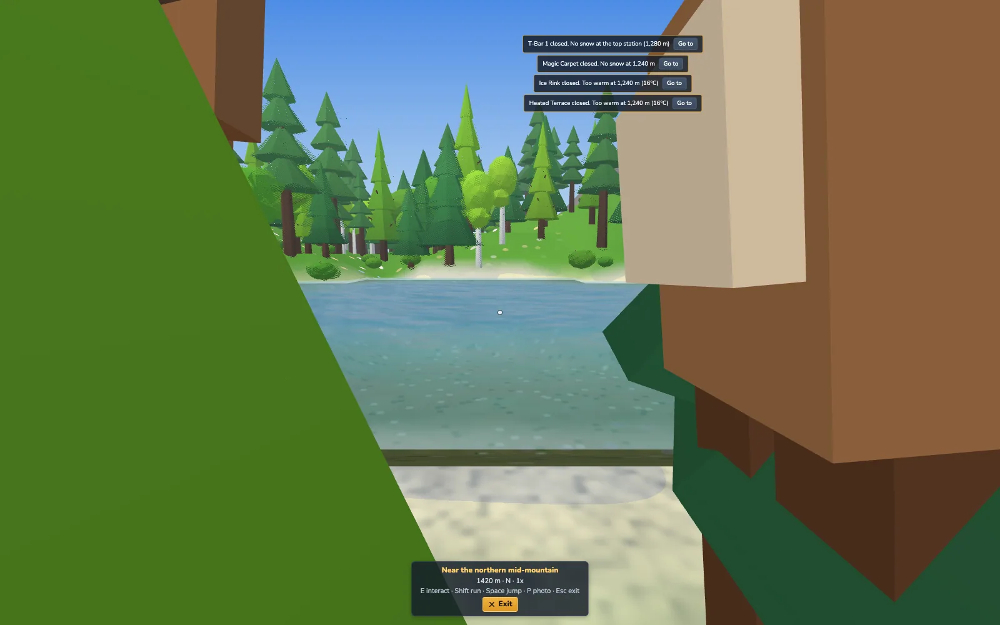
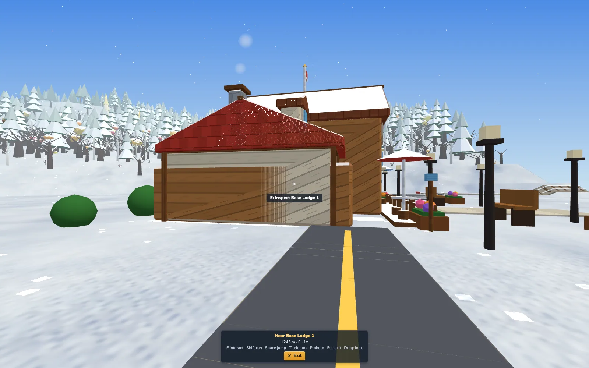
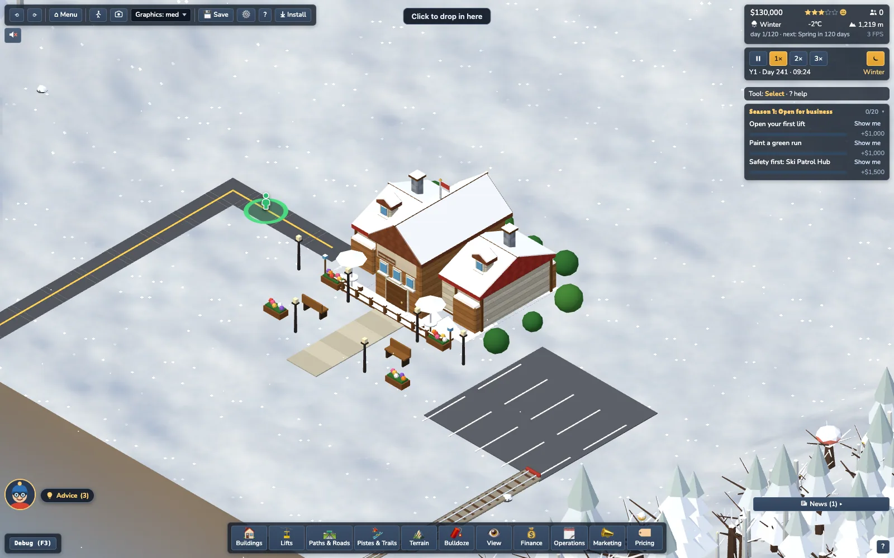
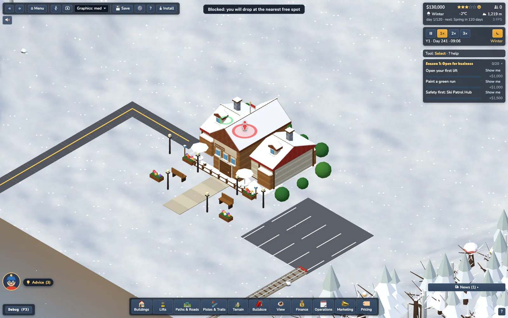
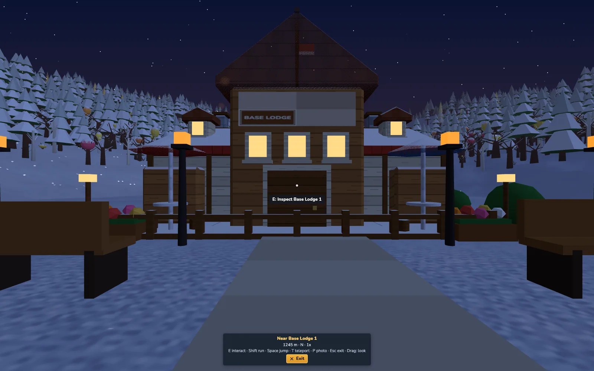
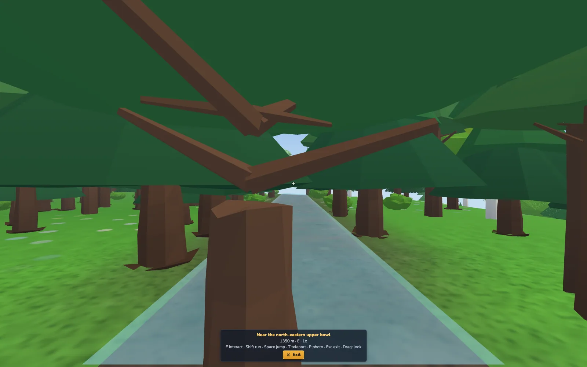

# Walk mode (M5.2, Task 12)

First-person on foot: explore the resort you built at eye level. The user asked for it after trying the ride-along. **Desktop only** (keyboard + mouse; no touch). Render-only: the walker is not a sim guest, so `stateHash` is identical with walk mode on or off (tests/render/walkPhysics.test.ts, 3 sim days with a walker roaming, probing and interacting). Walk state is never saved.

## Controls
| input | action |
|---|---|
| **V**, View drawer "Walk mode (V)" | enter at the **default start**: the nearest footpath tile to the iso view centre (see Start position). |
| **Shift+V**, top-bar walking-man button (click) | **Choose start**: drop mode (see below). |
| top-bar button dragged onto the map | drop in where you release (Esc / releasing off the map cancels). |
| inspector **Walk here** | stand in front of that building, looking at it (a blocked tile moves you to the nearest free one). |
| **T** | teleport: bird's-eye drop mode again; Esc returns to where you were. |
| mouse | **drag to look** (default): hold the left button on the canvas and drag. No pointer lock, the cursor stays free (hidden only while dragging), so screenshots / OS shortcuts / leaving the window work. Settings > Walk: mouse look = **Pointer lock** gives the immersive capture: click to capture, **hold Alt (or Tab) to free the mouse** until the next click, Esc leaves walk mode. Yaw wraps, pitch is clamped to +-80 deg |
| **W A S D** / arrows | walk; diagonals are normalised |
| **Shift** | run (hold, or toggle in Settings) |
| **Space** | small hop (not boarding: boarding is E) |
| **E** | interact: inspect the building / guest / animal you look at (compact info card for ~7 s; guests show a thought), or board the lift whose bottom station is within 2 tiles |
| **P** | photo mode from your eye; leaving photo mode returns to walking |
| **Esc** (or **V**, Exit button) | leave walk mode: the exact previous iso pose is restored. Browsers release the pointer lock on Esc, so a lock lost while walking counts as Esc |
| + - . , | time controls keep working (Space is the hop here; use , to slow down to a pause) |

Everything else on the canvas is swallowed. The UI is hidden (`body.view-walk`) except the HUD (`st-view-hud` walk variant): crosshair dot, context prompt under it (`E: Inspect Base Lodge 1`, `E: Board Chairlift 1`; a closed lift shows the reason on E: `Lift is closed: no snow at the top station (1,280 m)`), the info card, and a bottom card with the place name (`Names.describeLocation`, e.g. "Near Base Lodge 1"), altitude, compass point, game speed, the key hint and Exit.

## Start position (`walkStart.ts`, pure)
`chooseStart(world, opts)`: candidates are PATH tiles (cost = distance) and ROAD tiles (distance + `ROAD_PENALTY` 6; rail never) within `START_SEARCH_RADIUS` 24 tiles of the focus (the iso view centre), plus `WALL_PENALTY` 4 when a solid tile is within 2 tiles (so you do not start with your nose in a wall). Candidates are sorted (cost, y, x: deterministic) and the first that passes `tileStandable` (not solid, the walker circle collides with no trunk / decor circle / wall, inside the edge margin) wins. Fallbacks: the tile in front of the Base Lodge door (`nearestStandable`, ring search <= 14), then the nearest free tile to the village centre (the map centre if unknown). Facing: the nearest building 2-14 tiles away (`FACE_BUILDING_MIN/RANGE`), else along the longest straight path run, else the iso view direction. `WalkMode.begin` finally runs `spawnPoint` (settle + nearest standable), zeroes velocity and step phase.

## Choose start (Street-View drop)
`Shift+V`, a click on the top-bar button, or **T** while walking. The cursor becomes a small pegman SVG (`ui/walkDropMarker.ts`, pointer-events none, `role=status` hint "Click the map to drop in · Enter: nearest path · Esc: cancel") and a ring draped on the terrain (`DropRing.ts`, vertices sampled from `surfaceHeight`) marks the hovered tile: **green** = walkable, **red** = blocked (building, lift, unbridged water, trunk / decor, edge), with a dim green snap ring on the nearest free tile (`resolveDrop`, ring search <= 8): clicking a red tile drops there with a toast. Click drops facing the iso view's previous direction (T: your old heading); Enter / V drop at the default path spot; Esc cancels (from T it returns to the walker). The camera keeps working (WASD / wheel / rotate) so you can scout. Dragging the top-bar button: pointer events with an 8 px threshold, the marker follows, release over the map (canvas / empty UI layer) drops, anywhere else cancels; the click that follows a drag is swallowed.

## Design
* **`src/render/view/walkPhysics.ts`** (pure): `stepWalker(state, input, dt, world, out?)`. Terrain-following on the true surface (`surfaceHeightAt`: the same per-tile diagonal triangulation as the terrain mesh and roads). Substepped (<= 0.12 tiles per substep, <= 24 substeps, dt clamped to 0.25 s) so nothing can be tunnelled. Circle collider vs solid tiles (closest point on the tile square) and vs trunk / rock circles, sliding along them. Map-edge clamp with margin.
* **`WalkInput.ts`**: `mapKeys` (pure), `lookDelta` (pure), settings (`slope.walk.v1`), and `WalkInputHandler` (DOM: key tracking in the capture phase, pointer lock / drag-look fallback).
* **`walkInteract.ts`** (pure): look-ray vs boxes (`pickInteract`), lift boarding (`nearestBoardable`, `boardVerdict`, ride time), `nearestFree`, footstep surface (`footSurface`).
* **`WalkMode.ts`**: runtime. `TerrainWalkWorld` adapts the sim (Occupancy, water tiles, bridges, a per-tile index of trunk / rock circles rebuilt when the prop chunks change), drives `ViewCameraRig.setFree`, handles the 5 Hz probe (place name, prompt), footsteps, E, and the lift ride.
* **`buildWalkWorld()`** (`WalkMode.ts`) is the single place collision data is assembled: Occupancy + water / bridges (tiles), prop trunks / rocks and the village decor (`decorCircles`: lamp .08, bench 3 x .11 along its length, planter 3 x .13, hedge shrub .85 x its crown radius) as per-tile circle lists, rebuilt when the prop chunks change or `villageDecor.items` is replaced. Farm / pasture fences are drawn inside the building footprint (already solid). Signs: no separate layout data (part of building meshes, solid via the footprint).
* **Solid tiles**: building footprints (Occupancy `Building`; footprints are axis-aligned tile rects after rotation), lift stations / towers / trestles (`Lift`), lake and stream tiles unless a **bridge** is on them, out-of-map. Paths and roads are walkable.
* **Reads only**: grid, networks, props, buildings, lifts, guest store, fauna. No sim RNG (footstep pitch jitter uses a private LCG).

### Lift boarding (cosmetic)
E at a bottom station (within 2 tiles of its 2x2 footprint) starts a ride along the lift's real cable path (`liftPath` + `samplePath`) with the ride-along rig (`chair` / `gondola` / `cablecar` / `funicular` eye; T-bars use the chair view). Duration = the lift's real ride time (`computeStats().rideTimeS`, at its current speed, min 3 s) at **real pace** (the ride-along slow-mo setting only applies to skiing). At the top the walker is placed on the nearest free tile beyond the top station, facing along the line. You can look around while riding. **The walker is not a sim guest**: no queue slot, no ticket revenue, no occupancy, no rider counters. A closed lift (conditions, hours, manual, fault) gives the reason instead.

### Audio
* Footsteps: five synthesized recipes in `Sfx.ts` (`stepSnow` crunchy bandpass noise, `stepGravel` three grains, `stepGrass` soft low noise, `stepWood` tonal knock, `stepRoad` dry tick). Surface by the tile under the walker: bridge / building = wood, road, path = gravel, snow depth >= 0.12 or ice = snow, rock / dirt = gravel, else grass. Peaks 0.04-0.07 (click = 0.18): a texture roughly 9-12 dB below the quietest UI sfx, `PRIORITY.ambience` (never steals a voice), 4/s limit, scaled by "reduce loud sounds", pitch 0.88-1.14 random per step, slight random pan. One step per stride (`stepStride(speed)` = 0.45 + 0.28 x speed tiles: 1.8 steps/s walking, 2.4 running); silent when standing, in the air or sliding slowly.
* Near-field ambience: the audio listener is the walker (`createAudio` camera callback) with the zoom proxy `AMB.walkZoom` = 6 (fully "close"): crowd murmur, lift hum / clanks, birds, water and bells rise to their near-field levels (tests/audio/walkAudio.test.ts with a probe fixture); the probe radius shrinks to ~8 tiles around the walker. Wind and the snow bed keep their quiet levels (Mix levels in `docs/audio.md` unchanged). **Forest shelter**: the probe (`WorldProbe`, walker view only) counts tree trunks within `SHELTER.radius` 6 tiles (`countTrunks`, trees only, not rocks / shrubs); `shelter = min(1, n / 10)` lowers the wind bed by up to 30 % (`SHELTER.windCut`; 10 trunks = full). Everything else is untouched; the iso view never gets shelter.

### Rendering
Perspective rig (FOV 75 default, 60-100 in Settings), `ViewFog`, near plane 0.05, near LOD active (ground camera), figures within 6 tiles detailed. Terrain chunks within 15 tiles of a point **0.6 s ahead of the walker** are forced full-res (`terrain.setNearFocus(walk.focus)`), so running does not pop chunks. Eye = ground + 0.9 x 0.52 = 0.468 (+ hop), smoothed vertically (40 ms) so slopes and collision push-outs never jerk the view; head bob 0.012 per step (one dip per footfall) and a +4 deg FOV kick while running; both off with Reduced motion or the setting.

## Tuning constants (`WALK` in `walkPhysics.ts`)
| constant | value | meaning |
|---|---|---|
| `walkSpeed` / `runSpeed` | 1.6 / 3.2 tiles/s | game scale: 1.4 m/s literally would be 0.14 tiles/s (a crawl) because a tile is 10 m but figures are 0.52 units tall; 1.6 tiles/s = ~3 figure heights/s. 80 s to cross a 128 map walking |
| `accel` / `decel` | 14 / 18 tiles/s^2 | smooth start / stop (~0.11 s to walk speed) |
| `radius` | 0.26 | collision circle; ~2.5x a trunk (0.08-0.12) so a trunk never fills more than ~30 deg of the view |
| `slopeLimitDeg` | 40 | steepest climbable grade tan(40) = 0.84; judged over a fixed 0.2-tile probe ahead (`slopeProbe`), so the step-up height is 0.17 units (curbs, ledges); 0.5+ is a wall |
| `slideSpeed` | 1.4 | gentle downhill drift on too-steep ground |
| `jumpHeight` / `gravity` | 0.18 / 9 | small hop |
| `eyeHeight` | 0.468 | 0.9 x `FIGURE_HEIGHT`, same as the ride-along foot eye |
| `bobAmp` | 0.012 | head bob |
| `maxStepDist` / `boundsMargin` | 0.12 / 0.6 | substep length / edge margin |
| prop radii | `PROP_RADIUS` in `WalkMode.ts` | conifer .10, deciduous .10, pine .09, larch .08, birch .08, oak .12, shrub .10, snag .08, rock .27 (x prop scale x growth) |

On the generated terrain adjacent tile corners differ by at most 2 half-steps (1.0 unit per tile = 45 deg), so the 40 deg limit only blocks the steepest tile faces; sheer rock faces are blocked by trees / rocks / water in practice.

## Settings (Settings > Gameplay, persisted in `localStorage['slope.walk.v1']`)
Mouse look **Drag (default) / Pointer lock**, mouse sensitivity 0.5-2x, field of view 60-100, invert Y, head bob, run toggle (Shift toggles instead of holds).

## Harness
`npm run shot -- --view walk --walk-at lodge|station|x,y --walk-yaw deg --walk-pitch deg --walk-script "w:2;Rd:1;look:30,-5;e" --out walk-<name>`. `--walk-at lodge` = south of the Base Lodge looking north; `x,y` = tile. The script is a `;` list: `w:2` hold keys (w a s d, combinable `wd:1`) for 2 s, `Rw:2` run, `look:dyaw,dpitch` degrees, `e` interact. The headless run drives the PURE walker with synthetic key input at 60 Hz (no pointer lock), then the page renders. `--vjs` still runs after (e.g. `__slope.view.walk.mode.update(1/60)` loops to advance a lift ride). API: `__slope.view.walk.{enter(x,z,yaw), exit(), script(steps), mode}`. `npm run perf:ground` has `walk` rows.

### Animals and guests
Animals within 6 tiles shy away (`fleeOffset`, `NatureView.update(..., disturb)`): a display offset up to 3.2 tiles x timidity (deer / chamois / marmot / fox 1, ibex .9, sheep / goat .6, cow .35, eagle 0), eased at 2.5/s and turned to face away; the sim positions are never touched (tests: Critter unchanged, `stateHash` equal over 3 days with and without). Guests / animals closer than `PERSONAL_SPACE` 0.4 nudge the walker (`softPush`, at most walking speed, no velocity / step change).

## Screenshots

## Limitations / not verified
* **Pointer lock cannot be tested headlessly**: the lock request, Esc / lock-loss handling and the Alt-frees-the-mouse path are only unit-tested with a faked `pointerLockElement`; drag-look (the default) is DOM-tested with synthetic pointer events, not with a real mouse.
* No touch controls. No swimming / wading. Buildings cannot be entered; the lodge's front fence is part of the building mesh and the footprint is solid (the fence itself is approximated by the footprint, not by a thin segment).
* Guests do not react to you (no heads turning / waving); animals flee visually only.
* The cosmetic lift ride is not seated on a real carrier (a nearby carrier is visible); the ride cannot be cancelled except by leaving walk mode.
* Real-GPU frame rate unmeasured (software rendering only): draw calls 161-182 on 128 (budget 350).
